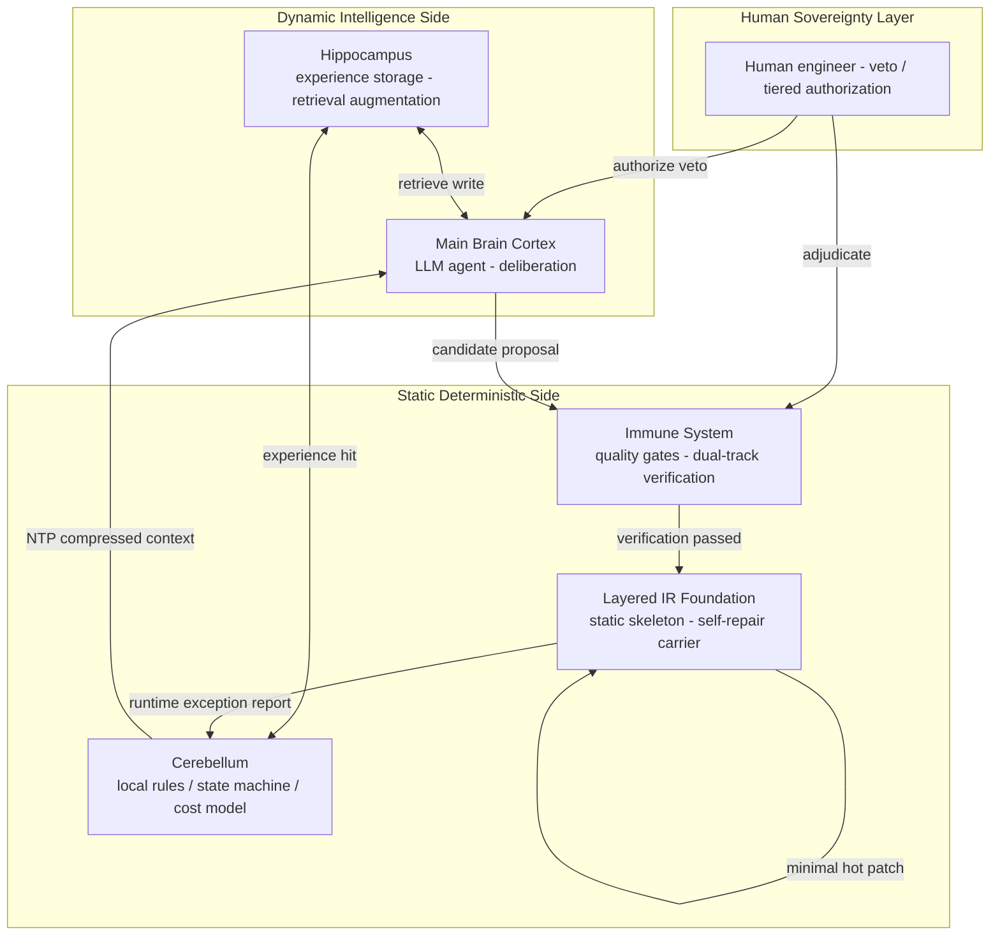
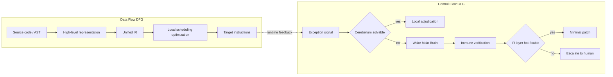
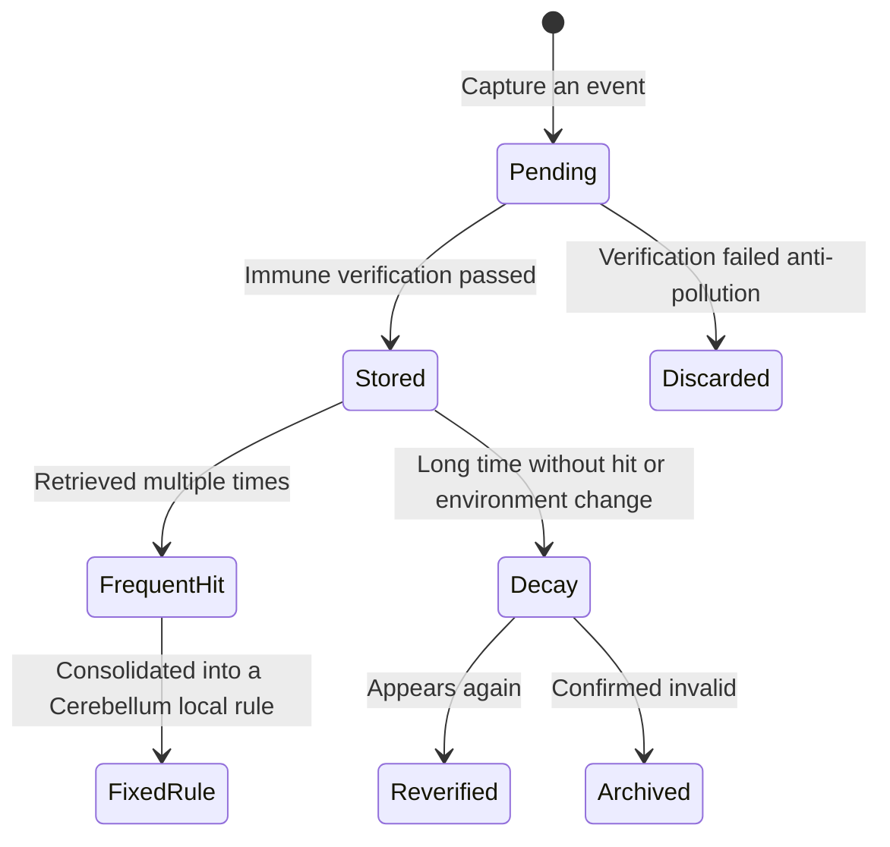
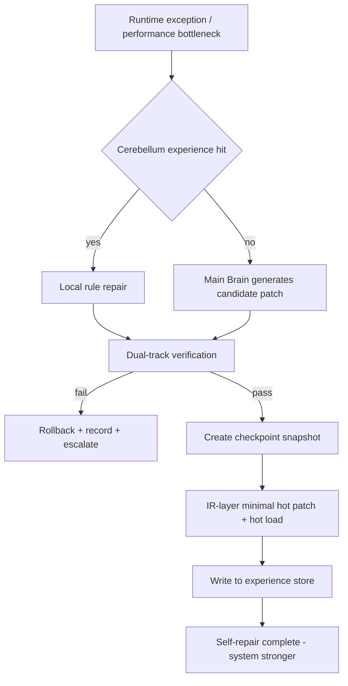
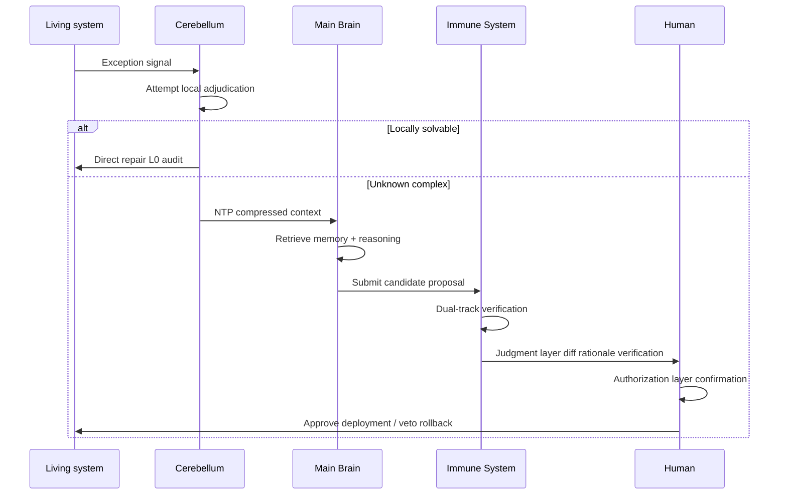
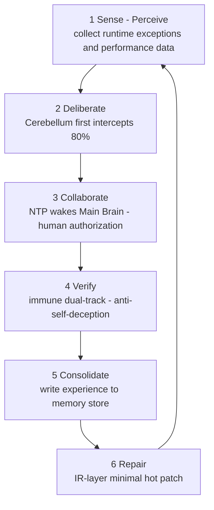
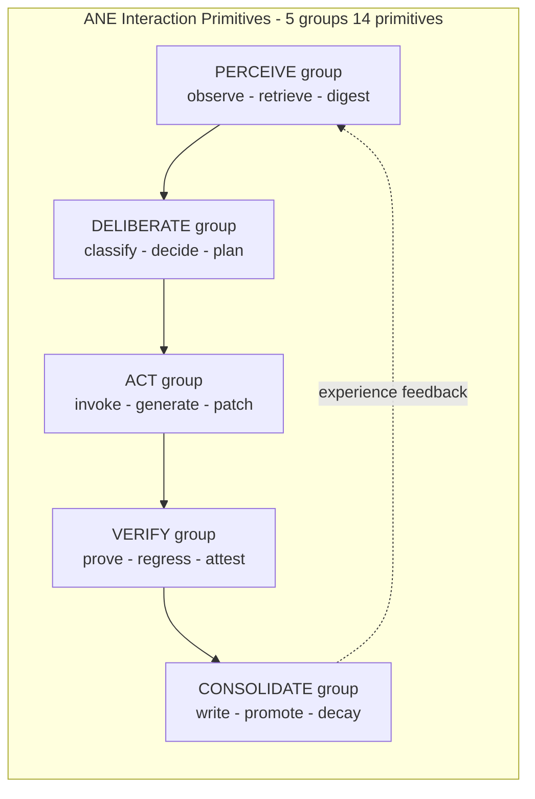
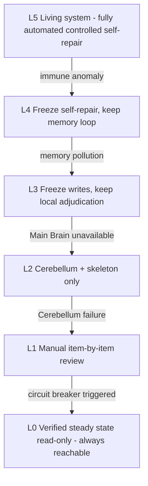
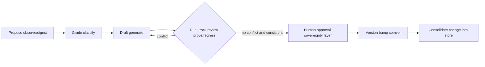
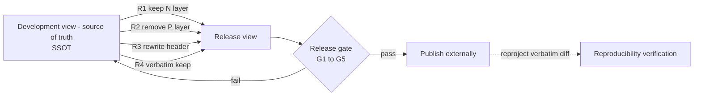

# "ANE Specification: AI-Native Engineering Paradigm for Living Software Systems" v0.5.0 · Formal Release

> **ANE Specification — AI-Native Engineering Paradigm for Living Software Systems**
>
> **A living-software paradigm for the age of AI agents · General-edition white paper**
>
> **Created by Feng Lei (冯磊)**　|　original paradigm proposer and chief architect
>
> ANE = **AI Native Engineering** · static-dynamic integration · dual-brain collaboration · Memory Moat · unified development and maintenance · governance and resilience · verifiable and adoptable
>
> Version: **v0.5.0**　|　Date: 2026-11-20　|　Form: Formal Release
>
> This specification is expressed in a **general paradigm language**, not bound to any specific product, framework, or engineering implementation, and applies to all teams building AI-native software systems.
>

---

## Table of Contents

- [Executive Summary (One-Page Overview)](#executive-summary-one-page-overview)
- [Preface: Software Is Life](#preface-software-is-life)
- [Chapter 0: Paradigm Positioning and Problem Statement](#chapter-0-paradigm-positioning-and-problem-statement)
- [Chapter 1: Core Axioms (Static-Dynamic Duality)](#chapter-1-core-axioms-static-dynamic-duality)
- [Chapter 2: Architecture Specification: The Seven-Organ Living-System Model](#chapter-2-architecture-specification-the-seven-organ-living-system-model)
- [Chapter 3: Determinacy Grading: The D0–D3 Authority Spectrum](#chapter-3-determinacy-grading-the-d0d3-authority-spectrum)
- [Chapter 4: Cerebellum Specification](#chapter-4-cerebellum-specification)
- [Chapter 5: Main Brain Specification and the Neurotransmitter Protocol NTP](#chapter-5-main-brain-specification-and-the-neurotransmitter-protocol-ntp)
- [Chapter 6: Memory Specification: Hippocampus and Experience Storage](#chapter-6-memory-specification-hippocampus-and-experience-storage)
- [Chapter 7: Immune Specification: Dual-Track Verification and Anti-Self-Deception](#chapter-7-immune-specification-dual-track-verification-and-anti-self-deception)
- [Chapter 8: Self-Repair Specification: The Instant Repair Law of the IR Layer](#chapter-8-self-repair-specification-the-instant-repair-law-of-the-ir-layer)
- [Chapter 9: Human-Machine Collaboration: Human Sovereignty and Tiered Authorization](#chapter-9-human-machine-collaboration-human-sovereignty-and-tiered-authorization)
- [Chapter 10: Evolution Theory: The Unified Development-Maintenance Flywheel](#chapter-10-evolution-theory-the-unified-development-maintenance-flywheel)
- [Chapter 11: Adoption: The ANE Maturity Model L0–L5](#chapter-11-adoption-the-ane-maturity-model-l0l5)
- [Chapter 12: Metrics and Anti-Patterns](#chapter-12-metrics-and-anti-patterns)
- [Chapter 13: Interaction Modes: The Agent Interaction-Pattern Matrix](#chapter-13-interaction-modes-the-agent-interaction-pattern-matrix)
- [Chapter 14: Interaction Primitives: Composable Minimal Interaction Units](#chapter-14-interaction-primitives-composable-minimal-interaction-units)
- [Chapter 15: Tool Ecosystem: MCP and Capability Integration Specification](#chapter-15-tool-ecosystem-mcp-and-capability-integration-specification)
- [Chapter 16: Multi-Agent Collaboration Protocol](#chapter-16-multi-agent-collaboration-protocol)
- [Chapter 17: Security and Trust Boundaries: OWASP Alignment](#chapter-17-security-and-trust-boundaries-owasp-alignment)
- [Chapter 18: Cost Governance and Context Engineering](#chapter-18-cost-governance-and-context-engineering)
- [Chapter 19: Sublation of Traditional Software Engineering](#chapter-19-sublation-of-traditional-software-engineering)
- [Chapter 20: Organizational Governance and Compliance Alignment](#chapter-20-organizational-governance-and-compliance-alignment)
- [Chapter 21: Fail-Safe and Graceful Degradation](#chapter-21-fail-safe-and-graceful-degradation)
- [Chapter 22: Identity, Namespaces, and Traceability](#chapter-22-identity-namespaces-and-traceability)
- [Chapter 23: Human Factors and Cognitive Engineering](#chapter-23-human-factors-and-cognitive-engineering)
- [Chapter 24: Multi-Tenancy and Memory Boundaries](#chapter-24-multi-tenancy-and-memory-boundaries)
- [Chapter 25: Meta-Specification: Governance and Evolution of the Specification Itself](#chapter-25-meta-specification-governance-and-evolution-of-the-specification-itself)
- [Chapter 26: Conformance Assessment Framework (ANE-CONF)](#chapter-26-conformance-assessment-framework-ane-conf)
- [Chapter 27: Migration and Adoption Path](#chapter-27-migration-and-adoption-path)
- [Chapter 28: Observability System](#chapter-28-observability-system)
- [Chapter 29: Testing Evolving Systems](#chapter-29-testing-evolving-systems)
- [Chapter 30: Applicability Boundaries and Clarification of Common Misreadings](#chapter-30-applicability-boundaries-and-clarification-of-common-misreadings)
- [Chapter 31: Economics and Adoption Decisions](#chapter-31-economics-and-adoption-decisions)
- [Chapter 32: Release Forms and Audience Views](#chapter-32-release-forms-and-audience-views)
- [Chapter 33: Information Grading and Release Gates](#chapter-33-information-grading-and-release-gates)
- [Chapter 34: Specification as Artefact: Single Source of Truth and Deterministic Projection](#chapter-34-specification-as-artefact-single-source-of-truth-and-deterministic-projection)
- [Chapter 35: Multi-Language and Localization Governance](#chapter-35-multi-language-and-localization-governance)
- [Chapter 36: Artefact Naming and Identification Specification](#chapter-36-artefact-naming-and-identification-specification)
- [Chapter 37: Structural Integrity and Post-Projection Verification](#chapter-37-structural-integrity-and-post-projection-verification)
- [Appendix A · Glossary](#appendix-a--glossary)

---

## Executive Summary (One-Page Overview)

> For decision-makers: if you read only one page, read this one.

| Dimension | One sentence |
|---|---|
| **What it is** | ANE is a software engineering paradigm for the age of AI agents, treating software as a "digital living organism" and constraining probabilistic intelligence with a deterministic skeleton. |
| **Core contradiction** | Traditional engineering only knows determinism; AI wrappers only know probability. ANE draws a clear responsibility boundary between them: what can be proven goes to the static layer, what can only be inferred goes to intelligence, with gates isolating the two and humans making the final ruling. |
| **Seven organs** | Skeleton (layered IR) · Cerebellum (local adjudication) · Main Brain (LLM) · Hippocampus (experience memory) · Immune System (dual-track verification) · Self-Repair (minimal repair) · Sovereignty (human authorization). |
| **Three moats** | Cerebellum first (80% of decisions cost zero tokens) · memory promotion (a Main Brain insight becomes a Cerebellum instinct) · dual-track immunity (symbolic + statistical must both pass before release). |
| **Unified development and maintenance** | Running is sensing, sensing is maintenance, maintenance is development, development is evolution — going live is not the end, it is the beginning of life. |
| **Governance foundation** | Compliance alignment (NIST AI RMF / EU AI Act / ISO 42001) · fail-safe (circuit breaker + FMEA) · identity traceability (stable ID + AI-BOM) · human factors · memory boundaries · meta-governance. |
| **Release engineering** | Artefact-based release: the specification derives external views from a single source of truth, with zero process-layer residue; three-tier information grading (N normative / E evidentiary / P process) + release gates make the specification itself "white-box, traceable, and anti-self-deception" first. |
| **Internationalization and artefact governance** | Multi-language governance (source / authoritative translation / glossary / G7 translation fidelity) · artefact naming rules (formal without suffix / development with suffix / English edition) · structural integrity checks (G6: continuous numbering / appendix renumbering / valid anchors), fixing the broken appendix in the formal edition. |
| **Cold start and memory governance** | Seed rules + explore/exploit adaptive switching (6.4) · hardware-topology awareness and adaptive compilation prioritization (2.3 / 8.5) · domestic regulatory alignment (20.2) · Dual-Fold Collaboration pattern (13.4 / 14.3) · Promotion Audit against memory poisoning (17.2 / 24.3). |
| **How to adopt** | Start with L2 Cerebellum + L3 memory (greatest benefit, lowest risk); add L4 self-repair only after immunity matures; L5 living systems are a long-term goal. |
| **Inviolable red lines** | Human sovereignty (Axiom 5) · anti-self-deception (silent failures = 0) · the global circuit breaker can stop everything at any time — no efficiency rationale may bypass these. |

**Three-step mantra**: what can be proven goes to the static layer · what is uncertain goes to intelligence · what crosses a red line goes to humans.

---

## Preface: Software Is Life

We discard the traditional notion that "software is a static tool." In the AI era, an excellent software system is a **digital organism with metabolism, immune self-repair, and continuous evolution**.

It is composed of seven organ types working in concert:

- **The Skeleton (layered IR)** is the unshakeable law of physics, determining "what it is";
- **The Cerebellum (local deterministic scheduling layer)** provides high-frequency, zero-cost instinctive reflexes, determining "how it reacts quickly";
- **The Main Brain (LLM agent)** awakens only when facing the unknown and complexity, determining "how it handles problems it has never seen";
- **The Hippocampus (experience storage and retrieval augmentation)** makes every success and failure a permanent memory, determining "how it avoids repeating mistakes";
- **The Immune System (multi-layer quality gates)** treats unproven generation as contamination, determining "how it stays pure";
- **The self-repair engine (minimal IR-layer repair)** repairs itself in place during operation, determining "how it survives and heals while wounded";
- **Human sovereignty (tiered authorization interaction)** is the higher will it must submit to, determining "whether it should be allowed to evolve".

In this organism, development and maintenance are no longer the two ends of a pipeline, but **the exhalation and inhalation of the same life process**: running is sensing, sensing is maintenance, maintenance is development, development is evolution.

> In one sentence: **the static is its unshakeable bone and blood; the dynamic is its ever-flowing nerves and thought; and memory and immunity make it "itself."**

---

## Chapter 0: Paradigm Positioning and Problem Statement

### 0.1 Three fractures in the industry status quo

| Fracture | Traditional practice | Consequence |
|---|---|---|
| **Determinacy fracture** | AI output goes directly into code or production without static constraints | Hallucination, instability, non-reproducibility |
| **Cost fracture** | Every decision asks the LLM (full-dependency patterns such as chaining and chain-of-thought prompting) | Token explosion, high latency, stalls and timeouts |
| **Lifecycle fracture** | Development–testing–deployment–maintenance is sliced into disconnected pipelines | Rot on arrival; maintenance becomes "debt repayment" |

### 0.2 ANE's position

ANE does not stand at either end of "traditional software engineering" or "AI-wrapper development." It **draws a clear responsibility boundary between the two**:

- whatever **can be proven deterministically** goes to the static skeleton and the Cerebellum — fast, cheap, reliable;
- whatever **can only be inferred probabilistically** goes to the Main Brain and memory — deep, accurate, learnable;
- between the two, **gates** provide immune isolation and **humans** make the final ruling.

### 0.3 Relationship to known concepts (avoid reinventing the wheel)

| Known concept | ANE's absorption and transcendence |
|---|---|
| Neurosymbolic AI | Inherits the "symbolic + neural" fusion idea; ANE further provides **engineered authority grading and a gate responsibility chain** |
| DevOps / DevSecOps / AIOps | ANE is their end-state: operational feedback directly drives development, and the loop is completed autonomously by the living system |
| Reinforcement learning / AutoML | ANE's "mutate–verify–consolidate" is its online version, but strongly constrained by the static skeleton and human sovereignty |
| Retrieval-augmented generation (RAG) | ANE elevates RAG from a "Q&A add-on" to a **memory organ of the living system**, a necessary capability for self-iteration |
| Human-in-the-loop | ANE refines this into **tiered authorization**, balancing safety and efficiency while preventing humans from becoming a throughput bottleneck |

---

## Chapter 1: Core Axioms (Static-Dynamic Duality)

> This chapter is the highest law of the paradigm. All subsequent clauses are expansions of the axioms and must not conflict with them.

### Axiom 1: The static is the foundation, the dynamic is the soul

The underlying logic of software must remain **absolutely static and deterministic** (strong typing, memory safety, state machines, formal provability). AI's generative capacity may act only on surface logic, intent parsing, and code suggestions, and **must never undermine the security of the static foundation**.

### Axiom 2: Stillness within motion, motion within stillness

- **Stillness within motion**: every dynamic generation, refactoring, or execution by AI must be constrained by static rules (gates, consistency checks, regression). Unverified AI output is treated as "contamination."
- **Motion within stillness**: the static foundation must possess adaptive self-repair. When the runtime environment changes, static code can drive AI to quickly find and hot-load new optimization patches.

### Axiom 3: Cerebellum first, Main Brain scarce

High-frequency, routine decisions that can be adjudicated locally **must** be completed in the Cerebellum and must not consume the LLM. The Main Brain is a scarce strategic resource, awakened only when local rules and memory cannot resolve an issue, with context compressed to the bare minimum.

### Axiom 4: Memory is the moat

Every success, failure, and rollback must be structured and consolidated. The system achieves self-iteration through memory; AI without memory is merely a stateless repeater, incapable of evolving into a living system.

### Axiom 5: Humans possess inalienable sovereignty

Any evolution that touches the static foundation or the production environment must be explicitly authorized by humans. Human and machine are separated, with clear authority and responsibility. **This axiom cannot be bypassed for any efficiency rationale.**

### Axiom 6: Full-spectrum white box, no silence

What cannot be explained cannot be controlled. The system must provide a globally observable ledger. On encountering an unknown problem it must immediately raise an error, block, and record — never covering it up by altering tests or forging green checkmarks.

### Axiom 7: Stability first, mutation controlled

Evolution of the living system adopts a "mutate–verify–stabilize" dual-track system. Mutation is allowed but must pass immune filtering; failure triggers rollback. Stability always takes precedence over cleverness.

---

## Chapter 2: Architecture Specification: The Seven-Organ Living-System Model

### 2.1 Architecture overview



### 2.2 Organ responsibilities at a glance

| Organ | English | Core responsibility | Latency | Consumes tokens | Typical implementation |
|---|---|---|---|---|---|
| Skeleton | Skeleton | Deterministic foundation for types, memory, and semantic equivalence | Resident | No | Layered IR and compiler backend |
| Cerebellum | Cerebellum | High-frequency scheduling, instruction prioritization, local adjudication | Microseconds to milliseconds | No | Local rule base + state machine + cost model |
| Main Brain | Main Brain | Deep reasoning for unknown, complex problems | Seconds to minutes | Yes (controlled) | On-demand LLM agent |
| Hippocampus | Hippocampus | Experience consolidation and retrieval | Persistent | Small amount on retrieval | Experience vector store + retrieval augmentation |
| Immune | Immune System | Gates, consistency checks, regression, anti-self-deception | Compile time / pre-merge | No | Multi-layer quality gates + full regression |
| Self-Repair | Self-Repair | Runtime hot patches and in-place optimization | Runtime | Case-dependent | IR-layer minimal repair engine |
| Sovereignty | Human Sovereignty | Authorization, veto, goal setting | On demand | No | Tiered authorization interface |

### 2.3 Data and control dual flows



> **Target-environment awareness (cf. 8.5)**: The skeleton must be more than logically correct — it must sense its runtime carrier. When high-level representations are lowered to target instructions, and when runtime minimal patches are generated, adaptive prioritization must account for the physical characteristics of the environment (instruction-set capability, accelerator scale, memory bandwidth, etc.). The same IR should yield different optimal instruction sequences on different hardware. This is the architectural anchor for 8.5 "hardware-topology awareness".

---

## Chapter 3: Determinacy Grading: The D0–D3 Authority Spectrum

> This is a core mechanism introduced in v3.0 and retained in v3.1, used to land Axioms 1 and 2 into executable authority boundaries. Each level has a clear statement of "what AI may do."

| Level | Name | Content | AI authority | Change approval |
|---|---|---|---|---|
| **D0** | Physical-law layer | Type systems, memory models, concurrent state machines, cryptographic primitives | **Forbidden to touch**, read-only | Immutable (enforced at compile time) |
| **D1** | Skeleton logic layer | Scheduling policies, IR transformation rules, optimization processes | May propose, requires formal equivalence proof | Gate + human review |
| **D2** | Surface logic layer | Business code, glue code, configuration, interface adaptation | May generate, requires full regression pass | Automatic gate release + audit |
| **D3** | Intent and expression layer | Requirement parsing, comments, test case generation, documentation | AI-led, no side effects | Human may review, does not block operation |

**Rule**: AI output may only land at its level of origin or a lower-risk level. Any change jumping directly from D3 to D0/D1 must traverse the Immune System's complete verification chain.

---

## Chapter 4: Cerebellum Specification

> Corresponds to Axiom 3. The Cerebellum is the "muscle memory" of the living system; 80% of routine decisions should terminate here.

### 4.1 Mandatory clauses

- **Clause 4 (Cerebellum First)**: every core system must embed a local Cerebellum module responsible for high-frequency, fast, low-energy local scheduling and logic adjudication. Connecting all logic directly to the LLM is forbidden.
- The Cerebellum must still be able to complete routine D0/D1 adjudication without network access and without an LLM.
- Cerebellum decisions must be explainable, replayable, and auditable.

### 4.2 Cerebellum capability boundaries

| Must have | Strictly forbidden |
|---|---|
| Local rule base and priority matching | Generative free creation |
| State machines and deterministic transitions | Unverified dynamic code execution |
| Cost models (e.g., instruction prioritization) | Direct modification of the D0 foundation |
| Fast retrieval of experience vectors | Silently swallowing unhandleable exceptions (must escalate) |

### 4.3 Engineering anchors

Local instruction scheduling and cost-model engines are a typical implementation of the Cerebellum: across multiple target architectures, prioritization of hundreds or thousands of instructions is completed instantly by built-in cost models and state machines, burning no tokens and remaining precise and reproducible.

---

## Chapter 5: Main Brain Specification and the Neurotransmitter Protocol NTP

> Corresponds to the latter half of Axiom 3. The Main Brain does one thing: solve unknown, complex problems that neither the Cerebellum nor memory can resolve.

### 5.1 Mandatory clauses

- **Clause 5 (Strategic Awakening)**: the LLM API may be awakened if and only if the Cerebellum encounters a difficulty that neither its local rule base nor its memory store can resolve. Context must be compressed to the bare minimum, transmitting only **feature vectors and error codes**, exchanging extremely low token consumption for advanced intelligence assistance.
- Main Brain output is a **proposal**, not a **command**. It may not bypass the Immune System to land directly.

### 5.2 Neurotransmitter Protocol NTP (Neural Transmitter Protocol)

Context transfer between the Cerebellum and the Main Brain must be structured; dumping the full code or logs into the LLM at once is forbidden.

```json
{
  "ntp_version": "1.0",
  "signal_type": "UNKNOWN | DEADLOCK | PERF_REGRESSION | SEMANTIC_CONFLICT",
  "error_code": "E-CORE-0427",
  "feature_vector": [0.12, -0.88, 0.33, "...compressed high-dimensional features..."],
  "context_digest": "sha256:9f3a... (context digest, not full text)",
  "tried_rules": ["rule_114", "rule_208"],
  "memory_hits": [],
  "constraints": ["D0 immutable", "target architecture constraints"],
  "budget_hint": { "max_tokens": 1200, "max_latency_ms": 8000 }
}
```

**Design intent**: transmit only features, error codes, constraints, and budgets, minimizing token consumption — this is where "using subtraction to counter addition" lands.

---

## Chapter 6: Memory Specification: Hippocampus and Experience Storage

> Corresponds to Axiom 4. Memory is the moat and the source of the living system's "self."

### 6.1 Mandatory clauses

- **Clause 6 (Memory Is the Moat)**: all software must connect to a dedicated experience store. Every success, failure, and rollback must be structured; AI must read past experience through retrieval augmentation and never repeat mistakes.
- Experience unverified by the Immune System is **forbidden to be written** (preventing memory pollution).

### 6.2 Experience Record structure

| Field | Description |
|---|---|
| `signature` | Problem feature vector / error code |
| `context` | Minimal context digest at trigger time |
| `action` | Action taken (rule hit / AI proposal / rollback) |
| `verification` | Gate result, consistency check, regression conclusion |
| `outcome` | success / failure / rollback |
| `lineage` | Provenance chain: which system, which change, who authorized |

### 6.3 Memory lifecycle



> Key mechanism: **experience can be promoted to a Cerebellum rule** (turning a Main Brain insight into a Cerebellum instinct) — the fundamental reason the flywheel becomes ever more token-efficient.

### 6.4 Cold Start and Knowledge Quenching

> Corresponds to Axioms 3 and 4. A living system is born with an empty memory — without initial experience, every problem is dumped onto the scarce and expensive Main Brain. This section specifies how a living system is "born with common sense."

- **Seed Rules**: while the system is at maturity L2/L3, human domain experts may inject a set of immune-verified **initial golden rules** as the Hippocampus's initial memory. Each seed rule must carry its source, applicable scope, verification evidence, and validity period in the ledger; **unverified rules are forbidden**.
- **Explore Mode (mandatory at cold start)**: early in the memory store's life the system is **forced** into Explore mode — proactively raising Main Brain invocation frequency to deliberately cover the unknown problem space and collect diverse samples. This high-frequency invocation is a necessary investment and remains subject to the budget gates of Chapter 18.
- **Exploit Mode**: once the experience store reaches an organization-defined **coverage threshold** (hit rate, sample diversity, rule coverage), the system automatically switches to Exploit mode, prioritizing local rules and sharply reducing Main Brain calls. Thresholds, switch criteria, and switch timestamps must be written to the ledger and be auditable.
- **Premature-convergence rollback**: after switching to Exploit mode, if the hit rate stays below the lower bound, the system must automatically fall back to Explore mode to collect more samples, preventing an "experience cocoon."

| Mode | Trigger | Main Brain invocation | Purpose | Exit condition |
|---|---|---|---|---|
| **Explore** (mandatory cold start) | Empty memory / below coverage threshold, or early L2/L3 | High (deliberate sampling) | Collect samples, discover rules | Coverage threshold reached |
| **Exploit** | Coverage threshold met, hit rate stable | Low (local priority) | Save cost, reduce latency | Hit rate falls below lower bound |

> **Knowledge quenching**: the process by which seed rules and Explore-phase samples are quenched into stable rules after immune verification. It complements natural promotion (6.3) — the former shortens cold start, the latter sustains long-term evolution. Both must pass the same immune verification; "going live quickly" is never grounds to bypass it.

---

## Chapter 7: Immune Specification: Dual-Track Verification and Anti-Self-Deception

> Corresponds to Axioms 2, 6, and 7. The Immune System is the fundamental guarantee that the living system does not decay.

### 7.1 Mandatory clauses

- **Clause 7 (Absolute Defense / Anti-Self-Deception)**: eliminate all silent failures. On encountering an unknown problem, the system must immediately raise an error, block, and record — never covering it up by modifying test cases or forging green checkmarks. Errors are the nourishment of evolution; falsehoods are poison to software.
- Any code or patch dynamically generated by AI must undergo the harsh interrogation of static gates; only when verified equivalent and error-free may it be merged. **Unverified AI output is equivalent to a viral infection.**

### 7.2 Dual-track verification model

| Track | Verification means | Question answered | Failure consequence |
|---|---|---|---|
| **Symbolic track** | Formal equivalence proofs, multi-path consistency checks, type checking, state-machine reachability | "Is it mathematically/semantically correct?" | Immediate block |
| **Statistical track** | Full regression, fuzzing, shadow run | "Is it correct in actual behavior?" | Immediate block and rollback |

Both tracks **must pass simultaneously** (logical AND); any failure is judged contamination.

### 7.3 Gate responsibility chain

```
AI candidate proposal
   → symbolic track (equivalence / consistency check)
   → statistical track (regression / fuzz)
   → human authorization (if touching D0/D1 or production)
   → allow merge / hot load
   → full-process ledger trail (traceable, replayable)
```

---

## Chapter 8: Self-Repair Specification: The Instant Repair Law of the IR Layer

> Corresponds to the latter half of Axiom 2. This is the most distinctive capability of the "living software system."

### 8.1 Mandatory clauses

- **Clause 8 (Instant Repair Law)**: the foundation of the living software system must contain a unified IR layer. When any runtime exception, performance bottleneck, or logic disorder occurs, the IR layer must possess an "omniscient view" spanning high-level source and low-level instructions, able to perform instruction-level refactoring, hot-patch generation, or optimization directly at the lower level at any time, achieving self-repair with "no restart, no human intervention, and in-place repair at any time."

### 8.2 Why the IR layer can "repair at any time"

Traditional software: error → crash → downtime → human digs through source → edit high-level language → recompile → redeploy (extremely long cycle).

IR-driven: all high-level representations and machine instructions ultimately flow through the unified IR layer, which has a "god's-eye view" and can perform "keyhole surgery" directly at the IR layer — generating repair patches, reordering instructions, and hot-loading optimizations without touching chaotic source code.

### 8.3 Safety preconditions for self-repair (a direct response to a key risk)

> AI generation + runtime hot repair = superposition of two uncertainties; threefold insurance is required:

| Insurance | Mechanism |
|---|---|
| **Rollbackable** | Establish a checkpoint snapshot before a hot patch; automatic rollback on failure |
| **Provable** | The patch must pass symbolic-track equivalence verification |
| **Auditable** | Every hot repair is written to the ledger and experience store for later human review |

### 8.4 Self-repair decision control flow



### 8.5 Hardware-Topology-Aware Compilation Prioritization

> Corresponds to 2.3. The same IR does not have the same "optimal" instruction sequence on different physical carriers — repairing without regard to hardware may fix the logic while crippling performance.

- **Mandatory requirement (hardware-topology awareness)**: when generating minimal hot patches or performing compilation prioritization, the IR layer **must** make adaptive decisions based on the physical characteristics of the current runtime environment, including at minimum: instruction-set and extension capabilities, accelerator core count and type, memory hierarchy and bandwidth, and interconnect / memory-access affinity. A "one-size-fits-all" patch sequence on any hardware is forbidden.
- **Profile acquisition**: hardware characteristics must be detected at startup and refreshed on change, and recorded in the observability ledger; when the profile is missing, degrade to a conservative baseline and raise an alert (see Chapter 21 graceful degradation) — never guess hardware capabilities.
- **Cost-model linkage**: the prioritization cost model (see Chapter 4 Cerebellum) must take the hardware profile as input when choosing instruction scheduling, operator fusion, and parallelism strategies; the same patch may yield different variants under different profiles, and each variant must independently pass dual-track verification (Chapter 7).
- **Reproducibility**: each patch variant must record "profile fingerprint → selected prioritization strategy" so that a repair in the same environment can be reproduced and replayed.

| Physical characteristic | Prioritization impact | Degradation when profile missing |
|---|---|---|
| Instruction set / extensions | Instruction selection, vectorization path | Conservative baseline instruction set |
| Accelerator core count / type | Parallelism, operator offload decision | Disable offload, host path |
| Memory hierarchy / bandwidth | Data layout, cache blocking | Default blocking parameters |
| Interconnect / memory affinity | Thread binding, data placement | Ignore affinity constraints |

> **Generality statement**: this clause specifies only the paradigm requirement to "sense and adapt to hardware physical characteristics"; it binds to no specific instruction set, accelerator architecture, or compiler implementation, and applies to heterogeneous environments from edge devices to data centers.

---

## Chapter 9: Human-Machine Collaboration: Human Sovereignty and Tiered Authorization

> Corresponds to Axiom 5. Humans are not removed, but elevated to the position of "legislator / adjudicator."

### 9.1 Mandatory clauses

- **Clause 9 (Veto Power)**: no AI agent may directly modify main-branch code or issue instructions to production without explicit human authorization. Human and machine are separated, with clear authority and responsibility.
- **Clause 10 (Full-Spectrum White Box)**: all low-level instruction mappings, compilation prioritization, and graph reconstruction must provide a global "god's-eye view" ledger. No black box may exist in the living system.

> Note: clause numbering = seven axioms + ten normative clauses, continuous with no duplicates.

### 9.2 Tiered authorization model (breaking the "human bottleneck")

| Authorization level | Trigger condition | Human action |
|---|---|---|
| **L0 automatic** | D3 layer, no side effects (documentation / comments / test generation) | After-the-fact audit only |
| **L1 review** | D2 layer, all gates green, high-confidence experience hit | Batch confirmation / spot check |
| **L2 strong authorization** | Touching D0/D1, production environment, irreversible changes | Explicit double-confirmation approval |

### 9.3 Dual-layer confirmation interaction

- **Judgment layer**: presents the AI's intent, diff, rationale, and verification conclusion for human judgment.
- **Authorization layer**: only takes effect after explicit human approval. Judgment and authorization are separated to eliminate mis-touches.



---

## Chapter 10: Evolution Theory: The Unified Development-Maintenance Flywheel

> Corresponds to the core vision of "development and maintenance as one." Going live is not the end, but the beginning of life.

### 10.1 Six stages of the flywheel



### 10.2 The threefold compounding of the flywheel

1. **Cost compounding**: the thicker the experience store and the more experience promoted to Cerebellum rules → fewer Main Brain awakenings → tokens and latency approach zero.
2. **Capability compounding**: each "mutate–verify–consolidate" exposes the system to more scenarios → faster response to the unknown.
3. **Safety compounding**: gates and experience reinforce each other → false positives decline, false negatives approach zero → the system becomes more trustworthy.

### 10.3 Development is maintenance, maintenance is development

- Traditional: build a building (development), repair it when broken (maintenance) — disconnected, decaying.
- ANE: like a tree, growing (development) while self-repairing (maintenance), in the same rhythm.
- **Running is sensing, sensing is maintenance, maintenance is development, development is evolution.**

---

## Chapter 11: Adoption: The ANE Maturity Model L0–L5

> Allows the paradigm to be adopted progressively from "vision" rather than all at once.

| Level | Name | Characteristics | Criterion |
|---|---|---|---|
| **L0** | Static workshop | Purely deterministic code, no AI involvement | No AI-generated code enters mainline |
| **L1** | Tool-assisted | AI completes/suggests, humans review everything | AI assistance but no automatic loop |
| **L2** | Cerebellum in place | Local rules intercept high-frequency decisions, zero tokens | Routine decisions bypass the LLM |
| **L3** | Memory loop | Experience store + retrieval augmentation effective | Same class of problem is not re-asked of the Main Brain |
| **L4** | Self-repair running | IR-layer hot patches + flywheel turning | Runtime repair without restart |
| **L5** | Living system | Unified development-maintenance, controlled self-iteration | Mutate–verify–consolidate fully automated, humans only strategic authorization |

**Adoption path**: starting with L2 (Cerebellum) and L3 (memory) yields the greatest benefit at the lowest risk; L4 (self-repair) may be enabled only after L2/L3 and the immune system are mature.

---

## Chapter 12: Metrics and Anti-Patterns

### 12.1 Key metrics (KPI)

| Metric | Definition | Target direction |
|---|---|---|
| Cerebellum interception rate | locally adjudicated decisions / total decisions | ↑ (target ≥80%) |
| Token-per-decision ratio | average tokens consumed per decision | ↓ |
| Memory hit rate | retrieval-augmented experience hits / Main Brain awakenings | ↑ |
| Experience promotion rate | share of experience consolidated into Cerebellum rules | ↑ |
| First-pass gate rate | share of proposals passing dual-track on the first try | ↑ (reflects Main Brain quality) |
| Self-repair success rate | successful hot patches / attempted hot patches | ↑ |
| Rollback rate | failed rollbacks / total changes | ↓ |
| MTTR | mean time to repair | ↓ |
| Silent-failure count | number of exceptions swallowed without reporting | = 0 (red line) |

### 12.2 Anti-pattern list (explicit "don'ts")

| Anti-pattern | Harm | Correct practice |
|---|---|---|
| Dumping full context into the LLM | Token explosion, high latency | Use NTP to transmit features and digests |
| AI directly modifying main branch / production | Bypassing sovereignty and immunity | Tiered authorization |
| Silent failure / fake green checkmark | Hides problems, system decays | Immediate error, block, record |
| Unverified experience written to store | Memory pollution, negative flywheel | Write only after immune verification |
| Hot update without snapshot | Non-rollbackable, disaster risk | Checkpoint + automatic rollback |
| Omni-LLM (no Cerebellum) | Stalls, burns money, unreliable | Cerebellum first |
| Unexplainable black box | Uncontrollable, untrustworthy | Full-spectrum white-box ledger |
| Unlimited rule-base growth | Cerebellum degenerates into a new monolith | Experience promotion + decay archiving |

---

## Chapter 13: Interaction Modes: The Agent Interaction-Pattern Matrix

### 13.1 Four dimensions of interaction

Any AI-native interaction can be classified along four axes:

| Dimension | Values | Description |
|---|---|---|
| **Tense** | synchronous / asynchronous / streaming | whether the request blocks and whether results return incrementally |
| **Direction** | human→machine / machine→human / machine→machine / machine→tool | relationship of interacting subjects |
| **Autonomy** | suggestion / semi-automatic / fully automatic (subject to authorization) | corresponds to tiered authorization L0–L2 in Chapter 9 |
| **Persistence** | stateless single-shot / stateful session / long-term memory | boundary across which state persists |

### 13.2 Ten standard interaction patterns (Interaction Patterns)

| Pattern | Core idea | Position in ANE | Risks and constraints |
|---|---|---|---|
| **Chain** | steps executed in sequence | Cerebellum deterministic pipeline | single-point failure must be rollbackable |
| **Routing** | dispatch by feature to different branches | Cerebellum routes by D0–D3 grading | routing criteria must be explainable |
| **Parallelization** | independent subtasks concurrently | Main Brain batch reasoning / multi-track verification | result aggregation must be deterministic |
| **Planning** | decompose a goal into a multi-step plan | Main Brain handles unknown complexity | plan must be shown in the judgment layer |
| **Reflection** | producer + reviewer dual agent | corresponds to the Immune System's "critic" | reviewer must not endorse itself |
| **Tool Use** | affect the external world via tools | see the MCP specification in Chapter 15 | least privilege + pre-call authorization |
| **Retrieval-Augmented Generation (RAG)** | retrieve first, then reason | Hippocampus experience reading | retrieval must carry access control |
| **Multi-Agent Collaboration** | role division, shared memory | see Chapter 16 | must be protocolized, no private chats |
| **Human-in-the-Loop (HITL)** | humans adjudicate key decisions | Human Sovereignty layer veto | avoid making humans a bottleneck |
| **Event-Driven Architecture (EDA)** | state change as event, subscribers respond | flywheel's sense–self-repair chain | events must be traceable and replayable |

### 13.3 Interaction pattern selection criteria

- **Use the Cerebellum when possible, not the Main Brain**: chain/routing first; planning/reflection only at D2/D3.
- **Synchronous when possible, not asynchronous**: async only for long tasks; but self-repair and production changes must go through an auditable async event chain.
- **Stream when possible**: human-facing output should stream first to reduce perceived latency, but streamed content is not considered a verified conclusion.
- **Any side effect must be explicit**: all tool calls and state writes must carry authorization credentials and provenance identifiers.

### 13.4 Dual-Fold Collaboration

> Corresponds to Axioms 5 and 6; it is the mandatory formalization of the "dual-layer confirmation interaction" of 9.3 at the human-machine interface. It defines the standard structure of "how the machine presents its judgment to the human, and how the human writes intent back to the machine."

The human-machine collaboration interface **must** present two semantically isolated "folds"; mixing cognition and authorization in a single layer is forbidden.

| Fold | Name | Direction | Core payload | Determinacy level |
|---|---|---|---|---|
| **Fold 1** | Judgment Fold | machine → human | **Cognitive Summary**: AI intent, candidate actions, diffs, evidence, verification conclusions, risk warnings | D1–D3 (not directly executable) |
| **Fold 2** | Authorization Fold | human → machine | **Intent Binding**: the human binds approval/denial to one specific candidate action as a credential | D0 (human-made, machine cannot sign on its behalf) |

**Mandatory pattern rules**:

- **Folds cannot be merged**: Fold 1 only presents and explains, and may not trigger side effects; Fold 2 only carries human deterministic intent and may not be auto-generated by AI. Any automatic landing that bypasses Fold 2 is a violation of Axiom 5.
- **Summary must carry evidence**: a cognitive summary must simultaneously give its evidence chain (retrieved experience, evidence, verification results), never a bare conclusion — "seeing the reasons" is the prerequisite for humans exercising sovereignty.
- **Binding must be precise**: an intent binding must point to one specific candidate action in Fold 1 (action ID + parameters + target environment), preventing "approve A, execute B."
- **Full traceability**: every unfold, summary, binding, and denial in the two folds is written to the ledger with an `attest` credential for replay audit.

> This pattern is the confluence of "full-spectrum white box" (Axiom 6) and "human sovereignty" (Axiom 5) at the interaction layer: Fold 1 ensures humans **understand**, Fold 2 ensures humans **decide**.

---

## Chapter 14: Interaction Primitives: Composable Minimal Interaction Units

### 14.1 Primitive layering



### 14.2 Primitive definition table

| Group | Primitive | Semantics | Determinacy level | Composable |
|---|---|---|---|---|
| Perceive | `observe` | collect runtime signals and exceptions | D0 | Yes |
| Perceive | `retrieve` | retrieve relevant memories from the experience store | D1 | Yes |
| Perceive | `digest` | compress raw context into a feature digest | D1 | Yes |
| Deliberate | `classify` | grade the problem by D0–D3 | D0 | Yes |
| Deliberate | `decide` | Cerebellum local adjudication or escalation to Main Brain | D1 | Yes |
| Deliberate | `plan` | generate a multi-step action plan | D3 | Yes |
| Act | `invoke` | call an external tool (under MCP contract) | D2 | Yes |
| Act | `generate` | generate code/text/patch draft | D3 | Yes |
| Act | `patch` | land a minimal modification in the IR layer | D1 | No (verification prerequisite) |
| Verify | `prove` | symbolic-track equivalence proof | D0 | Yes |
| Verify | `regress` | statistical-track regression verification | D0 | Yes |
| Verify | `attest` | generate an auditable credential and write to ledger | D0 | Yes |
| Consolidate | `write` | write an experience record (after verification) | D1 | Yes |
| Consolidate | `promote` | promote experience to a Cerebellum rule | D1 | No (requires high confidence) |
| Consolidate | `decay` | experience decay and archiving | D1 | Yes |

### 14.3 Primitive composition rules

1. **Type consistency**: primitive output types must match downstream input types (feature vectors, credentials, patches, judgments).
2. **Side-effect isolation**: `invoke`/`patch` are side-effect primitives and must carry an `attest` credential in pairs.
3. **Verification cannot be skipped**: before any `patch`, there must be passing records of `prove` and `regress`.
4. **Escalation is traceable**: the jump from `generate` (D3) to `patch` (D1) must leave a complete primitive chain for replay audit.

**Primitive encoding of Dual-Fold Collaboration (cf. 13.4)**: Fold 1's "cognitive summary" is produced by the `digest → retrieve → prove/regress` combination, stopping at `attest` (evidence credential) without landing; Fold 2's "intent binding" is a human-in-the-loop deterministic authorization write whose product is a credential bound to a specific action, after which `invoke`/`patch` is permitted. Thus a complete controlled chain is:

```
observe → digest → retrieve → decide(candidate) → prove+regress
        → attest(Fold 1 cognitive summary) → [human intent binding] → invoke/patch → attest(Fold 2 authorization) → write
```

> Key constraint: `attest` appears once in each fold with different semantics — the former is "machine self-attests evidence," the latter is "human grants authority"; the absence of either is a bypass of the dual-fold pattern.

> NTP (Neural Transmitter Protocol) is essentially the standardized payload format of the `digest → decide → plan` primitive group.

---

## Chapter 15: Tool Ecosystem: MCP and Capability Integration Specification

### 15.1 Why a standard protocol rather than private glue is mandatory

Private tool integration leads to semantic fragmentation, hidden risk surfaces, masked failures, and an inability to accumulate an ecosystem. ANE requires tool integration to go through a **contractual protocol layer**, unifying capability discovery, permission negotiation, and audit tracing.

### 15.2 Three-part architecture and ANE organ mapping

| MCP role | Responsibility | Counterpart in ANE |
|---|---|---|
| **Host** | hosts the agent, holds the model, enforces security policies and user authorization | Sovereignty adjudication layer + Immune System |
| **Client** | maintains a 1:1 session with a single Server, performs capability negotiation and message routing | Cerebellum local scheduling |
| **Server** | exposes tools/resources/prompts, focused on a single capability | capability unit callable by Main Brain / Cerebellum |

**Core principle**: the Host never touches tools directly; all access goes through a negotiated contract; the Server must not read the full session and must not "see" other Servers.

### 15.3 Capability negotiation and four primitive groups

| Primitive category | Representative operations | Description |
|---|---|---|
| Server · Tools | `tools/list` · `tools/call` | executable functions that change external state |
| Server · Resources | `resources/list` · `resources/read` | context data sources (documents, configuration, records) |
| Server · Prompts | `prompts/list` · `prompts/get` | reusable interaction templates |
| Client · Sampling | `sampling/createMessage` | Server requests the Host to perform model inference (reverse call) |
| Client · Elicitation | `elicitation/create` | Server requests supplementary information or confirmation (corresponds to the judgment layer) |
| Client · Logging | `logging/*` | structured logs for audit |

**Capability negotiation**: during the initialization handshake both parties declare capabilities; undeclared capabilities may not be used; incompatible protocol versions must terminate the connection. This directly corresponds to ANE's "least privilege" principle.

### 15.4 Tool contracts and dual validation

- Each tool declares its input via JSON Schema and **must** use `additionalProperties: false`, rejecting unexpected fields.
- The Host validates agent parameters before sending; the Server validates again before execution — **dual-defense redundancy**.
- Descriptions from untrusted Servers must not be treated as automatically trustworthy or safe.

### 15.5 Tool security annotations → D0–D3 mapping

| Annotation | Meaning | ANE authorization requirement |
|---|---|---|
| `readOnlyHint` | does not change external state | L0 automatic release (D3 read) |
| `idempotentHint` | repeated calls yield the same result | automatic retry after L1 review |
| `destructiveHint` | has permanent impact | L2 strong authorization + rollback snapshot |
| `openWorldHint` | accesses external data that may contain arbitrary instructions | treat as untrusted input, guard against injection |

### 15.6 Integration gates

Before any new tool is integrated, it must pass:

1. **Contract review**: complete Schema, clear capability declaration, explicit transport mode (local process / remote HTTP).
2. **Least privilege**: grant only the minimum scope needed to complete the task; remote Servers should use OAuth 2.1 + PKCE with short-lived rotating tokens.
3. **Boundary declaration**: filesystem-type tools must declare allowed workspace boundaries (roots); the boundary itself is not a complete security boundary and still requires Host-policy backstop.
4. **Immune verification**: tool calls are incorporated into the dual-track verification chain; side-effect calls must generate an `attest` credential.

---

## Chapter 16: Multi-Agent Collaboration Protocol

### 16.1 Two complementary protocols

| Protocol | Layer | What it solves | ANE mapping |
|---|---|---|---|
| Tool-context protocol (e.g., MCP) | agent ↔ tool | capability discovery, tool calls, context exchange | Chapter 15 |
| Agent-to-agent protocol (e.g., A2A) | agent ↔ agent | capability advertising, task delegation, long-task state | this chapter |

### 16.2 Agent card and task lifecycle

- **Capability advertising (Agent Card)**: declares skills, endpoints, and authentication methods in a structured document for discovery by others.
- **Task state machine**: created → working → input required → completed / failed / cancelled.
- **Interaction tenses**: fast synchronous calls, long-task streaming subscriptions, and fully asynchronous webhook notifications coexist.
- **Opaque execution**: collaborators need not expose internal thoughts, plans, or tools, exchanging only context, state, instructions, and data — protecting implementation privacy, while task metadata must remain auditable.

### 16.3 Collaboration discipline

1. **Single responsibility**: each agent focuses on a clear capability, composable and replaceable.
2. **Observable communication**: all inter-agent messages must pass through an observable bus; untraceable peer-to-peer is forbidden.
3. **Human sovereignty penetration**: cross-agent task delegation may not bypass tiered authorization; delegation touching D0/D1 or production must return to human adjudication.
4. **Conflicts adjudicable**: when multi-agent conclusions conflict, gate verification results and human judgment are the final arbitration; "majority vote" does not replace truth.

---

## Chapter 17: Security and Trust Boundaries: OWASP Alignment

### 17.1 Three trust boundaries

| Boundary | Content | Corresponding risk |
|---|---|---|
| **What the model reads** | user input, retrieved documents, tool results, web content | prompt injection, system prompt leakage |
| **What the model learns** | training data, fine-tuning sets, vector stores | data poisoning, vector and embedding weaknesses |
| **What the model can do** | output handling, tool permissions, autonomous action | improper output handling, excessive agency |

**Core principle**: everything the model reads is treated as potentially adversarial input; every model output must be verified before use; every action is confined to the minimum blast radius.

### 17.2 Top ten risks → ANE countermeasure matrix

| Risk (common industry list) | ANE countermeasure | Organ primarily responsible |
|---|---|---|
| Prompt injection | external content treated as untrusted; tool annotations distinguish open-world data; least agency | Immune + Sovereignty |
| Sensitive information disclosure | access control on retrieval, secret isolation at construction, output redaction | Hippocampus + Immune |
| Supply chain | tools / Servers / dependencies must have contracts and provenance reviewed | Immune |
| Data and model poisoning | experience writes must be verified; full lineage recorded | Hippocampus |
| **Memory-promotion poisoning** (experience → global rule) | **Promotion Audit**: N consecutive independent reproductions + human engineer signature endorsement (see 24.3), preventing AI inbreeding from corrupting rules | Immune + Sovereignty + Hippocampus |
| Improper output handling | mandatory validation before output to Shell/SQL/browser | Immune |
| Excessive agency | least agency: grant only the autonomy and tools needed; time-limited permissions | Sovereignty + Immune |
| System prompt leakage | no secrets in prompts; assume extractability | Sovereignty |
| Vector and embedding weaknesses | mandatory per-user access control on retrieval; guard against embedding inversion | Hippocampus |
| Misinformation | explicit uncertainty; review step for high-risk answers | Main Brain + Immune |
| Unbounded consumption | budget caps, rate limits, timeouts, cost alerts | Cost governance (Chapter 18) |

### 17.3 Least Agency principle (Least Agency)

- An agent's autonomy, tool set, permission scope, and validity period are all **task-level and time-limited**.
- Permissions are automatically reclaimed when the task ends or times out.
- Destructive or money-related actions always require explicit human confirmation.
- This principle aligns with Axiom 5 (human sovereignty) and is its concretization in the security domain.

---

## Chapter 18: Cost Governance and Context Engineering

### 18.1 Three budget gates

| Gate | Constraint | Trigger action |
|---|---|---|
| Token budget | per-call / per-task token cap (see NTP `budget_hint`) | compress context on overrun or escalate to human |
| Time budget | per-step latency cap, total task duration cap | timeout degrades to local adjudication |
| Monetary budget | per-task cost cap | circuit break and alert |

### 18.2 Context engineering strategies

1. **Compression**: the `digest` primitive transmits only features and digests, not full text.
2. **Caching**: prompt caching for stable prefixes and high-frequency knowledge, avoiding repeated billing.
3. **Subtask isolation**: sub-agents use fresh contexts and return only digests, preventing context bloat.
4. **Retrieval instead of stuffing**: use RAG to fetch on demand rather than stuffing all material into the prompt.
5. **Experience promotion**: consolidate high-frequency conclusions into Cerebellum rules, permanently removing LLM calls.

### 18.3 Cost observability

- Record token consumption, latency, cost, and memory-hit status for every decision.
- Use "Cerebellum interception rate," "memory hit rate," and "token-per-decision ratio" as first-class operational metrics (see Chapter 12).
- Cost anomalies (denial-of-service-style consumption / wallet attacks) are incorporated into alerts and circuit breaking.

---

## Chapter 19: Sublation of Traditional Software Engineering

### 19.1 Virtues that must be inherited (not to be discarded)

| Traditional virtue | Position in ANE |
|---|---|
| Strong typing and formal methods | foundation of Axiom 1's static bedrock and symbolic-track verification |
| Version control and traceability | prerequisite for experience lineage, ledger, and replay |
| Automated testing and regression | core means of the immune statistical track |
| CI/CD and quality gates | engineering carrier of the gate responsibility chain |
| Code review | concrete form of the judgment layer + human sovereignty |
| Modularity and separation of concerns | source of the seven organs and the single-capability principle |
| Immutable infrastructure and rollback | foundation of "rollbackable" in self-repair's threefold insurance |

### 19.2 Vices that must be overcome

| Traditional vice | How ANE overcomes it |
|---|---|
| Long change cycles, slow feedback | the flywheel makes running equal development, shortening the feedback loop |
| Maintenance as "debt repayment," rot on arrival | self-repair + experience promotion make the system stronger with use |
| Deterministic assumptions cannot handle open environments | Main Brain handles the unknown; immune filtering consolidates it into determinacy |
| Human-machine split (development/operations separation) | unified development and maintenance, with humans adjudicating at the center |
| Large amounts of glue code and duplicated labor | primitive composition + tool protocol reuse |
| Change risk relying on "human carefulness" | gates + dual-track verification + tiered authorization institutionalized |

### 19.3 Sublation principle

> **Retain the deterministic "bone," replace the rigid "shell."** Whatever can be proven continues to use traditional engineering means; whatever must adapt to openness is augmented with agents; between the two, immune gates and human sovereignty are always the boundary. ANE is the evolved state of traditional software engineering, not a replacement.

---

## Chapter 20: Organizational Governance and Compliance Alignment

### 20.1 Mapping of the four governance functions (aligned with NIST AI RMF)

NIST AI RMF 1.0 proposes four functions — GOVERN / MAP / MEASURE / MANAGE — which ANE maps item by item onto its organs:

| RMF function | Connotation | ANE organ | Landing point in this specification |
|---|---|---|---|
| **GOVERN** | risk culture, policies, role accountability, third-party risk | Human Sovereignty layer | Axiom 5, tiered authorization in Chapter 9, RACI in 20.3 |
| **MAP** | establish system context: purpose, users, capability boundaries, possible impacts | Skeleton + Main Brain | problem statement in Chapter 0, D0–D3 grading, NTP constraints |
| **MEASURE** | quantitative/qualitative assessment, benchmarks, monitoring trustworthiness characteristics | Immune System + cost governance | KPIs in Chapter 12, dual-track verification in Chapter 7, cost observability in Chapter 18 |
| **MANAGE** | prioritized response, go/no-go, incident response, decommissioning, continuous improvement | Self-Repair + full flywheel | self-repair in Chapter 8, flywheel in Chapter 10, circuit breaking in Chapter 21 |

**Requirement**: any organization claiming ANE conformance must be able to draw a map of these four functions to its own processes — missing any function means "organs without governance."

### 20.2 Regulatory alignment (referencing the EU AI Act and others)

| Regulatory requirement (referencing the EU AI Act) | ANE mechanism | Evidence material |
|---|---|---|
| **Risk-based regulation** | D0–D3 determinacy grading + maturity L0–L5 | grading ledger, maturity assessment form |
| **Lifecycle risk management** | six flywheel stages + mutate–verify–consolidate | primitive-chain trace, experience-store lineage |
| **Technical documentation and log retention** | `attest` credentials + full-spectrum white-box ledger | tamper-proof audit logs, AI-BOM (see Chapter 22) |
| **Human oversight (Art.14)** | Axiom 5 + tiered authorization + global circuit breaker | authorization credentials, stop-button drill records |
| **Accuracy, robustness, cybersecurity** | dual-track verification + OWASP alignment | symbolic-track proofs, statistical-track regression reports |
| **Automation-bias protection** | human factors in Chapter 23 | judgment-layer design, review sampling records |

**Domestic regulatory alignment (China)**:

| Domestic regulation / standard | Core requirement | ANE mechanism | Evidence material |
|---|---|---|---|
| **Data Security Law** | data classification and grading, whole-process records, risk monitoring and response | three-tier information grading (N/E/P), experience-record `lineage` chain, global white-box ledger | data grading inventory, primitive-chain trace, tamper-proof audit logs |
| **Personal Information Protection Law** | informed consent, data minimization, right to erasure | Least Agency principle (17.3), redaction before write, delete-by-source with cascade (24.4) | authorization credentials, redaction records, erasure deletion credentials |
| **Multi-Level Protection Scheme 2.0 (Level 3)** | identity authentication, access control, security auditing, data integrity and confidentiality | stable ID and AI-BOM (Chapter 22), per-user access control (24.2), dual-track verification, full-spectrum white box | identity ledger, access logs, symbolic-track proofs and statistical-track regression reports |
| **Generative-AI traceability / controllability** | generated-content labeling, process traceability, human intervention | Axiom 5 Human Sovereignty + Axiom 6 Anti-Self-Deception: `attest` credentials, tiered authorization, global circuit breaker, silent failures = 0 | authorization credentials, circuit-breaker drill records, complete primitive-chain trace |

> **Why "Human Sovereignty + Anti-Self-Deception" satisfies domestic regulatory hard requirements**: the core domestic demand on generative AI is "traceable and controllable." **Axiom 5 (Human Sovereignty)** ensures every dynamic mutation requires explicit human authorization, is subject to veto and a global circuit breaker — corresponding to "controllable"; **Axiom 6 (Anti-Self-Deception)** ensures the whole process is white-box and logged, silent failures are zero, and conclusions are replayable — corresponding to "traceable." These are not documents added after launch but execution disciplines built into the primitive chain and gates, making regulatory evidence a natural byproduct of the system.

> **Temporal facts** (per the 2026-08 Digital Omnibus revision): EU AI Act obligations for GPAI have applied since 2025-08; core obligations such as Art.14 human oversight and transparency since 2026-08; Annex III high-risk obligations from 2027-12 and Annex I from 2028-08. **ANE front-loads these obligations as built-in engineering capabilities rather than adding documentation after launch.**

### 20.3 Responsibility matrix (RACI)

| Activity | Living system / Cerebellum | Main Brain | Immune | Human sovereignty | Governance committee |
|---|---|---|---|---|---|
| D0/D1 change approval | C | R (proposal) | C | **A** | I |
| Routine adjudication (D2/D3) | **R/A** | I | C | I (after-the-fact audit) | I |
| Gate rule formulation | I | I | R | C | **A** |
| Memory store admission review | C | R | **A** | I | I |
| Circuit breaker trigger and recovery | R | I | C | **A** | I |
| Compliance evidence | C | I | R | C | **A** |

> R = Responsible · A = Accountable · C = Consulted · I = Informed. **Key principle: the Main Brain never holds A (ultimate responsibility); A belongs to humans or the governance committee.**

### 20.4 Risk register

Every ANE system must maintain a living risk register with at least these fields: risk description, trust boundary (see Chapter 17), determinacy level, probability × impact, responsible organ, owner, status, and review date. The register itself is placed under version control and traceability.

---

## Chapter 21: Fail-Safe and Graceful Degradation

### 21.1 Mandatory clauses

- **Clause 26 (Fail-Safe Default State)**: when any organ fails, the system must automatically retreat to a **predefined fail-safe state** — the skeleton foundation remains intact, no side-effect writes occur, and external services continue in degraded mode; **"fully automatic while broken" is absolutely forbidden**.
- **Clause 27 (Global Circuit Breaker)**: the system must provide a **global stop switch** that humans can trigger at any time, freezing all self-repair, tool calls, and Main Brain awakenings within one minute and locking the system at the most recent verified steady state. This aligns with the EU AI Act Art.14 stop-button requirement and cannot be bypassed by any automation.

### 21.2 Organ-level failure mode analysis (FMEA)

| Organ | Failure mode | Impact | Detection signal | Degradation action |
|---|---|---|---|---|
| Skeleton | type/semantic foundation corrupted | catastrophic | consistency check failure | roll back to latest steady state + refuse external service |
| Cerebellum | rule base failure / misjudgment | high-frequency decision errors | interception rate drops sharply, more escalations | degrade to conservative rules + restricted Main Brain |
| Main Brain | hallucination / timeout / unavailability | wrong candidate proposals | first-pass gate rate drops sharply | reject its output, fall back to local adjudication |
| Hippocampus | memory pollution / retrieval failure | negative flywheel | abnormal hit rate, missing lineage | freeze writes, switch to empty-memory mode |
| Immune | gate bypass / missed detection | contamination enters mainline | ledger gap, abnormal two-person spot check | reject all changes, enter read-only |
| Self-Repair | hot patch failure | runtime corruption | rollback rate rises, checkpoint anomaly | automatic rollback + stop self-repair |
| Sovereignty | authorization chain failure | unauthorized changes | side-effect calls without credentials | reject all side effects, human takeover |

### 21.3 Graceful degradation ladder



**Iron law**: degradation is **one-way tightening**, **automatically triggered**, and **manually accelerated by humans**; upgrading back to a higher level must re-run immune verification and authorization and may not automatically rise.

### 21.4 Circuit breaker drills

The global circuit breaker must be drilled regularly like a fire drill, recording trigger latency, correctness of the locked steady state, and recovery procedure. A circuit breaker never drilled is considered nonexistent.

---

## Chapter 22: Identity, Namespaces, and Traceability

### 22.1 Stable identification system

All first-class citizens must have globally unique, stable, resolvable identifiers (URN style, examples):

| Object | Identifier format | Example |
|---|---|---|
| Rule | `urn:ane:rule:<domain>:<seq>@<semver>` | `urn:ane:rule:sched:114@2.1.0` |
| Experience | `urn:ane:exp:<domain>:<hash>` | `urn:ane:exp:core:9f3a…` |
| Primitive call | `urn:ane:op:<type>:<trace-id>` | `urn:ane:op:patch:t-8c21` |
| Gate | `urn:ane:gate:<track>:<seq>@<semver>` | `urn:ane:gate:symbol:03@1.4.0` |
| Agent | `urn:ane:agent:<role>:<instance>` | `urn:ane:agent:brain:prod-01` |
| Steady-state snapshot | `urn:ane:snap:<system>@<digest>` | `urn:ane:snap:core@sha256:…` |

**Requirement**: once published, an identifier may not be reused; a content change must produce a new versioned identifier; `trace-id` runs through an entire primitive chain.

### 22.2 Semantic versioning

Rules, experience templates, gate definitions, tool contracts, and model prompts — every evolvable artefact — must carry semantic version `MAJOR.MINOR.PATCH`:

- **MAJOR**: incompatible change (judgment criteria changed, output type changed) → all dependents must be re-verified;
- **MINOR**: backward-compatible capability addition;
- **PATCH**: semantic-neutral fix.

### 22.3 AI-BOM (AI Bill of Materials)

Every living system must maintain an AI-BOM registering "what it is made of":

| Category | Registered content |
|---|---|
| Model | model name, version, provenance, license, capability boundary |
| Data / memory | experience-store snapshot version, retrieval index version, data sources and authorization |
| Tools | tool Server list, versions, permission annotations, contract digests |
| Rules | Cerebellum rule-set version, promotion provenance |
| Prompts | system prompt version, template version |

**Use**: when a supply-chain incident occurs (a model or tool is found vulnerable), affected systems can be located within minutes — this is the engineered antidote to the OWASP "supply chain" risk.

### 22.4 Configuration as code

Gate rules, authorization policies, degradation ladders, and circuit-breaker thresholds are all incorporated into version control and dual-track verification as code; **existing only in someone's head or an admin configuration page is forbidden**. Configuration changes go through the same immune chain as code changes.

---

## Chapter 23: Human Factors and Cognitive Engineering

### 23.1 Mandatory clauses

- **Clause 28 (Anti-Automation Bias)**: the judgment layer must proactively present "where the system is uncertain, possible errors, and rejected alternatives" rather than only a single seemingly authoritative conclusion. This aligns with the EU AI Act Art.14 explicit requirement to guard against automation bias.
- **Clause 29 (Adjudication Challengeable)**: humans must be able to view the evidence chain of any AI conclusion with one click (NTP payload, memory hits, gate results) and overturn it; the overturn record enters the experience store as a negative sample.

### 23.2 Cognitive load and alert governance

| Anti-pattern | Consequence | ANE constraint |
|---|---|---|
| Alert flood | alert fatigue, real risks ignored | tiered aggregation of alerts; L0 automatic items do not disturb humans |
| Pop-up every time | authorization fatigue, humans click "agree" with eyes closed | batch processing by authorization level; only L2 requires explicit confirmation |
| Only good news, no bad | automation bias, humans lose judgment | mandatory display of confidence, failure cases, alternatives |
| Unexplainable urgency | humans cannot make responsible judgments in time | key adjudications must have a "pause" option; no countdown pressure |

### 23.3 Skill retention

Highly automated systems degrade human operators' skills, leaving them unable to take over during rare failures. ANE requires:

- regular "no-AI drills": humans handle simulated failures manually with Main Brain/self-repair disabled;
- rotation training for key roles to maintain direct understanding of the foundation;
- mandatory human post-mortem after circuit-breaker recovery; no "system self-repaired, so it never happened."

### 23.4 Authority-responsibility consistency

The person granted adjudication authority must have corresponding capability and time guarantees. **A "veto power" without sufficient information and time is fake sovereignty** — the organization must invest presentation quality and human resources in the judgment layer commensurate with the risk level.

---

## Chapter 24: Multi-Tenancy and Memory Boundaries

### 24.1 Memory partitions

| Partition | Visibility | Write permission | Purpose |
|---|---|---|---|
| **Global public zone** | read-only for all tenants | write after governance committee review | general deterministic experience, security patches |
| **Tenant private zone** | only that tenant | write after that tenant's immune verification | business-specific experience |
| **Project isolation zone** | only that project | write after that project's immune verification | project-specific context |
| **Temporary sandbox zone** | creator | verification-free but non-promotable | tentative experience, burned on expiry |

**Red line**: without explicit authorization, no experience may be written or read across tenants; sandbox experience **can never** be directly promoted to a Cerebellum rule.

### 24.2 Access control on retrieval

- Retrieval augmentation (RAG) must carry tenant/project context as a mandatory filter; "recall from the whole store" is forbidden.
- Cross-zone retrieval requires an explicitly declared purpose and a trail.
- Vector embeddings must guard against inversion and membership inference (aligning with the vector-weakness risk in Chapter 17).

### 24.3 Memory isolation verification and Promotion Audit

When the Immune System admits experience to the store, in addition to content verification it must also verify **boundary compliance**: source tenant, authorization credential, and target partition must be consistent; otherwise the write is rejected and an alert is raised.

On top of this, any experience promoted from a "private zone / sandbox zone" to a "global Cerebellum rule" must additionally pass a **Promotion Audit** — the last immune gate on the main highway of the flywheel:

- **Mandatory requirement (Promotion Audit)**: promotion must satisfy three hard conditions simultaneously, none of which may be omitted:
  1. **N consecutive independent reproductions**: the same benefit must be reproduced across N mutually independent run cycles / environments / evaluators, with N set by the governance committee by risk level (recommended N ≥ 3); "independent" means at least two of data source, execution environment, and verifying subject differ, preventing a single model from "self-endorsing."
  2. **Human engineer signature endorsement**: at least one authorized human engineer must review the reproduction evidence and sign; the Main Brain (LLM) may never self-sign a promotion. Signatures count toward RACI (see 20.3) and are traceable to a specific natural person.
  3. **Anti-inbreeding check**: examine the correlation between the experience and its "ancestor experiences / homologous variants"; if the promotion basis is highly dependent on homologous samples (near self-reference), it is judged as inbreeding and rejected, downgraded to "under observation."
- **Audit credential**: every promotion generates an independent credential recording the experience ID, the N-reproduction evidence chain, the endorser's signature, and the correlation-check result, written to a tamper-proof ledger for post-hoc review and regulatory evidence.
- **Degradation linkage**: if corruption is discovered after promotion, it must be possible to roll back to the pre-promotion state with one action and cascade-invalidate all downstream rules derived from it (aligning with the cascade cleanup of the right to be forgotten in 24.4).

> **Why this is mandatory**: Chapter 17 lists "data and model poisoning" as a risk, but this system's unique attack surface is "promotion" — an attacker can induce the Cerebellum to solidify a wrong experience into a global instinct, far more damaging than a single wrong output. The Promotion Audit, through "independent reproduction + human endorsement + anti-inbreeding," demotes AI self-promotion from "trusted" to "must be proven," upholding Axiom 5 (human sovereignty) and Axiom 6 (anti-self-deception).

### 24.4 Redaction and the right to be forgotten

- Experience records must be redacted before writing (keys, personal data, commercially sensitive information).
- Support deletion by source (right to be forgotten) — deletion must cascade-clean vector indexes and derived rules and record a deletion credential.

---

## Chapter 25: Meta-Specification: Governance and Evolution of the Specification Itself

### 25.1 Three-layer structure

| Layer | Content | Mutability |
|---|---|---|
| **Axiom layer** | seven axioms of Chapter 1 | **immutable** (constitutional red line); change requires v2.0-level consensus |
| **Clause layer** | mandatory clauses and organ specifications in each chapter | evolvable, must go through proposal–verification–approval–version bump |
| **Guide layer** | implementation suggestions, examples, patterns | freely replaceable, follows best-practice updates |

**Principle**: the lower may not violate the higher. Any new clause conflicting with an axiom is rejected outright.

### 25.2 Revision process (an instance of the specification flywheel)

Every revision of the specification itself runs through one ANE flywheel:



### 25.3 Compatibility commitments

- **PATCH**: no change to clause semantics (errata, wording); old implementations remain compliant;
- **MINOR**: new clauses or capabilities, without breaking existing compliance;
- **MAJOR**: changes to axiom or clause semantics, requiring a migration guide and comparison table.

### 25.4 Self-application

The specification's iteration process is an instance of the meta-specification: every round of "modify → verify → record," every round leaves a trail in the experience store, both versions are synchronized, and red lines remain unbroken. **However the specification requires living systems to evolve, it requires itself to evolve in the same way** — this is the ultimate proof of ANE's self-consistency.

### 25.5 Constitutional red lines

The following three points constitute the "constitution" of ANE and may not be deleted or altered by any version, any organization, or any efficiency rationale:

1. **Human sovereignty is inalienable** (Axiom 5);
2. **Anti-self-deception, silent failures = 0** (Axiom 6, Clause 7);
3. **The global circuit breaker is always reachable** (Clause 27).

---

## Chapter 26: Conformance Assessment Framework (ANE-CONF)

### 26.1 Why a conformance framework is mandatory

The more requirements a specification has, the more it needs an operable ruler. ANE-CONF (ANE Conformance Framework) provides **graded, auditable, reproducible** conformance determination, making "ANE conformant" an evidenced fact rather than marketing language. It aligns with the conformity-assessment thinking of NIST AI RMF and the EU AI Act for high-risk systems.

### 26.2 Three conformance levels

| Level | Name | Criterion | Applicability |
|---|---|---|---|
| **ANE-C1** | Principle conformance | all seven axioms + D0–D3 grading landed + full-spectrum white-box ledger | internal pilots, early projects |
| **ANE-C2** | Mechanism conformance | C1 + Cerebellum interception rate ≥80% + memory loop effective + dual-track all green + circuit-breaker drill passed | production systems, internal delivery |
| **ANE-C3** | System conformance | C2 + organizational governance (RACI/risk register) + compliance alignment + observability + migration and testing discipline + third-party audit | external certification, highly regulated industries |

### 26.3 Assessment methods (four evidence types)

| Evidence type | Means | Output |
|---|---|---|
| **Document review** | evidence clause by clause against mandatory clauses of each chapter | conformance matrix (clause → evidence → conclusion) |
| **Configuration review** | check whether gate rules, authorization policies, and circuit-breaker thresholds are code | configuration-as-code verification report |
| **Behavioral review** | run primitive-chain traces, replay attack/exception scenarios | primitive-chain execution trace + replay report |
| **Operational review** | collect KPIs (interception / hit / rollback / silent-failure counts) | periodic metric snapshots |

### 26.4 Self-assessment questionnaire (minimal set)

1. Is there a D0 static foundation untouchable by AI? (Axiom 1)
2. Are routine decisions completed without an LLM? (Axiom 3)
3. Is every success/failure structured into the store with promotable experience? (Axiom 4)
4. Are there human veto and a global circuit breaker? (Axiom 5 / Clause 27)
5. Are silent failures eliminated and the ledger replayable? (Axiom 6)
6. Must AI output pass dual-track verification before landing? (Axiom 7)
7. Does the system automatically retreat to a fail-safe state on failure? (Clause 26)

> **Red-line veto**: any answer "no" disqualifies the system from ANE-C1 or above.

### 26.5 Continuous conformance

Conformance is not a one-time certification but a **continuous state**: KPIs falling below thresholds, failed circuit-breaker drills, or any silent failure all trigger conformance downgrade and alerts. This embodies the flywheel of Chapter 10 and the meta-specification of Chapter 25 — **conformance itself is a vital sign requiring continuous maintenance**.

---

## Chapter 27: Migration and Adoption Path

### 27.1 Three adoption principles

1. **Evolution, not revolution**: start from localized high-value scenarios; no full-system rewrite.
2. **Solidify before intelligent**: first converge the static foundation and determinacy (L0→L1), then add the Cerebellum (L2).
3. **Every step rollbackable**: each migration stage has an explicit rollback point; failure returns to the previous steady state.

### 27.2 Six-step migration path


| Step | Action | Entry condition | Exit verification | Corresponding level |
|---|---|---|---|---|
| 1 Map | inventory determinacy boundaries, AI touchpoints, data flows | — | produce boundary map | L0 |
| 2 Solidify foundation | define immutable D0 core, add type/state-machine/compatibility tests | boundaries clear | foundation provable | L0→L1 |
| 3 Build Cerebellum | sink high-frequency rules from the LLM into local rules/state machines | foundation stable | interception rate ≥80% | L1→L2 |
| 4 Build memory loop | connect experience store, read-only retrieval first then verified writes | Cerebellum in place | same problem no longer asked of Main Brain | L2→L3 |
| 5 Install immune and circuit breaker | dual-track verification gates + global circuit breaker + FMEA drill | memory effective | circuit-breaker drill passed | L3→L4 prerequisite |
| 6 Enable self-repair and flywheel | IR-layer minimal hot patches, fully automated flywheel loop | immunity mature | self-repair success rate met | L4→L5 |

### 27.3 Anti-migration patterns (pitfalls)

| Anti-pattern | Consequence | Correct practice |
|---|---|---|
| Start with fully automatic LLM | hallucination enters mainline, cost explosion | solidify foundation + Cerebellum first |
| Self-repair without a foundation | hot patch without rollback point = disaster | do steps 2, 3, 5 before step 6 |
| Pollute experience store before governance | negative flywheel, increasingly wrong | write only after verification (Axiom 4) |
| One-shot full migration | uncontrollable risk surface | canary-style small-step gradual rollout (see 27.4) |
| Treat ANE as a tool purchase | buying a platform ≠ landing the paradigm | build organizational governance in parallel (Chapter 20) |

### 27.4 Gradual adoption (learning from progressive delivery)

Follow mature industry practice: first run new mechanisms in parallel with the old system in shadow mode, suppressing side effects and recording without taking effect; then gradually ramp up by small percentages (e.g., 1%→5%→25%→100%), with quality/safety/cost SLOs at each level and automatic rollback on breach. **Shadow mode validates "reasoning and decision-making"; gradual rollout validates "consequences and side effects" — the two must not be confused.**

---

## Chapter 28: Observability System

### 28.1 Three pillars + event sourcing

| Pillar | Role in ANE | Key requirement |
|---|---|---|
| **Logs** | structured event records of primitive calls, authorization, gates, exceptions | structured (key-value/JSON), audit logs guarantee delivery and tamper-resistance |
| **Metrics** | time series of KPIs from Chapter 12 | high-cardinality dimensions drillable; metrics can be derived post hoc from richer data |
| **Traces** | end-to-end DAG of one primitive chain across organs | trace-id runs through the whole path, correlated with logs/metrics via shared context |
| **Event Sourcing** | full immutable event stream of state changes | replay to the steady state at any moment, supporting rollback and audit |

> The three pillars require correlation via "shared context" (context propagation) — this is exactly where `trace-id` from Chapter 22 earns its keep: a single decision can be linked end-to-end from `observe` to `attest` with one click.

### 28.2 Observability as evidence

- Every assessment/change produces **signed, timestamped artefacts**: configuration hash, data snapshot hash, score, security metrics, approval signatures — stored in an auditable ledger.
- These artefacts serve directly as evidence for compliance claims in Chapter 20 and conformance assessment in Chapter 26.
- When logs are used for audit trails they must **guarantee delivery** (blocking delivery), not be dropped best-effort like ordinary telemetry.

### 28.3 SLOs and error budgets

- Set SLOs for Cerebellum interception rate, gate pass rate, self-repair success rate, and cost/decision.
- Use error budgets to **datafy** the trade-off between "fast evolution" and "stable reliability": when the budget is exhausted, freeze mutation and prioritize stability — this is the observable landing of Axiom 7's "stability first."

### 28.4 The observation-to-action loop

```
Observe (three pillars + event stream) → Detect (anomaly / drift / cost spike)
→ Trigger (Cerebellum adjudication / Main Brain awakening / circuit breaker) → Verify (dual-track) → Consolidate (experience store)
→ Feedback (update SLOs / gate rules) → back to observation
```

**Anti-patterns**: building dashboards without looking, only good news, ungraded alerts — all violate Axiom 6 and the alert governance of Chapter 23.

---

## Chapter 29: Testing Evolving Systems

### 29.1 Core shift: from "asserting exact values" to "asserting invariants and relations"

| Method | Problem solved | Landing point in ANE |
|---|---|---|
| **Metamorphic testing** | cannot preset exact output | define input–output relations: similar inputs should yield similar-quality outputs; semantically equivalent rewrites should be preserved |
| **Property-based testing** | boundaries and input space | invariants must always hold: Schema validity, safe refusal, D0 untouched |
| **Golden-set regression** | every model/prompt change | curated sample set fully run on every change to prevent regression |
| **Adversarial / red teaming** | prompt injection, privilege escalation, tool abuse | cover jailbreak, injection, PII leakage, tool misuse (aligning with Chapter 17) |

### 29.2 Testing for side effects and deployment

| Means | Key point | Discipline |
|---|---|---|
| **Shadow mode** | new version handles real traffic, suppresses all side effects, records only | must intercept every tool call; suppress execution but **never suppress logs** |
| **Canary** | 1%→5%→25%→100% gradual rollout | quality/safety/latency SLOs at each level, **automatic rollback** on breach (manual rollback = failed control) |
| **Chaos engineering** | continuous low-blast-radius fault injection | validate FMEA and degradation paths in Chapter 21; regular game days |
| **Mutation testing** | check whether assertions really catch bugs | AI-generated tests retained only after mechanical checks such as "mutants killed" |

### 29.3 Evaluator discipline

- **LLM-as-judge** can scale scoring but must be **regularly calibrated with human annotation**; it may not self-evaluate and self-certify.
- Human evaluation is the gold standard for subjective quality and intent alignment; invest review resources commensurate with risk (authority-responsibility consistency in Chapter 23).
- Generative tests are treated as **proposals**: included only after mechanical verification (mutants killed / new coverage / reproducible crashes) and human review of assertions.

### 29.4 Continuous verification (testing never ends)

After launch, AI systems drift, encounter new inputs, and evolve. ANE requires:

- **continuous monitoring** replaces "test then release": drift detection, alert triggering, and feedback into the experience store must all be proven effective in practice;
- **after every self-repair**, regression and metamorphic tests are automatically triggered to confirm the patch did not break invariants;
- **after every version bump**, signed, timestamped evaluation artefacts are produced and entered into the auditable ledger (Chapter 28).

> In one sentence: traditional testing verifies "is it correct now," while testing evolving systems must also verify "**is it still correct after change, and can it return to correctness on its own when something goes wrong**."

---

## Chapter 30: Applicability Boundaries and Clarification of Common Misreadings

### 30.1 Applicability boundaries (where to use with caution or not at all)

| Scenario | Why caution | Recommendation |
|---|---|---|
| Hard real-time safety-critical systems (e.g., flight control) | self-repair and Main Brain awakening introduce unpredictable latency | use only D0/D1 static skeleton and formal verification; disable runtime self-repair |
| Very small one-off scripts | cost of seven organs far exceeds benefit | use lightweight engineering; no full ANE needed |
| Fully offline, no-network environments | Main Brain unreachable, experience store hard to sync | strengthen Cerebellum + local experience, degrade to L2/L3 |
| Highly regulated domains prohibiting automatic changes | self-repair and automatic landing are non-compliant | disable automatic landing, route everything through L2 strong authorization |

**Principle**: ANE is a **tailorable paradigm**, not a cure-all. Select organs by scenario; better to use fewer than to misuse.

### 30.2 Clarification of common misreadings (what ANE is not)

| Misreading | Clarification |
|---|---|
| "ANE means letting AI write code fully automatically" | Wrong. AI output is a **proposal** that must pass immune verification and human authorization; the Main Brain is a scarce resource, not the main force. |
| "With ANE humans can stop caring" | Wrong. Humans are **elevated** to legislators/adjudicators; sovereignty is inalienable (Axiom 5). |
| "ANE discards traditional software engineering" | Wrong. It is **sublation**: inherit the deterministic hard core, replace the rigid shell (Chapter 19). |
| "Cerebellum = a crude rule engine" | Wrong. The Cerebellum is the **strategic cost-control layer**, 80% of decisions at zero tokens, the key that keeps the flywheel turning. |
| "The bigger the memory store the better" | Wrong. Unverified experience is forbidden, and promotion + decay + forgetting are required, otherwise a negative flywheel. |
| "Self-repair = arbitrary hot updates" | Wrong. Self-repair has threefold insurance (rollbackable / provable / auditable) and fail-safe preconditions. |
| "Conforming to ANE = buying a platform" | Wrong. ANE is a **paradigm**, independent of any product; platforms are merely implementation carriers. |
| "L5 is the only goal" | Wrong. Most systems are optimal staying at L2/L3 long-term; L5 applies only to suitable scenarios. |
| "Circuit breaker can wait until something happens" | Wrong. Circuit breakers must be **drilled regularly**; one never drilled is considered nonexistent. |
| "The specification is static" | Wrong. The specification evolves according to the meta-specification; every 30-round iteration is an instance (Chapter 25). |

### 30.3 Semantic guardianship

The creator and the governance committee are responsible for maintaining the **semantic integrity** of this specification: any implementation claiming "ANE compatible" should pass the evidenced assessment of the conformance framework in Chapter 26, rather than merely citing terminology. The clarification list is updated with every audit round and consolidated into the experience store.

---

## Chapter 31: Economics and Adoption Decisions

### 31.1 Cost structure

| Cost item | Description | Control means |
|---|---|---|
| Static foundation construction | initial investment in types/state machines/compatibility tests | one-time investment, amortized long-term |
| Main Brain token cost | inference fees for on-demand awakening | Cerebellum interception + memory promotion, approaching zero (Chapter 18) |
| Experience store operations | storage, retrieval, governance | decay archiving + partitioning (Chapter 24) |
| Governance and compliance | RACI, audits, drills | institutionalized, tooled |
| Migration cost | human effort and time for the six-step path | gradual canary, localized start (Chapter 27) |

### 31.2 Benefit sources (ROI model)

| Benefit | Measure | Source |
|---|---|---|
| Efficiency benefit | MTTR↓, change cycle↓, labor freed | self-repair + flywheel, maintenance no longer "debt repayment" |
| Cost benefit | token/decision ratio↓, Main Brain calls↓ | Cerebellum interception + memory promotion compounding |
| Quality benefit | rollback rate↓, silent failures = 0, defect escape↓ | dual-track immunity + observability |
| Risk benefit | compliance evidence cost↓, incident loss↓ | compliance alignment + circuit breaking + audit evidence |
| Moat benefit | experience store appreciates with use | compounding asset that grows stronger with use |

**Simplified ROI**: `ROI = (efficiency benefit + cost benefit + quality benefit + risk avoidance) − total investment`, where "cost benefit" grows compounding as the flywheel turns — this is the fundamental economic difference between ANE and the "pile on compute / pile on tokens" route.

### 31.3 Adoption decision tree

```
Is the system long-lived with a maintenance burden?
 ├─ No (one-off / short-lived) → no need for ANE
 └─ Yes → Is there a high-value, locally startable scenario?
          ├─ No → first do step 2 solidify foundation, defer the intelligent layer
          └─ Yes → run a canary pilot along the six-step path → measure EROI → expand if target met
```

### 31.4 Value realization cadence

- **Short term (L2/L3)**: Cerebellum interception + memory hits → tokens and MTTR drop immediately;
- **Medium term (L4)**: self-repair + flywheel → maintenance shifts from "firefighting" to "growth";
- **Long term (L5/C3)**: experience moat + system conformance → an organizational capability that is hard to replicate.

> Decision-makers need only remember: **the economics of ANE are to exchange deterministic "subtraction" (Cerebellum interception, memory promotion) for the "multiplication" of intelligence (growing stronger with use), rather than piling up "addition" with compute.**

---

## Chapter 32: Release Forms and Audience Views

### 32.1 Why a specification needs multiple release forms

One specification serves three audiences at once, whose needs conflict:

| Audience | Cares about | Does not need | Required form |
|---|---|---|---|
| Adoption decision-makers | value, cost, risk, feasibility | clause details, audit process | executive summary + conformance levels |
| Implementers / architects | precise clauses, interfaces, contracts, gates | background of design trade-offs | full normative text (formal release) |
| Maintainers / governance committee | why it is defined this way, what changed, basis | — | development view (including process layer) |

**Core contradiction**: one document cannot be both "minimal" and "complete." ANE's answer is **single source of truth, multiple projections** (see Chapter 34), rather than maintaining several documents that evolve independently.

### 32.2 Three-layer view model

- **View V1 · Decision Summary Layer**: one-page executive summary + conformance level explanation. Goal: decide "whether to adopt" within 5 minutes.
- **View V2 · Normative Text Layer**: all normative content (axioms, clauses, interfaces, contracts, glossary, conclusion). This is the main body of the **formal release** and the only authoritative text usable for conformance assessment.
- **View V3 · Development Process Layer**: design decision records, change rationale, version history, phase notes. This is exclusive to the **development view**, for traceability only, and **may not serve as a conformance criterion**.

**Iron law**: V2 is the sole authority; V1 may not distort V2 when citing it; V3 may not tamper with V2 when explaining it. Normative statements across the three layers must be word-for-word identical; any difference is a document defect.

### 32.3 View consistency constraints

1. **One-way derivation**: V1 and V3 are derived from or interpret V2; reverse modification of V2 from V1/V3 without synchronization is forbidden.
2. **Same clause source**: all "Clause X" numbers, wording, and semantics are consistent across the three views.
3. **Projection verifiable**: release views must be reproducible from the source through deterministic rules, word-for-word identical (Chapter 34).
4. **Process-layer isolation**: any content bearing version trails, phase markers, or process-record wording belongs only to V3.

---

## Chapter 33: Information Grading and Release Gates

### 33.1 Three-tier information grading (N / E / P)

| Tier | Code | Definition | Typical content | In formal release |
|---|---|---|---|---|
| Normative layer | **N (Normative)** | authoritative statements prescribing "how the system should be implemented" | axioms, clauses, interfaces, contracts, glossary, conclusion | ✅ all must be retained |
| Evidentiary layer | **E (Evidentiary)** | artefacts proving "the implementation conforms to the specification" | design review conclusions, verification records, traces, conformance assessments | ⚠️ trimmed as needed (full text not included by default) |
| Process layer | **P (Process)** | traces recording "how the specification was designed" | version history, phase notes, evolution plans, review rounds, draft notes | ❌ all removed |

**Decision mantra**: if it says "how the system should be" → N; if it says "how we prove/verify" → E; if it says "how this document came to be" → P.

### 33.2 Formal release purity checklist (prohibited items)

The following must not appear in the formal release (any occurrence = gate failure):

1. Version-number iteration trails (historical version wording);
2. Per-round versions, review rounds, continuous-revision timestamps;
3. Full design-review records and review-role labels;
4. Evolution plans, execution discipline, version-increment rules, and other development-process descriptions;
5. Development-history descriptions such as "early versions";
6. Form labels and multi-view release descriptions themselves.

**Boundary note**: external compliance references within the N layer (e.g., "aligned with EU AI Act Art.14") are normative content and are **retained**; this chapter itself, being N layer (prescribing release rules), is retained in the formal edition, but its example version wording is expressed with placeholders.

### 33.3 Release Gate

After the formal release is generated, it must pass the following gates before external release:

| Gate | Check item | Pass criterion |
|---|---|---|
| G1 purity | scan for prohibited keywords from 33.2 | zero hits |
| G2 completeness | word-for-word comparison of N-layer clauses with the source of truth | zero differences |
| G3 consistency | chapter numbering, terminology, anchors | fully aligned |
| G4 renderability | diagram syntax, label closure | no errors |
| G5 attribution | creator attribution retained | hit |

Failure of any item prohibits release — **this is the "anti-self-deception" principle applied to the document itself**: a draft with residual process traces may not masquerade as a formal standard.

---

## Chapter 34: Specification as Artefact: Single Source of Truth and Deterministic Projection

### 34.1 Specification as Artefact (Spec-as-Artefact)

A specification is not a one-off article, but an **artefact under version control, buildable and verifiable**:

- it has a **stable identity** (name + semantic version + creator attribution, see Chapter 22);
- it has a **build process** (projecting different views from the source of truth);
- it has **quality gates** (G1–G5 in Chapter 33);
- it follows **compatibility commitments** (PATCH/MINOR/MAJOR in Chapter 25).

This is fully isomorphic with ANE's requirements for living software systems — **however the specification uses ANE to govern itself is how it requires living systems to govern themselves** (the third self-application of the meta-specification).

### 34.2 Single Source of Truth (SSOT)

- **Development view as the source of truth (SSOT)**: all normative clauses are edited and maintained only in the source.
- **Release views are derived artefacts**: generated from the source through deterministic projection rules; **direct manual editing is forbidden**.
- **No dual writing**: any clause change is made in one place in the source and then re-projected — radically eliminating the risk of "content drift across views."

### 34.3 Deterministic projection rules

Projection is a pure function from the source to the formal release: `Release = Project(Debug, Rules)`. The rule set retains R1 (executive summary without process wording, preface, N-layer content of Chapters 0–34, glossary, conclusion), R2 (remove process descriptions, multi-view release notes, newly added chapter introductions, P-layer process appendices), R3 (header version fixed to the formal identifier, TOC without P-layer appendices, footer without process rounds), R4 (attribution, clause numbering, Mermaid diagrams, and table structure preserved word-for-word).



**Reproducibility**: the same source + the same rule set necessarily produce a word-for-word identical release view. If re-projection differs, the rules are ambiguous or manual intervention occurred; fix the rules, not the artefact.

### 34.4 Machine-readable contracts and consistency self-check

The specification should provide machine-readable interface contracts (NTP, experience-record structure, stable IDs, RACI, etc.) so organs can interoperate and be externally verified; and establish a **consistency self-check script** that automatically executes G1–G5 of Chapter 33:

- keyword scanning (zero hits for prohibited items);
- uniqueness of clause numbers, TOC anchors, diagram-count alignment;
- attribution placement, word-for-word diff of N-layer across both versions.

**Significance of this discipline**: turning "anti-self-deception" from a verbal principle into a **repeatedly runnable checker** — the specification no longer relies on humans claiming it is clean, but on machines proving it is clean.

---

## Chapter 35: Multi-Language and Localization Governance

### 35.1 The essence of the problem: translation is a derived view

A multi-language version of a specification is essentially **different language projections of the same N-layer content**, not several independent documents. Therefore:

- **The source of truth is unique**: at any moment only one authoritative language version is the sole source of truth for clauses; this specification uses Chinese as the source and English as the authoritative translation.
- **Translations are derived views**: like the formal release, they must be generated/verified from the source through a deterministic process; "dual writing" (source changed but translation not updated) is forbidden.
- **Terminology is the anchor**: cross-language consistency is guaranteed by a **frozen glossary**, not by translators' improvisation.

### 35.2 Three-language role model

| Role | Definition | Authority | Update method |
|---|---|---|---|
| **Source language** | language used for clause creation and adjudication (this specification = Chinese) | highest; the source prevails in ambiguity | edited directly in the source of truth |
| **Authoritative translation** | translation strictly derived from the source and verified by G7 (this specification = English) | equal effect to the source | derived from source + verification |
| **Reference translation** | community/third-party translation without G7 verification | reference only, not a basis for compliance | independently maintained, marked "non-authoritative" |

**Iron law for ambiguity adjudication**: any semantic divergence between language versions is resolved in favor of the **source language**; reference translations may not serve as evidence for conformance assessment (Chapter 26).

### 35.3 Frozen Glossary

The first engineering task of localization is to establish a **frozen glossary** — once the Chinese–English (and multilingual) mappings of key terms are approved by the governance committee, they are frozen; any change goes through the meta-specification revision process (Chapter 25):

| Source term | Authoritative English translation | Meaning anchor |
|---|---|---|
| Cerebellum (小脑) | Cerebellum | local deterministic high-frequency adjudication layer |
| Main Brain (大脑) | Main Brain / Deliberative Agent | on-demand LLM agent |
| Immune System (免疫系统) | Immune System | multi-layer quality gates + dual-track verification |
| Memory Moat (记忆护城河) | Memory Moat | learning barrier formed by experience store + retrieval augmentation |
| Deterministic Projection (确定性投影) | Deterministic Projection | pure-function release yielding word-for-word identical output from identical input |
| Process Layer / Normative Layer (过程层 / 规范层) | Process Layer / Normative Layer | P-layer / N-layer information grading |

**Freezing discipline**: translation renderings may not drift with versions; new terms must be entered into the table before use; terms not in the table may not appear in key clauses of authoritative translations.

### 35.4 Multi-language artefact governance rules

1. **Version lockstep**: version numbers of the source and all authoritative translations must be identical; when the source bumps version, authoritative translations must be synchronized in the same projection cycle; long-term "Chinese v0.5 / English v0.4" coexistence is not allowed.
2. **Structural alignment**: chapter/clause/axiom/diagram numbers of translations must align **one-to-one** with the source (verified by G6).
3. **Process layer not translated**: P-layer content in the source (design process records, evolution plans) does not enter formal translations — translations are likewise clean projections of the N layer.
4. **Translations traceable**: the header of each authoritative translation is marked "translated from source vX.Y.Z + localization gate G7 passed + verification date."

### 35.5 Localization fidelity gate G7

In addition to G1–G6, multilingual versions must additionally pass **G7, the localization fidelity gate**:

- **G7-a terminology consistency**: hit rate of the frozen glossary in the authoritative translation = 100%, with no unauthorized translation drift.
- **G7-b structural alignment**: chapter/clause/axiom/diagram numbers correspond one-to-one with the source, with no missing or misplaced numbers (assisted by G6).
- **G7-c semantic spot check**: bidirectional back-translation spot checks on every axiom and normative clause; semantic deviation beyond threshold requires human adjudication.
- **G7-d purity inheritance**: translations inherit the N-layer purity of the source — the G1 zero-hit process-trace scan is also run on translations.
- **G7-e version lockstep**: translation header version == source version; otherwise gate failure.

> **Key assertion**: without G7, multilingual means "copying one specification into several that will fight each other." With G7, multilingual means "several authoritative texts of the same law."

---

## Chapter 36: Artefact Naming and Identification Specification

### 36.1 Three elements of naming

The file identifier of every specification artefact consists of three parts, none optional:

```
<topic name> [form suffix] [language identifier] . <extension>
```

| Element | Values | Description |
|---|---|---|
| Topic name | fixed specification brand name | shared by all artefacts of the same specification family; no independent renaming |
| Form suffix | none / `<development form identifier>` | **the formal release has no form suffix**; the development view must have one |
| Language identifier | none (Chinese source) / `-en` (English) or the English name | distinguishes language versions |
| Extension | `.md` / `.html` | delivery format |

### 36.2 Semantic contract of the form suffix

**Core rule: the formal release view has no suffix; the development view has a form identifier.**

- **Formal release** = no form suffix. Reason: the formal version is the "default state"; a recipient seeing a file without a suffix can confirm it is the authoritative clean version, with no need for additional disclaimers in the filename.
- **Development view** = must carry the `<development form identifier>` suffix. Reason: the development view contains process-layer content (audits, evolution plans, version history) and **must be prominently marked in the filename** to prevent it from being mistaken for the formal release.
- **Anti-patterns**: adding suffixes such as "-formal / -final / -release" to the formal version (implying a more formal version exists), or omitting the form identifier on the development view (letting process traces masquerade as a formal specification) — both undermine audience judgment.

### 36.3 Three-track naming instances for this specification

| Artefact | File identifier | Audience | Purity |
|---|---|---|---|
| Formal release | `ANE-Specification-AI-Native-Engineering-Paradigm.md/.html` | implementers, auditors, adoption decision-makers | N layer, G1–G6 all passed |
| Development view | `ANE-Specification-AI-Native-Engineering-Paradigm<development form identifier>.md/.html` | maintainers, governance committee | full P-layer process |
| English authoritative translation | `ANE-Specification-...-en.md/.html` | international audience | N layer, G1–G7 all passed |

### 36.4 Naming stability and change discipline

1. **Published artefact names may not be changed arbitrarily**: once released externally, the filename becomes an external reference contract; renaming requires a minor version bump and registration in the change record.
2. **Form and content must match**: a file labeled "development view" must genuinely contain process-layer content; a file without a suffix must genuinely pass purity gates — name–reality mismatch is a release incident.
3. **Naming validation incorporated into G6**: the projection and delivery process must validate consistency between "form suffix ↔ content purity," preventing a development view from being misnamed as a formal view.

---

## Chapter 37: Structural Integrity and Post-Projection Verification

### 37.1 Problem: keyword purity and structural integrity are two different things

| Dimension | G1 purity gate | G6 structural integrity gate (new in this chapter) |
|---|---|---|
| Check object | words (whether process-trace words appear) | structure (numbering, anchors, pairing, sequence) |
| Meaning of pass | no words that should not appear | structure self-consistent, no breaks, no dangling references |
| Failure example | — | appendix has only B but not A; chapter number skipped; anchor points to deleted content |

**Lesson**: projection deletes whole blocks of content; after deletion, affected numbering must be **re-sequenced** — otherwise the higher the purity, the more hidden the structural break (because no one will look at the vacancy left by the deleted block).

### 37.2 G6 structural integrity gate (six items)

Before delivery, formal releases/translations must pass **G6, the structural integrity gate**, in addition to G1–G5:

- **G6-a appendix continuity**: appendix numbers run continuously from A with no skips. If a P-layer appendix is removed, N-layer appendices must be **renumbered** (continuous from A after renumbering), with TOC, body headings, and anchors updated synchronously.
- **G6-b chapter continuity**: body chapter numbers run continuously from zero/one, with no gaps or duplicates.
- **G6-c clause uniqueness**: each normative clause number is unique, with no duplicate definitions (cross-references do not count as definitions).
- **G6-d valid anchors**: every TOC anchor has a corresponding target in the body; no dangling links to deleted chapters.
- **G6-e diagram pairing**: Mermaid diagram counts match between MD and HTML; HTML `<section>` / `<div>` tags are balanced and closed.
- **G6-f name–reality consistency**: form suffix matches content purity (36.4 in Chapter 36); suffixless files must pass G1, files with the development-view suffix must contain the P layer.

### 37.3 Appendix renumbering rule (root-cause fix for this incident)

Projection rules must explicitly include appendix renumbering:

```
R5 (renumbering): after deleting P-layer appendices, re-sequence retained N-layer appendices as A, B, C... ;
                  update synchronously: TOC entries, body appendix headings, HTML section ids and <span class="num">, anchor references.
```

R5 is consolidated into the projection process, making appendix renumbering reproducible.

### 37.4 Engineering the structural self-check

G6 should not be checked by human eyes, but executed automatically by projection/verification scripts (e.g., `ane_release_projector.py` and the accompanying G1–G6 checker). **The ultimate form of "anti-self-deception" is: the structural correctness of the specification is proven by machines, not claimed by humans.** This is in one lineage with Chapter 34's "specification as artefact" and Chapter 25's "using ANE to govern ANE."

---

## Appendix A · Glossary

| Term | Definition |
|---|---|
| ANE | AI Native Engineering — AI-native software engineering |
| Unified IR layer | deterministic foundation connecting high-level semantics and low-level instructions, serving as both compilation hub and self-repair carrier |
| Cerebellum | local deterministic high-frequency adjudication layer: rule base + state machine + cost model |
| Main Brain | on-demand LLM agent handling unknown, complex problems |
| NTP | Neural Transmitter Protocol, the structured compressed-context format from Cerebellum to Main Brain |
| Hippocampus | experience vector store + retrieval augmentation mechanism |
| Immune System | multi-layer quality gates + dual-track verification + anti-self-deception |
| Dual-track verification | symbolic track (semantic equivalence) + statistical track (behavioral regression) passing simultaneously |
| Tiered confirmation | dual confirmation interaction: judgment layer display + authorization layer approval |
| Experience promotion | high-frequency experience consolidated into Cerebellum local rules |
| Flywheel | closed loop of sense–deliberate–collaborate–verify–consolidate–repair |
| Steady state | stable version after immune filtering of mutation |
| Interaction pattern | chain / routing / parallel / planning / reflection / tool / RAG / multi-agent / HITL / event-driven |
| Interaction primitive | observe·retrieve·digest / classify·decide·plan / invoke·generate·patch / prove·regress·attest / write·promote·decay |
| Tool-context protocol | contractual integration protocol between agents and tools (Host/Client/Server + capability negotiation) |
| Agent-to-agent protocol | protocol for capability advertising and task delegation between agents |
| Least agency | grant only time-limited autonomy and tool permissions required by the task |
| Sublation | inherit the deterministic hard core, replace the rigid shell |
| Four governance functions | NIST AI RMF GOVERN/MAP/MEASURE/MANAGE, based on which this specification maps organs |
| RACI | responsibility matrix: Responsible R / Accountable A / Consulted C / Informed I; the Main Brain never holds A |
| Fail-safe state | predefined safe state the system retreats to when an organ fails |
| Global circuit breaker | stop switch that lets humans freeze all automation and lock the verified steady state at any time |
| FMEA | Failure Mode and Effects Analysis, enumerating failure modes/effects/signals/degradation actions organ by organ |
| Stable identifier | URN-style globally unique ID; rules/experience/primitives/gates/agents/snapshots all have versioned identities |
| AI-BOM | AI bill of materials, registering the composition and versions of models/data/tools/rules/prompts |
| Automation bias | the cognitive tendency of humans to over-trust automated conclusions, which must be actively guarded against |
| Memory partition | four-level experience isolation: global/tenant/project/sandbox, prohibiting unauthorized cross-zone flow |
| Meta-specification | governance rules of the specification itself; three-layer structure (axioms immutable / clauses evolvable / guides replaceable) |
| Constitutional red lines | three bottom lines never to be deleted or altered: human sovereignty, anti-self-deception, global circuit breaker |
| ANE-CONF | ANE conformance framework; three certification levels: C1 principle / C2 mechanism / C3 system |
| Conformance assessment | four evidence types — document / configuration / behavioral / operational review — determining whether a system truly conforms to ANE |
| Six migration steps | map → solidify foundation → build Cerebellum → memory loop → immune and circuit breaker → self-repair flywheel |
| Three pillars | observability logs / metrics / traces, requiring shared-context correlation |
| Event sourcing | full immutable stream of state-change events, supporting replay to the steady state at any moment |
| Metamorphic testing | asserts input–output relations rather than exact values, suited to nondeterministic systems |
| Shadow mode | new version handles real traffic but suppresses all side effects, recording without taking effect |
| Canary | gradual rollout 1%→5%→25%→100%, automatic rollback on breach |
| SLO / error budget | service-level objective and tolerable unreliability allowance, datafying the stability–evolution trade-off |
| Misreading clarification | the "what ANE is not" list, guarding paradigm semantics against dilution and misuse |
| ROI model | economic calculation of five benefit types (efficiency/cost/quality/risk/moat) minus total investment |
| Release form | ways the same specification is presented to different audiences; three views: V1 decision summary / V2 normative text / V3 development process |
| Information grading | three tiers: N normative / E evidentiary / P process; determines whether content may enter the formal release |
| Release gate | five pre-release checks: G1 purity / G2 completeness / G3 consistency / G4 renderability / G5 attribution |
| Single Source of Truth (SSOT) | development view is the sole editing source; release views are generated by projection, with no dual writing |
| Deterministic Projection | `Release = Project(Debug, Rules)`, pure-function release yielding word-for-word identical output from identical input |
| Source / authoritative translation | the sole source-of-truth language for clauses / a translation strictly derived from the source and verified by G7 |
| Frozen glossary | cross-language locked mappings of key terms, approved by the governance committee and not allowed to drift with versions |
| G6 structural integrity | gate verifying appendix continuity / chapter continuity / clause uniqueness / valid anchors / diagram pairing / name–reality consistency |
| G7 localization fidelity | gate verifying terminology consistency / structural alignment / semantic spot check / purity inheritance / version lockstep |
| Seed Rules | initial golden rule set injected by human experts during cold start, immune-verified |
| Explore / Exploit modes | two memory-usage modes: Explore (high-frequency Main Brain sampling) / Exploit (local-priority token saving), switched by coverage threshold |
| Knowledge quenching | process by which seed rules and Explore-phase samples are quenched into stable rules after immune verification |
| Hardware-topology awareness | IR layer adaptively prioritizing compilation by runtime physical characteristics (instruction set / accelerator cores / memory bandwidth / interconnect affinity) |
| Dual-Fold Collaboration | mandatory human-machine pattern: Fold 1 judgment layer (Cognitive Summary) + Fold 2 authorization layer (Intent Binding) |
| Cognitive Summary | Fold 1 output: AI intent, candidates, evidence, verification conclusions, and risk warnings, not directly executable |
| Intent Binding | Fold 2 output: a deterministic credential binding human approval to a specific candidate action |
| Promotion Audit | N independent reproductions + human signature endorsement + anti-inbreeding check before experience is promoted to a global rule |
| Inbreeding | rule corruption caused by promotion evidence depending heavily on homologous / self-referential samples; must be checked and rejected |
| Appendix renumbering R5 | after projection deletes P-layer appendices, retained N-layer appendices are renumbered continuously with anchors synchronized |
| Form-suffix contract | naming rule: formal release has no suffix, development view carries the `<development form identifier>` suffix |

---

---

> **Conclusion**: While an organization is still doing "addition" — piling up compute, models, and tokens — ANE is doing "subtraction and multiplication": setting rules for the Cerebellum, drawing boundaries for the Main Brain, building a moat for memory, and installing an immune system for evolution.
>
> Even this specification obeys the rules it defines — projecting a clean formal release from a single source of truth and proving its own purity with gates. **Only a specification that can govern itself is qualified to govern living systems.**

*Created by Feng Lei (冯磊), continuously evolving, planned to v1.0.0. New experience records are welcome via issue / PR.*
