# "ANE Specification: AI-Native Engineering Paradigm for Living Software Systems" v0.8.0 · Formal Release

> **ANE Specification — AI-Native Engineering Paradigm for Living Software Systems**
>
> **A living-software paradigm for the age of AI agents · General-edition white paper**
>
> **Created by Feng Lei (冯磊)**　|　original paradigm proposer and chief architect
>
> ANE = **AI Native Engineering** · static-dynamic integration · dual-brain collaboration · Memory Moat · unified development and maintenance · governance and resilience · verifiable and adoptable
>
> Version: **v0.8.0**　|　Date: 2026-11-21　|　Form: Formal Release
>
> This specification is expressed in a **general paradigm language**, not bound to any specific product, framework, or engineering implementation, and applies to all teams building AI-native software systems.
>

---

## Table of Contents

- [Executive Summary (One-Page Overview)](#executive-summary-one-page-overview)
- [Preface: Software Is Life](#preface-software-is-life)
- [Chapter 0: Paradigm Positioning and Problem Statement](#chapter-0-paradigm-positioning-and-problem-statement)
- [Chapter 1: Core Axioms (Static-Dynamic Duality)](#chapter-1-core-axioms-static-dynamic-duality)
- [Chapter 2: Architecture Specification: The Seven-Organ Living-System Model](#chapter-2-architecture-specification-the-seven-organ-living-system-model)
- [Chapter 3: Determinacy Grading: The D0–D3 Authority Spectrum](#chapter-3-determinacy-grading-the-d0d3-authority-spectrum)
- [Chapter 4: Cerebellum Specification](#chapter-4-cerebellum-specification)
- [Chapter 5: Main Brain Specification and the Neurotransmitter Protocol NTP](#chapter-5-main-brain-specification-and-the-neurotransmitter-protocol-ntp)
- [Chapter 6: Memory Specification: Hippocampus and Experience Storage](#chapter-6-memory-specification-hippocampus-and-experience-storage)
- [Chapter 7: Immune Specification: Dual-Track Verification and Anti-Self-Deception](#chapter-7-immune-specification-dual-track-verification-and-anti-self-deception)
- [Chapter 8: Self-Repair Specification: The Instant Repair Law of the Semantic Layer](#chapter-8-self-repair-specification-the-instant-repair-law-of-the-semantic-layer)
- [Chapter 9: Human-Machine Collaboration: Human Sovereignty and Tiered Authorization](#chapter-9-human-machine-collaboration-human-sovereignty-and-tiered-authorization)
- [Chapter 10: Evolution Theory: The Unified Development-Maintenance Flywheel](#chapter-10-evolution-theory-the-unified-development-maintenance-flywheel)
- [Chapter 11: Adoption: The ANE Maturity Model L0–L5](#chapter-11-adoption-the-ane-maturity-model-l0l5)
- [Chapter 12: Metrics and Anti-Patterns](#chapter-12-metrics-and-anti-patterns)
- [Chapter 13: Interaction Modes: The Agent Interaction-Pattern Matrix](#chapter-13-interaction-modes-the-agent-interaction-pattern-matrix)
- [Chapter 14: Interaction Primitives: Composable Minimal Interaction Units](#chapter-14-interaction-primitives-composable-minimal-interaction-units)
- [Chapter 15: Tool Ecosystem: MCP and Capability Integration Specification](#chapter-15-tool-ecosystem-mcp-and-capability-integration-specification)
- [Chapter 16: Multi-Agent Collaboration Protocol](#chapter-16-multi-agent-collaboration-protocol)
- [Chapter 17: Security and Trust Boundaries: OWASP Alignment](#chapter-17-security-and-trust-boundaries-owasp-alignment)
- [Chapter 18: Cost Governance and Context Engineering](#chapter-18-cost-governance-and-context-engineering)
- [Chapter 19: Sublation of Traditional Software Engineering](#chapter-19-sublation-of-traditional-software-engineering)
- [Chapter 20: Organizational Governance and Compliance Alignment](#chapter-20-organizational-governance-and-compliance-alignment)
- [Chapter 21: Fail-Safe and Graceful Degradation](#chapter-21-fail-safe-and-graceful-degradation)
- [Chapter 22: Identity, Namespaces, and Traceability](#chapter-22-identity-namespaces-and-traceability)
- [Chapter 23: Human Factors and Cognitive Engineering](#chapter-23-human-factors-and-cognitive-engineering)
- [Chapter 24: Multi-Tenancy and Memory Boundaries](#chapter-24-multi-tenancy-and-memory-boundaries)
- [Chapter 25: Meta-Specification: Governance and Evolution of the Specification Itself](#chapter-25-meta-specification-governance-and-evolution-of-the-specification-itself)
- [Chapter 26: Conformance Assessment Framework (ANE-CONF)](#chapter-26-conformance-assessment-framework-ane-conf)
- [Chapter 27: Migration and Adoption Path](#chapter-27-migration-and-adoption-path)
- [Chapter 28: Observability System](#chapter-28-observability-system)
- [Chapter 29: Testing Evolving Systems](#chapter-29-testing-evolving-systems)
- [Chapter 30: Applicability Boundaries and Clarification of Common Misreadings](#chapter-30-applicability-boundaries-and-clarification-of-common-misreadings)
- [Chapter 31: Economics and Adoption Decisions](#chapter-31-economics-and-adoption-decisions)
- [Chapter 32: Release Forms and Audience Views](#chapter-32-release-forms-and-audience-views)
- [Chapter 33: Information Grading and Release Gates](#chapter-33-information-grading-and-release-gates)
- [Chapter 34: Specification as Artefact: Single Source of Truth and Deterministic Projection](#chapter-34-specification-as-artefact-single-source-of-truth-and-deterministic-projection)
- [Chapter 35: Multi-Language and Localization Governance](#chapter-35-multi-language-and-localization-governance)
- [Chapter 36: Artefact Naming and Identification Specification](#chapter-36-artefact-naming-and-identification-specification)
- [Chapter 37: Structural Integrity and Post-Projection Verification](#chapter-37-structural-integrity-and-post-projection-verification)
- [Appendix A · Glossary](#appendix-a--glossary)

---

## Executive Summary (One-Page Overview)

> For decision-makers: if you read only one page, read this one.

| Dimension | One sentence |
|---|---|
| **What it is** | ANE is a software engineering paradigm for the age of AI agents, treating software as a "digital living organism" and constraining probabilistic intelligence with a deterministic skeleton. |
| **Core contradiction** | Traditional engineering only knows determinism; AI wrappers only know probability. ANE draws a clear responsibility boundary between them: what can be proven goes to the static layer, what can only be inferred goes to intelligence, with gates isolating the two and humans making the final ruling. |
| **Seven organs** | Skeleton (layered semantic layer) · Cerebellum (local adjudication) · Main Brain (LLM) · Hippocampus (experience memory) · Immune System (dual-track verification) · Self-Repair (minimal repair) · Sovereignty (human authorization). |
| **Three moats** | Cerebellum first (80% of decisions cost zero tokens) · memory promotion (a Main Brain insight becomes a Cerebellum instinct) · dual-track immunity (symbolic + statistical must both pass before release). |
| **Unified development and maintenance** | Running is sensing, sensing is maintenance, maintenance is development, development is evolution — going live is not the end, it is the beginning of life. |
| **Governance foundation** | Compliance alignment (NIST AI RMF / EU AI Act / ISO 42001) · fail-safe (circuit breaker + FMEA) · identity traceability (stable ID + AI-BOM) · human factors · memory boundaries · meta-governance. |
| **Release engineering** | Artefact-based release: the specification derives external views from a single source of truth, with zero process-layer residue; three-tier information grading (N normative / E evidentiary / P process) + release gates make the specification itself "white-box, traceable, and anti-self-deception" first. |
| **Internationalization and artefact governance** | Multi-language governance (source / authoritative translation / glossary / G7 translation fidelity) · artefact naming rules (formal without suffix / development with suffix / English edition) · structural integrity checks (G6: continuous numbering / appendix renumbering / valid anchors), fixing the broken appendix in the formal edition. |
| **Cold start and memory governance** | Seed rules + explore/exploit adaptive switching (6.4) · hardware-topology awareness and adaptive execution optimization (2.3 / 8.5) · domestic regulatory alignment (20.2) · Dual-Fold Collaboration pattern (13.4 / 14.3) · Promotion Audit against memory poisoning (24.3). |
| **Evolution speed and dual-brain collaboration** | Five-step algorithm: delete → simplify → optimize → accelerate → automate, order inviolable (10.4) · execution discipline: three-sentence communication / no overnight bad news / integrated die-casting / 99% grey release (10.5) · three hard boundaries of the Cerebellum including no speculation (4.4) · hard boundary between the two brains and anti-crosstalk (5.3) · NTP two-way channel with four iron laws (5.4) · communication state machine and channel arbitration (5.5) · two-brain extreme states (21.3b). |
| **Model carrier and engineering closure** | Model carrier governance: selection criteria / model card / upgrade-retirement / carrier replaceability (5.6) · prompt asset governance: template versioning + injection guard + frozen glossary interface (18.4) · incident response and blameless postmortem: linking "no overnight bad news" to promotion (21.5) · substantive ISO 42001 alignment (20.2) · NTP timeout and deduplication parameters (5.5) · three channel-arbitration observability metrics (12.1). |
| **How to adopt** | Start with L2 Cerebellum + L3 memory (greatest benefit, lowest risk); add L4 self-repair only after immunity matures; L5 living systems are a long-term goal. |
| **Inviolable red lines** | Human sovereignty (Axiom 5) · anti-self-deception (silent failures = 0) · the global circuit breaker can stop everything at any time — no efficiency rationale may bypass these. |

**Three-step mantra**: what can be proven goes to the static layer · what is uncertain goes to intelligence · what crosses a red line goes to humans.

---

## Preface: Software Is Life

We discard the traditional notion that "software is a static tool." In the AI era, an excellent software system is a **digital organism with metabolism, immune self-repair, and continuous evolution**.

It is composed of seven organ types working in concert:

- **The Skeleton (layered semantic layer)** is the unshakeable law of physics, determining "what it is";
- **The Cerebellum (local deterministic scheduling layer)** provides high-frequency, zero-cost instinctive reflexes, determining "how it reacts quickly";
- **The Main Brain (LLM agent)** awakens only when facing the unknown and complexity, determining "how it handles problems it has never seen";
- **The Hippocampus (experience storage and retrieval augmentation)** makes every success and failure a permanent memory, determining "how it avoids repeating mistakes";
- **The Immune System (multi-layer quality gates)** treats unproven generation as contamination, determining "how it stays pure";
- **The self-repair engine (minimal semantic-layer repair)** repairs itself in place during operation, determining "how it survives and heals while wounded";
- **Human sovereignty (tiered authorization interaction)** is the higher will it must submit to, determining "whether it should be allowed to evolve".

In this organism, development and maintenance are no longer the two ends of a pipeline, but **the exhalation and inhalation of the same life process**: running is sensing, sensing is maintenance, maintenance is development, development is evolution.

> In one sentence: **the static is its unshakeable bone and blood; the dynamic is its ever-flowing nerves and thought; and memory and immunity make it "itself."**

---

## Chapter 0: Paradigm Positioning and Problem Statement

### 0.1 Three fractures in the industry status quo

| Fracture | Traditional practice | Consequence |
|---|---|---|
| **Determinacy fracture** | AI output goes directly into code or production without static constraints | Hallucination, instability, non-reproducibility |
| **Cost fracture** | Every decision asks the LLM (full-dependency patterns such as chaining and chain-of-thought prompting) | Token explosion, high latency, stalls and timeouts |
| **Lifecycle fracture** | Development–testing–deployment–maintenance is sliced into disconnected pipelines | Rot on arrival; maintenance becomes "debt repayment" |

### 0.2 ANE's position

ANE does not stand at either end of "traditional software engineering" or "AI-wrapper development." It **draws a clear responsibility boundary between the two**:

- whatever **can be proven deterministically** goes to the static skeleton and the Cerebellum — fast, cheap, reliable;
- whatever **can only be inferred probabilistically** goes to the Main Brain and memory — deep, accurate, learnable;
- between the two, **gates** provide immune isolation and **humans** make the final ruling.

### 0.3 Relationship to known concepts (avoid reinventing the wheel)

| Known concept | ANE's absorption and transcendence |
|---|---|
| Neurosymbolic AI | Inherits the "symbolic + neural" fusion idea; ANE further provides **engineered authority grading and a gate responsibility chain** |
| DevOps / DevSecOps / AIOps | ANE is their end-state: operational feedback directly drives development, and the loop is completed autonomously by the living system |
| Reinforcement learning / AutoML | ANE's "mutate–verify–consolidate" is its online version, but strongly constrained by the static skeleton and human sovereignty |
| Retrieval-augmented generation (RAG) | ANE elevates RAG from a "Q&A add-on" to a **memory organ of the living system**, a necessary capability for self-iteration |
| Human-in-the-loop | ANE refines this into **tiered authorization**, balancing safety and efficiency while preventing humans from becoming a throughput bottleneck |

### 0.4 Background, Reading Path, and the "Inspectability Contract"

> For first-time readers. After this section you should be able to answer three questions: why biological metaphors are used, where to start reading, and where to verify any claim.

**Why a "living system" and organs**: traditional software is treated as a machine — repair it after it breaks. AI-native systems behave more like living systems — sensing, adapting, and self-repairing while running. To make this complexity memorable, the specification uses seven organ names as **functional codenames**: Skeleton, Cerebellum, Main Brain, Hippocampus, Immune System, Self-Repair, and Human Sovereignty. They are **engineering roles, not biological assumptions**. Each has one unique responsibility, latency profile, and implementation anchor in Chapter 2, plus a plain-language entry with provenance in Appendix A.0. **No biological premise needs to be accepted** — treat the names as module labels.

**Three background lines**: ① software engineering supplies the static foundation (version control, testing, gates, traceability) — inherited, not rejected; ② AI Agents supply generalized reasoning and natural-language interaction — constrained, not deified; ③ edge and heterogeneous environments supply physical constraints (compute, memory, interconnect) — the skeleton must sense its environment rather than assume unlimited resources. A new paradigm is needed exactly at their intersection.

**Reading path for beginners (about ten minutes)**:

1. Executive summary (one-page overview) — what the whole paradigm says;
2. This section 0.4 + Appendix A.0 plain-language glossary — translate codenames into everyday words;
3. Chapter 1, seven axioms — which red lines cannot be crossed;
4. Chapter 2 organ table + Chapter 14 primitive table — what the system consists of and what actions it can take;
5. Chapter 13 interaction specification — how humans collaborate, trace, and see;
6. Only when implementing: Chapter 31 economics, Chapter 27 migration, Chapter 26 conformance.

**Inspectability contract (a constraint the specification imposes on itself)**:

| Reader's question | Where to look | Guarantee |
|---|---|---|
| "What does this term mean?" | Appendix A (plain explanation + first-appearance provenance + source type) | Exactly one authoritative definition per core term |
| "What does this action do?" | Chapter 14 primitive table (determinism tier + side-effect flag) | Every primitive has name, semantics, D-tier, authorization flag |
| "Can I see this step?" | 13.6 visualization stage list | Every key stage has content, audience, and provenance |
| "What happened afterwards?" | 13.5 interaction logs + Chapter 22 `trace-id` | One `trace-id` links the whole interaction |
| "What is this requirement based on?" | Clause IDs + Chapter 1 axioms + Appendix A.1 | Every normative requirement traces to an axiom or superior clause |

> **If a reader cannot understand something, that is a defect of the specification, not of the reader.** Submit such cases as issues and fix them through the meta-specification process in Chapter 25. All numbers (80%, N ≥ 3, 99%, 1–3 uplinks, D0–D3, L0–L5, G1–G7) are explained in Appendix A.1 with meaning, rationale, source, and adjustment rules. **A number without provenance may not enter a normative clause.**

### 0.5 First Principles: Where Every Design Comes From

> This specification does not accept "the industry does it this way" as a reason. Every axiom, mechanism, term, and number must trace back to one of the following irreducible first principles; anything that cannot must not enter normative clauses.

| ID | First principle | Disciplinary source | ANE designs derived from it |
|---|---|---|---|
| **P1** | What can be proven should be proven; only the unprovable is delegated to inference | Computing theory and formal methods (adopted) | Axioms 1–2, immutable skeleton, deterministic Cerebellum, no guessing at D0/D1, dual-track verification (4.4 / 7.x) |
| **P2** | Intelligence and compute are scarce and must be allocated by deterministic benefit | Resource allocation and economics (adopted) | Cerebellum-first, `budget_hint`, arbitration queueing, Explore→Exploit, rate limiting (3 / 5.5 / 6.4 / 18.1) |
| **P3** | Every decision affecting the future must leave verifiable traces | Auditing and information theory (adopted) | Axiom 6, `attest`, ledger, three log tiers, trace-id replay, no-provenance = contamination (10 / 13.5 / 22.1 / 28.x) |
| **P4** | Final responsibility stays with the actor able to bear consequences — it does not transfer as intelligence rises | Responsibility ethics and governance (adopted) | Axiom 5, tiered authorization, Dual-Fold, Main Brain never holds A, global circuit breaker, human endorsement (5 / 9 / 13.4 / 20.3 / 24.3) |
| **P5** | Without feedback there is no evolution; loop speed determines adaptability | Cybernetics and system dynamics (adopted) | Flywheel, experience promotion, five-step algorithm, no overnight bad news, 99% grey release, postmortems (10 / 6.3 / 21.5) |
| **P6** | Under uncertainty, fall back to a known safe state; safety precedes efficiency | Safety engineering and defense in depth (adopted) | Stability first, `UnknownSignal`, degradation ladder, one-way tightening, sandbox isolation, circuit breaker (Axiom 7 / 4.4 / 5.4 / 21.x) |
| **P7** | Interfaces must be decoupled from current capability to accommodate stronger intelligence | Evolutionary architecture and open–closed principle (adopted) | Main Brain as capability interface rather than a model, stable roles with replaceable implementations, D-tier by risk not model capability (5.6 / 0.6) |

**Disciplines for using first principles**: ① **Traceability duty** — every new clause must record its P-number and derivation chain in the review record; unlabelled proposals may not enter the body. ② **Conflict arbitration** — P4 (responsibility) > P6 (safety) > P3 (traceability) > P1 (determinism); efficiency and cost may never override responsibility or safety. ③ **No invented principles** — P1–P7 combine established disciplinary foundations; ANE's originality lies in organizing them into executable engineering constraints. ④ **Relationship to appendices** — A.0 source types and A.1 numeric rationales both ultimately rest on these P-numbers. "Because the specification says so" is not a reason; "because P3 requires traceability" is.

### 0.6 Evolutionary Compatibility: Grounded Today, Ready for AGI and Recursive Self-Improvement

> A specification must solve today's problems without blocking tomorrow's paths. **ANE is not a usage manual for one generation of models; it defines the responsibility and evidence boundary that remains valid no matter how intelligent the system becomes.**

| Layer | Current requirement | Compatibility with stronger general intelligence / recursive self-improvement | Provenance |
|---|---|---|---|
| **Interface** | The Main Brain connects through a uniform capability interface; clauses name no specific model | Carrier upgrades or replacements do not change N-layer clauses; stronger capability plugs in | 5.6 · P7 |
| **Authority** | Authorization by D0–D3 risk tier, not by "what the model can currently do" | Higher intelligence does not change permission boundaries; D0 remains untouchable | Ch. 3 · P4 |
| **Improvement** | The flywheel permits promotion and self-repair, subject to immune verification, human signature, and ledger | Recursive self-improvement may recurse only inside gates; it may not modify gates, axioms, or the authorization chain | 24.3 · 25.5 · P4/P6 |

**Four forward-looking disciplines**: ① **Capability-independent** — roles, primitives, and permissions are defined by risk and responsibility, never by current model ceilings, so model upgrades do not rewrite the specification. ② **Conservative defaults** — defaults take the conservative end of ranges; relaxation requires explicit human authorization (the reverse of one-way tightening, see 21.3). ③ **Bounded recursion** — every self-improvement action must be replayable (P3), stay within D0 (P1/P6), leave gates and axioms untouched (P4), and have convergence criteria in resources and time (P2); otherwise it is an unauthorized mutation. ④ **Sovereignty does not decay** — as intelligence, autonomy, and self-improvement increase, human veto, global circuit breaking, and audit intensity increase **in step, never decrease**. Any proposal to "remove human review because the system is now reliable enough" violates P4 and is rejected outright.

> **In one sentence**: this specification is not "how to use today's model" but "the responsibility and evidence boundary that does not expire when the Main Brain is replaced or becomes far stronger." Present feasibility determines how to land it; forward compatibility determines that it is not overturned by the future.

---

## Chapter 1: Core Axioms (Static-Dynamic Duality)

> This chapter is the highest law of the paradigm. All subsequent clauses are expansions of the axioms and must not conflict with them.

### Axiom 1: The static is the foundation, the dynamic is the soul

The underlying logic of software must remain **absolutely static and deterministic** (strong typing, memory safety, state machines, formal provability). AI's generative capacity may act only on surface logic, intent parsing, and code suggestions, and **must never undermine the security of the static foundation**.

### Axiom 2: Stillness within motion, motion within stillness

- **Stillness within motion**: every dynamic generation, refactoring, or execution by AI must be constrained by static rules (gates, consistency checks, regression). Unverified AI output is treated as "contamination."
- **Motion within stillness**: the static foundation must possess adaptive self-repair. When the runtime environment changes, static code can drive AI to quickly find and online-load new optimization patches.

### Axiom 3: Cerebellum first, Main Brain scarce

High-frequency, routine decisions that can be adjudicated locally **must** be completed in the Cerebellum and must not consume the LLM. The Main Brain is a scarce strategic resource, awakened only when local rules and memory cannot resolve an issue, with context compressed to the bare minimum.

### Axiom 4: Memory is the moat

Every success, failure, and rollback must be structured and consolidated. The system achieves self-iteration through memory; AI without memory is merely a stateless repeater, incapable of evolving into a living system.

### Axiom 5: Humans possess inalienable sovereignty

Any evolution that touches the static foundation or the production environment must be explicitly authorized by humans. Human and machine are separated, with clear authority and responsibility. **This axiom cannot be bypassed for any efficiency rationale.**

### Axiom 6: Full-spectrum white box, no silence

What cannot be explained cannot be controlled. The system must provide a globally observable ledger. On encountering an unknown problem it must immediately raise an error, block, and record — never covering it up by altering tests or forging green checkmarks.

### Axiom 7: Stability first, mutation controlled

Evolution of the living system adopts a "mutate–verify–stabilize" dual-track system. Mutation is allowed but must pass immune filtering; failure triggers rollback. Stability always takes precedence over cleverness.

---

## Chapter 2: Architecture Specification: The Seven-Organ Living-System Model

### 2.1 Architecture overview

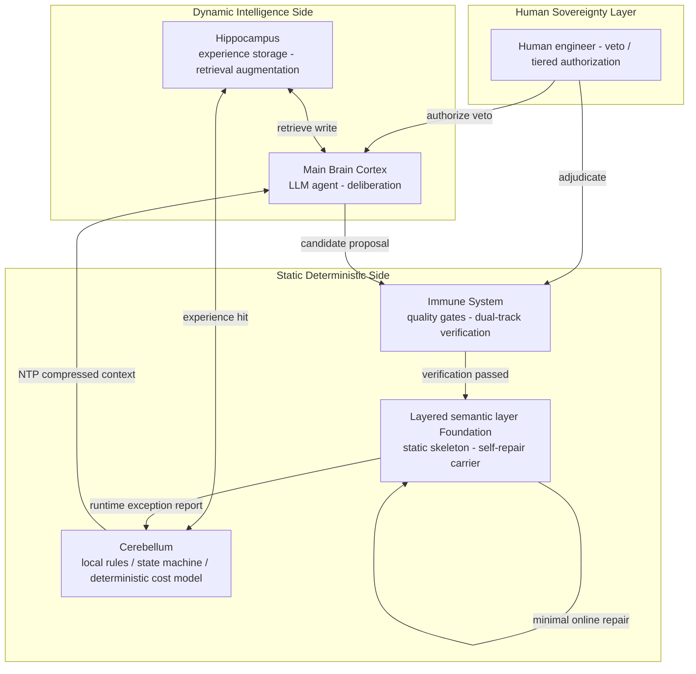

### 2.2 Organ responsibilities at a glance

| Organ | English | Core responsibility | Latency | Consumes tokens | Typical implementation |
|---|---|---|---|---|---|
| Skeleton | Skeleton | Deterministic foundation for types, memory, and semantic equivalence | Resident | No | Layered semantic foundation and implementation adaptation layer |
| Cerebellum | Cerebellum | High-frequency scheduling, execution-strategy optimization, local adjudication | Microseconds to milliseconds | No | Local rule base + state machine + deterministic cost model |
| Main Brain | Main Brain | Deep reasoning for unknown, complex problems | Seconds to minutes | Yes (controlled) | On-demand LLM agent |
| Hippocampus | Hippocampus | Experience consolidation and retrieval | Persistent | Small amount on retrieval | Experience vector store + retrieval augmentation |
| Immune | Immune System | Gates, consistency checks, regression, anti-self-deception | Build time / pre-merge | No | Multi-layer quality gates + full regression |
| Self-Repair | Self-Repair | Runtime online repairs and in-place optimization | Runtime | Case-dependent | semantic-layer minimal repair engine |
| Sovereignty | Human Sovereignty | Authorization, veto, goal setting | On demand | No | Tiered authorization interface |

### 2.3 Data and control dual flows

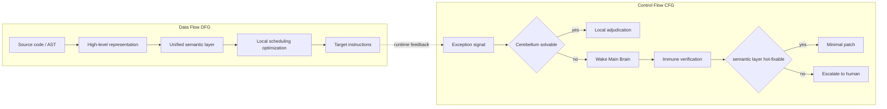

> **Target-environment awareness (cf. 8.5)**: The skeleton must be more than logically correct — it must sense its runtime carrier. When high-level representations are lowered to target executable code, and when runtime minimal patches are generated, adaptive prioritization must account for the physical characteristics of the environment (processor capability, accelerator scale, memory and storage characteristics, etc.). The same semantic layer should yield different optimal execution plans on different hardware. This is the architectural anchor for 8.5 "hardware-topology awareness".

---

## Chapter 3: Determinacy Grading: The D0–D3 Authority Spectrum

> This is a core mechanism introduced in v3.0 and retained in v3.1, used to land Axioms 1 and 2 into executable authority boundaries. Each level has a clear statement of "what AI may do."

| Level | Name | Content | AI authority | Change approval |
|---|---|---|---|---|
| **D0** | Physical-law layer | Type systems, memory models, concurrent state machines, cryptographic primitives | **Forbidden to touch**, read-only | Immutable (enforced at build time) |
| **D1** | Skeleton logic layer | Scheduling policies, semantic layer transformation rules, optimization processes | May propose, requires formal equivalence proof | Gate + human review |
| **D2** | Surface logic layer | Business code, glue code, configuration, interface adaptation | May generate, requires full regression pass | Automatic gate release + audit |
| **D3** | Intent and expression layer | Requirement parsing, comments, test case generation, documentation | AI-led, no side effects | Human may review, does not block operation |

**Rule**: AI output may only land at its level of origin or a lower-risk level. Any change jumping directly from D3 to D0/D1 must traverse the Immune System's complete verification chain.

---

## Chapter 4: Cerebellum Specification

> Corresponds to Axiom 3. The Cerebellum is the "muscle memory" of the living system; 80% of routine decisions should terminate here.

### 4.1 Mandatory clauses

- **Clause 4 (Cerebellum First)**: every core system must embed a local Cerebellum module responsible for high-frequency, fast, low-energy local scheduling and logic adjudication. Connecting all logic directly to the LLM is forbidden.
- The Cerebellum must still be able to complete routine D0/D1 adjudication without network access and without an LLM.
- Cerebellum decisions must be explainable, replayable, and auditable.

### 4.2 Cerebellum capability boundaries

| Must have | Strictly forbidden |
|---|---|
| Local rule base and priority matching | Generative free creation |
| State machines and deterministic transitions | Unverified dynamic code execution |
| Deterministic cost models (e.g., execution-strategy optimization) | Direct modification of the D0 foundation |
| Fast retrieval of experience vectors | Silently swallowing unhandleable exceptions (must escalate) |

### 4.3 Engineering anchors

Local execution scheduling and deterministic cost-model engines are a typical implementation of the Cerebellum: across multiple target architectures, adaptive optimization of hundreds or thousands of low-level operations is completed instantly by built-in deterministic cost models and state machines, burning no tokens and remaining precise and reproducible.

### 4.4 Absolute determinism of the Cerebellum: three hard boundaries

In engineering terms the Cerebellum must be defined as the **absolute defender of determinism**: it is "compressed historical experience" plus "deterministic cost models grounded in physical law". It recognizes only rules, state machines, and hardware profiles; it makes no value judgments and produces no form of creation.

| Hard boundary | Requirement | How it is judged |
|---|---|---|
| **Offline capability** | With the network cut and the Main Brain entirely unreachable, local rules plus promoted memory must still sustain no less than **80%** of routine transactions | Periodic "disconnection drills": block remote calls, run the full routine suite; the pass rate is the metric |
| **Growable** | Rules are not hard-coded constants; new "muscle memory" may only grow through the Hippocampus's **experience promotion** | Every rule must trace back to its experience source and promotion-audit record (24.3) |
| **No speculation** | When no local rule matches, the Cerebellum **must raise its hand immediately** and throw `UnknownSignal`; guessing, approximate substitution, or "let's just try it" is forbidden | The ledger may contain no record of "a judgment produced with no rule hit"; if one appears, it is contamination |

> **Anti-crosstalk**: the Cerebellum's ceiling is "deterministically handling the known", not "reasonably handling the unknown". Writing the Cerebellum as a "miniature LLM" burns tokens and loses determinism at the same time — the most expensive form of regression there is.

---

## Chapter 5: Main Brain Specification and the Neurotransmitter Protocol NTP

> Corresponds to the latter half of Axiom 3. The Main Brain does one thing: solve unknown, complex problems that neither the Cerebellum nor memory can resolve.

### 5.1 Mandatory clauses

- **Clause 5 (Strategic Awakening)**: the LLM API may be awakened if and only if the Cerebellum encounters a difficulty that neither its local rule base nor its memory store can resolve. Context must be compressed to the bare minimum, transmitting only **feature vectors and error codes**, exchanging extremely low token consumption for advanced intelligence assistance.
- Main Brain output is a **proposal**, not a **command**. It may not bypass the Immune System to land directly.

### 5.2 Neurotransmitter Protocol NTP: base payload

Context transfer between the Cerebellum and the Main Brain must be structured; dumping the full code or logs into the LLM at once is forbidden.

```json
{
  "ntp_version": "1.1",
  "direction": "uplink",
  "signal_type": "UNKNOWN",
  "error_code": "E-CORE-0427",
  "feature_vector": [0.12, -0.88, 0.33, 0.57],
  "context_digest": "sha256:afcd135cddc2ffc17db5c430579ff01cf7d0b648d43685d7b38066c51d1870a3",
  "tried_rules": ["rule_114", "rule_208"],
  "memory_hits": [],
  "constraints": ["D0_IMMUTABLE", "TARGET_ENV_LIMITED"],
  "budget_hint": {
    "max_tokens": 1200,
    "max_latency_ms": 8000,
    "priority": "D1"
  }
}
```

The block above is **valid JSON**: values carry only real data — never enum catalogues, field descriptions, or Chinese/English glosses. All explanations live in the table below. The sample hashes were computed with SHA-256 from fixed sample strings and can be parsed directly.

**Field glossary (every value is traceable)**

| Field | Type | Plain-language meaning | Why it is mandatory | Values / source |
|---|---|---|---|---|
| `ntp_version` | string | Protocol version | Sender and receiver must agree on field semantics | `major.minor`, example `1.1`; defined in 5.2 |
| `direction` | enum | Which way the message travels | One bidirectional channel; the receiver dispatches accordingly | `uplink` / `downlink`; defined in 5.4 |
| `signal_type` | enum | What kind of problem occurred | Lets the Main Brain select the relevant knowledge | `UNKNOWN` / `DEADLOCK` / `PERF_REGRESSION` / `SEMANTIC_CONFLICT`; defined in 5.4 |
| `error_code` | string | The fault's identity number | Pinpoints the fault and enables retrieval of past experience | `E-<domain>-<4 digits>`, example `E-CORE-0427`; generated by the reporter |
| `feature_vector` | number[] | Compressed numeric features | Replaces full context with a few numbers, minimizing tokens | Each item normalized to `[-1, 1]`; dimensionality set by the protocol; produced by the `digest` primitive |
| `context_digest` | string | A fingerprint of the original context, not the original | Verifies consistency without leaking full text | `sha256:<64 hex digits>`; produced by `digest` |
| `tried_rules` | string[] | Local rules already attempted | Prevents the Main Brain from repeating failed paths | Rule IDs; empty means none tried yet |
| `memory_hits` | string[] | Experience records retrieved from memory | Tells the Main Brain which experience is already in play | Experience record IDs; empty means no hit |
| `constraints` | enum[] | Boundaries that cannot be crossed | Any proposal violating them is rejected outright | `D0_IMMUTABLE` (human sovereignty is non-delegable) / `TARGET_ENV_LIMITED`; Chapter 0, D0–D3 |
| `budget_hint.max_tokens` | integer | Maximum tokens allowed for this request | Prevents one request from draining global cost | Positive integer, example `1200`; 5.3 cost-sensitivity clause |
| `budget_hint.max_latency_ms` | integer | Maximum wait before returning | Prevents the request from stalling the main flow | Positive integer (ms), example `8000`; same |
| `budget_hint.priority` | enum | Determinacy class of this request | Determines queuing and preemption order | `D0`–`D3`, example `D1`; Chapter 0, D0–D3 |

**Design intent**: transmit only features, error codes, constraints, and budgets, minimizing token consumption — this is where "using subtraction to counter addition" lands.

### 5.3 Hard boundary between the two brains: neither may live the other's life

If the line between Cerebellum and Main Brain is not nailed down, the system inevitably falls into one of two abysses: **the Main Brain steals the Cerebellum's work** (high-frequency transactions escalated upward — token leakage, exploding latency), or **the Cerebellum forces itself to do the Main Brain's work** (inferring when rules are missing — hallucination straight into the trunk, concurrent deadlock).

| Dimension | Cerebellum | Main Brain |
|---|---|---|
| **Essence** | Compressed historical experience + physical deterministic cost model | Engine of generalized reasoning and pattern recombination: a connector across domains of knowledge |
| **Physical carrier** | Local / edge process | Remote inference service (an LLM is merely its carrier, not the thing itself) |
| **What it handles** | Known, high-frequency, decidable | Long tail, unseen combinations, semantic conflict |
| **Unit cost** | Near-zero tokens, microsecond scale | Expensive and scarce, second-scale latency |
| **Output form** | Deterministic judgment (may land directly) | Candidate proposal / pseudocode (may not land directly) |
| **Primitive authority** | May invoke deterministic primitives and a restricted `patch` (only after immunity) | **Forbidden** to touch side-effecting primitives such as `invoke` / `patch` |
| **Failure mode** | Throws `UnknownSignal` upward | Rejected, timed out, or judged unavailable |

**Three constraints on the Main Brain**:

1. **Never responsible for execution**: it may only produce candidate strategies, pseudocode, or unverified candidate patches. Any channel that "directly modifies production" must not exist (aligned with Axiom 5).
2. **Cost-sensitive**: every awakening must carry and obey `budget_hint` (token ceiling, latency ceiling, priority). Exceeding budget means abort plus a negative sample — not "let's try once more".
3. **Accepts rejection**: having its proposal vetoed by the Cerebellum or rejected by an immune gate is the norm, not an anomaly. Rejection rate is a quality metric, not a defect to be hidden.

> **Decision mantra**: if it can be decided, do not infer; if you must infer, you do not know; if you do not know, escalate — and non-escalation is contamination.

### 5.4 The NTP two-way channel: uplink distress and downlink proposal

What passes between the two brains is not "textual conversation" but **compressed features and hypotheses awaiting verification**. The channel must be bidirectional, asynchronous, and sandbox-protected.

**Uplink (Cerebellum → Main Brain): distress and compressed context**

Trigger conditions (any one of three): no local rule hit (`UnknownSignal`), three consecutive retry failures, or concurrent deadlock / execution-level collapse.

```json
{
  "ntp_version": "1.1",
  "direction": "uplink",
  "signal_type": "UNKNOWN",
  "error_code": "E-CORE-0427",
  "feature_vector": [0.12, -0.88, 0.33, 0.57],
  "context_digest": "sha256:afcd135cddc2ffc17db5c430579ff01cf7d0b648d43685d7b38066c51d1870a3",
  "tried_rules": ["rule_114", "rule_208"],
  "attempt_count": 3,
  "env_profile": {
    "processor_capability": "GENERIC_CPU_V3",
    "accelerator_count": 2,
    "memory_tier": "HBM_2TIER",
    "interconnect": "MESH_2D"
  },
  "budget_hint": {
    "max_tokens": 1200,
    "max_latency_ms": 8000,
    "priority": "D1"
  }
}
```

**Uplink-only field glossary** (shared fields carry the meanings given in 5.2)

| Field | Type | Plain-language meaning | Why it is mandatory | Values / source |
|---|---|---|---|---|
| `attempt_count` | integer | How many local retries have already failed | Escalation is allowed only after the threshold (default 3), preventing token burn on every small disturbance | Positive integer, example `3`; 5.4 trigger conditions |
| `env_profile.processor_capability` | enum | Target processor capability family | A proposal must fit the execution environment without binding to a specific product model | Abstract tier, example `GENERIC_CPU_V3`; Chapter 8, hardware awareness |
| `env_profile.accelerator_count` | integer | Number of available accelerator units | Determines whether parallel or specialized proposals are admissible | Non-negative integer, example `2`; Chapter 8 |
| `env_profile.memory_tier` | enum | Memory and storage tier | Determines whether a proposal's memory assumptions hold | Abstract tier, example `HBM_2TIER`; Chapter 8 |
| `env_profile.interconnect` | enum | Interconnect topology | Determines data-movement cost assumptions | Abstract tier, example `MESH_2D`; Chapter 8 |

**Downlink (Main Brain → Cerebellum): proposal and intent binding**

```json
{
  "ntp_version": "1.1",
  "direction": "downlink",
  "proposal_id": "p-7f3c",
  "candidate": {
    "format": "SEMANTIC_PATCH",
    "digest": "sha256:51ce14ac8674ef2c7c9a623d9f38160737652ff04fedba92d5fc9f991242676a"
  },
  "confidence": 0.62,
  "rationale_digest": "sha256:c3c4c8e4a969b52d457a33f82caf95781519c7433ad6be072d74a3c89d02cb0d",
  "assumptions": ["ENV_STABLE", "NO_CONCURRENT_WRITE"],
  "budget_spent": {
    "tokens": 980,
    "latency_ms": 5400
  },
  "status": "PENDING_VERIFICATION",
  "rationale_binding": {
    "algorithm": "ANS-1+SHA-256",
    "summary_ref": "sum-9a1e",
    "digest": "sha256:f535948ab4faff07fe8828a6dd2d99040fb0fdd55c06a9cfd7736448b0f38c76"
  }
}
```

**Downlink field glossary (every value is traceable)**

| Field | Type | Plain-language meaning | Why it is mandatory | Values / source |
|---|---|---|---|---|
| `proposal_id` | string | This proposal's identifier | Required for tracking, rejection, and citation | `p-<short hex>`, example `p-7f3c`; generated by the Main Brain |
| `candidate.format` | enum | The representation form of the candidate | Makes explicit that it is **not** an executable artefact | `SEMANTIC_PATCH` / `PSEUDOCODE`; 5.3 |
| `candidate.digest` | string | A fingerprint of the candidate, not its body | The Main Brain never inlines content; the receiver must fetch by digest from the sandbox and re-verify before use | `sha256:<64 hex digits>`; Chapter 8, sandbox build |
| `confidence` | number | The Main Brain's self-assessed confidence | Used for ranking and risk hints, **never for authorization** | Float in `[0, 1]`, example `0.62`; 5.3 |
| `rationale_digest` | string | A fingerprint of the reasoning summary | A human-readable summary may be attached to Fold 1; this field holds only a verifiable fingerprint | `sha256:<64 hex digits>`; Chapter 13, Fold 1 cognitive summary |
| `assumptions` | string[] | Unverified premises the proposal relies on | Lets a reviewer see the proposal's weak points at a glance | Assumption IDs, examples `ENV_STABLE` / `NO_CONCURRENT_WRITE` |
| `budget_spent.tokens` | integer | Tokens actually consumed by this request | Measures Main Brain cost for rate limiting | Non-negative integer, example `980`; 5.5 |
| `budget_spent.latency_ms` | integer | Actual time consumed by this request | Measures Main Brain latency for rate limiting | Non-negative integer (ms), example `5400`; 5.5 |
| `status` | enum | Always "pending verification" | Eliminates any state called "approved by the Main Brain" at the protocol layer | Fixed to `PENDING_VERIFICATION`; 5.4 |
| `rationale_binding` | object | Welding credential between the human-readable summary and this proposal | Prevents "approve A, show B" summary swap | See ANS-1 subsection below |

> **Why the candidate carries only a fingerprint**: if the Main Brain inlined the patch body into the message, a receiver could use it without verification, opening a door for "hallucination straight into the trunk". Transmitting only `candidate.digest` forces the receiver to fetch it from the sandbox and re-verify — this is Axiom 3 ("prove what can be proved") landing in the protocol.

**ANS-1 canonical serialization and digest binding (normative)**

The same object serializes to different bytes across languages (key order, whitespace, Unicode escaping, number format), producing different digests for the same data. Every `*_digest` and `rationale_binding` hash must therefore be computed after **ANS-1 (ANE Normalized Serialization v1)** canonicalization:

1. **Key order**: object members sorted ascending by UTF-16 code units (consistent with RFC 8785 JCS, **referenced**);
2. **No whitespace**: no spaces, indentation, or newlines;
3. **Strings**: only JSON control characters escaped; non-ASCII chars emitted as UTF-8, not `\uXXXX`;
4. **Numbers**: integers in decimal; fixed significant digits for floats, no scientific notation or trailing zeros; non-finite numbers forbidden;
5. **Arrays**: original order preserved, never sorted.

The binding digest input is fixed to five fields: `ANS-1({algorithm, proposal_id, rationale_digest, summary_ref, summary_text_canonical})`, written to `rationale_binding.digest`. **The authoritative text is the canonical English text**; translations must carry `translation_of: summary_ref` and are excluded from binding — otherwise translation drift yields multiple "valid" digests for one proposal.

> **【MUST】** All `sha256:` digests are generated through ANS-1; **【MUST】** the Fold 1 summary carries `summary_ref` and a recomputable binding digest; **【MAY】** translated summaries declare `translation_of`. Machine-readable contract: `schemas/ntp-1.1.schema.json`; runnable tool: `tools/validate_ntp.py` (`validate` for CI, `canonicalize` for ANS-1 output).

> Critical semantics: the downlink payload **is not a command but a hypothesis awaiting verification**. `status` is always `PENDING_VERIFICATION`; there is no such state as "approved by the Main Brain".

**The four iron laws of the channel**

| Iron law | Requirement | Consequence of violation |
|---|---|---|
| **No full context** | Never feed source code, logs, or raw sessions wholesale; they must be compressed by the `digest` primitive into feature vectors, AST summaries, or error-stack digests | Token explosion, uncontrollable latency, runaway cost |
| **Asynchronous, non-blocking** | After an uplink is sent the current task is suspended as `Pending` and the Cerebellum turns to other work; the Main Brain's callback wakes it as an interrupt | The system hangs, throughput collapses to zero |
| **Sandbox isolation** | Downlink artefacts may only be built and dual-track verified in a sandbox or isolated verification environment; never executed directly in production | Contamination enters the trunk, unrecoverable |
| **Mandatory trace** | Every uplink payload, every downlink reply, and whether it was adopted must be written in full to the ledger and memory store | No replay, no promotion, no retrospective |

### 5.5 Communication state machine, channel arbitration, and rate limiting

A controlled two-brain link must traverse the full state machine; no state may be skipped:

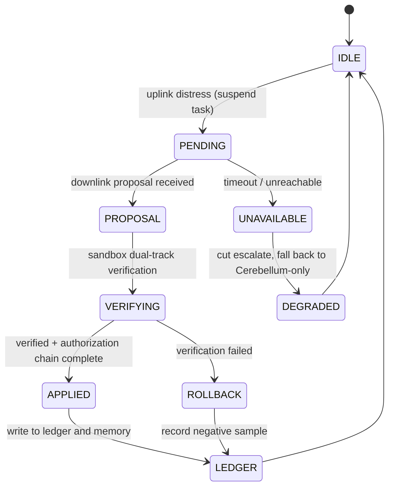

| State | Semantics | Forbidden |
|---|---|---|
| `PENDING` | Escalated, waiting; the task yields execution | Busy-waiting; duplicate uplinks for the same signal (must be deduplicated and merged) |
| `PROPOSAL` | Proposal received, not yet verified | Executing the candidate directly |
| `VERIFYING` | Building and dual-track verifying in the sandbox | Skipping regression and passing straight through |
| `APPLIED` | Verified and fully authorized | Writing without a credential |
| `ROLLBACK` | Verification failed; revert and record a negative sample | Silently discarding the failed sample |
| `DEGRADED` | Main Brain unavailable, Cerebellum-only mode | Accepting any mutation-class change during this period |

**Channel arbitration (multiple living systems competing for Main Brain quota)**

When several subsystems or agents raise uplink requests simultaneously, a unified scheduling unit must queue them; none may connect to the remote service on its own:

1. **Urgency first**: D0/D1 anomalies (damage to the skeleton or skeleton logic) outrank D2 business anomalies; D3 generation requests rank lowest.
2. **Budget first**: at equal urgency, order by remaining token quota and latency ceiling; as the quota nears exhaustion only D0/D1 are admitted.
3. **Overflow degrades**: when quota is exhausted, excess requests are forced back to the Cerebellum for conservative rule handling and recorded in the ledger (no queuing, no retry).

**Rate limiting (coupled with cold start in 6.4)**

| Phase | Uplink frequency policy | Purpose |
|---|---|---|
| Explore mode | High-frequency uplink permitted until sample coverage reaches the threshold | Collect long-tail samples quickly and avoid a rule base that idles for long |
| Exploit mode | Strict limiting: per-unit-time quota + cooling window + deduplication of same-source signals | Cut cost; prevent "high-frequency distress" from masking a missing rule base |

> Rate-limit parameters are D1-level configuration and must pass a gate to change; "temporarily relaxing the limit" may not be used as a way around the budget.

**Timeout and deduplication parameters (default ranges; implementations must choose within them and register the choice)**

| Parameter | Default range | Disposition |
|---|---|---|
| Uplink `PENDING` timeout | By D-tier: D0 seconds, D1 tens of seconds, D2 minutes, D3 no real-time wait | Timeout always routes to `DEGRADED` (21.3b); it must **not** be recorded as "Main Brain refused," nor silently retried |
| Same-source merge window | Default: signals sharing error code + environment profile + rule gap are merged | Merging compresses duplicate uplinks only, never discards differing samples; the first sample in the window must be recorded |
| Max uplinks per task | Explore mode relaxed within budget; Exploit mode defaults to 1–3 | Exceeding the cap forces the request back to conservative Cerebellum rules; classify as a "rule gap," not "Main Brain incapable," and count in the rejection rate (12.1) |
| Cooling window | A configurable window between two uplinks from the same source | Prevents high-frequency distress from masking a missing rule base (5.5 / 12.2) |

> Parameter values are E-layer evidence (observable, adjustable), not hard-coded N-layer clauses; but **a missing parameter may never justify skipping timeout disposition** — absent configuration, use the conservative end of the range.

### 5.6 Model Carrier Governance

> The Main Brain is an "engine of generalized reasoning and pattern recombination"; **the specific model is only its physical carrier** (5.3). Since the carrier is replaceable, it must be governed like any dependency — otherwise "replaceable" is mere rhetoric.

- **The carrier may not become an architectural dependency**: no normative clause, primitive chain, or rule may name a specific model; the Main Brain connects through a uniform capability interface, and replacing the carrier may not change N-layer clauses.
- **Six selection criteria (each introduction or replacement must record all six)**: ① task capability coverage (long-tail and unseen combinations); ② latency and throughput (D-tier deadlines); ③ unit cost (within `budget_hint`); ④ reproducibility (deviation band for identical inputs and summaries); ⑤ security and data boundary (auditable output, no cross-tenant leakage); ⑥ exitability (an alternative carrier and a rollback path exist).
- **A model card is mandatory**: record carrier version, training/knowledge cutoff, known biases, supported and prohibited scenarios, evaluation results, and the accountable owner; the card enters version control with the AI-BOM (22.3), and its absence fails the onboarding gate.
- **Upgrades and retirements pass the same gate**: a new carrier must first pass evaluator discipline (29.3) and dual-track verification (Chapter 7), then replace via grey release; the old carrier remains rollback-ready for one cycle before retirement, with reasons and replacement relations recorded.
- **Carrier differences are observable**: record carrier identifier, version, and confidence for every call; when results across carriers disagree, enter the ledger and handle as a conflict (16.3) — never silently pick one.

> Carrier governance (who reasons) and prompt asset governance (how the question is asked, 18.4) are two sides of the same coin; together they determine the credibility and cost of Main Brain output.

---

## Chapter 6: Memory Specification: Hippocampus and Experience Storage

> Corresponds to Axiom 4. Memory is the moat and the source of the living system's "self."

### 6.1 Mandatory clauses

- **Clause 6 (Memory Is the Moat)**: all software must connect to a dedicated experience store. Every success, failure, and rollback must be structured; AI must read past experience through retrieval augmentation and never repeat mistakes.
- Experience unverified by the Immune System is **forbidden to be written** (preventing memory pollution).

### 6.2 Experience Record structure

| Field | Description |
|---|---|
| `signature` | Problem feature vector / error code |
| `context` | Minimal context digest at trigger time |
| `action` | Action taken (rule hit / AI proposal / rollback) |
| `verification` | Gate result, consistency check, regression conclusion |
| `outcome` | success / failure / rollback |
| `lineage` | Provenance chain: which system, which change, who authorized |

### 6.3 Memory lifecycle

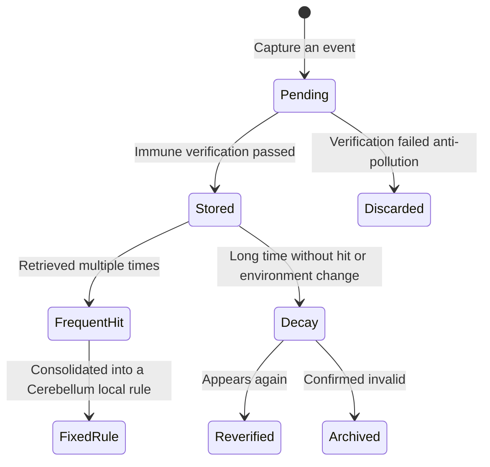

> Key mechanism: **experience can be promoted to a Cerebellum rule** (turning a Main Brain insight into a Cerebellum instinct) — the fundamental reason the flywheel becomes ever more token-efficient.

### 6.4 Cold Start and Knowledge Quenching

> Corresponds to Axioms 3 and 4. A living system is born with an empty memory — without initial experience, every problem is dumped onto the scarce and expensive Main Brain. This section specifies how a living system is "born with common sense."

- **Seed Rules**: while the system is at maturity L2/L3, human domain experts may inject a set of immune-verified **initial golden rules** as the Hippocampus's initial memory. Each seed rule must carry its source, applicable scope, verification evidence, and validity period in the ledger; **unverified rules are forbidden**.
- **Explore Mode (mandatory at cold start)**: early in the memory store's life the system is **forced** into Explore mode — proactively raising Main Brain invocation frequency to deliberately cover the unknown problem space and collect diverse samples. This high-frequency invocation is a necessary investment and remains subject to the budget gates of Chapter 18.
- **Exploit Mode**: once the experience store reaches an organization-defined **coverage threshold** (hit rate, sample diversity, rule coverage), the system automatically switches to Exploit mode, prioritizing local rules and sharply reducing Main Brain calls. Thresholds, switch criteria, and switch timestamps must be written to the ledger and be auditable.
- **Premature-convergence rollback**: after switching to Exploit mode, if the hit rate stays below the lower bound, the system must automatically fall back to Explore mode to collect more samples, preventing an "experience cocoon."

| Mode | Trigger | Main Brain invocation | Purpose | Exit condition |
|---|---|---|---|---|
| **Explore** (mandatory cold start) | Empty memory / below coverage threshold, or early L2/L3 | High (deliberate sampling) | Collect samples, discover rules | Coverage threshold reached |
| **Exploit** | Coverage threshold met, hit rate stable | Low (local priority) | Save cost, reduce latency | Hit rate falls below lower bound |

> **Knowledge quenching**: the process by which seed rules and Explore-phase samples are quenched into stable rules after immune verification. It complements natural promotion (6.3) — the former shortens cold start, the latter sustains long-term evolution. Both must pass the same immune verification; "going live quickly" is never grounds to bypass it.

---

## Chapter 7: Immune Specification: Dual-Track Verification and Anti-Self-Deception

> Corresponds to Axioms 2, 6, and 7. The Immune System is the fundamental guarantee that the living system does not decay.

### 7.1 Mandatory clauses

- **Clause 7 (Absolute Defense / Anti-Self-Deception)**: eliminate all silent failures. On encountering an unknown problem, the system must immediately raise an error, block, and record — never covering it up by modifying test cases or forging green checkmarks. Errors are the nourishment of evolution; falsehoods are poison to software.
- Any code or patch dynamically generated by AI must undergo the harsh interrogation of static gates; only when verified equivalent and error-free may it be merged. **Unverified AI output is equivalent to a viral infection.**

### 7.2 Dual-track verification model

| Track | Verification means | Question answered | Failure consequence |
|---|---|---|---|
| **Symbolic track** | Formal equivalence proofs, multi-path consistency checks, type checking, state-machine reachability | "Is it mathematically/semantically correct?" | Immediate block |
| **Statistical track** | Full regression, fuzzing, shadow run | "Is it correct in actual behavior?" | Immediate block and rollback |

Both tracks **must pass simultaneously** (logical AND); any failure is judged contamination.

### 7.3 Gate responsibility chain

```
AI candidate proposal
   → symbolic track (equivalence / consistency check)
   → statistical track (regression / fuzz)
   → human authorization (if touching D0/D1 or production)
   → allow merge / hot load
   → full-process ledger trail (traceable, replayable)
```

---

## Chapter 8: Self-Repair Specification: The Instant Repair Law of the Semantic Layer

> Corresponds to the latter half of Axiom 2. This is the most distinctive capability of the "living software system."

### 8.1 Mandatory clauses

- **Clause 8 (Instant Repair Law)**: the foundation of the living software system must contain a unified semantic layer. When any runtime exception, performance bottleneck, or logic disorder occurs, the semantic layer must possess an "omniscient view" spanning high-level source and low-level operations, able to perform low-level execution-logic restructuring, hot-patch generation, or optimization directly at the lower level at any time, achieving self-repair with "no restart, no human intervention, and in-place repair at any time."

### 8.2 Why the semantic layer can "repair at any time"

Traditional software: error → crash → downtime → human digs through source → edit high-level language → rebuild → redeploy (extremely long cycle).

semantic-layer-driven: all high-level representations and machine-level executable code ultimately flow through the unified semantic layer, which has a "god's-eye view" and can perform "keyhole surgery" directly at the semantic layer — generating repair patches, adjusting execution paths, and online loading optimizations without touching chaotic source code.

### 8.3 Safety preconditions for self-repair (a direct response to a key risk)

> AI generation + runtime hot repair = superposition of two uncertainties; threefold insurance is required:

| Insurance | Mechanism |
|---|---|
| **Rollbackable** | Establish a checkpoint snapshot before a online repair; automatic rollback on failure |
| **Provable** | The patch must pass symbolic-track equivalence verification |
| **Auditable** | Every hot repair is written to the ledger and experience store for later human review |

### 8.4 Self-repair decision control flow

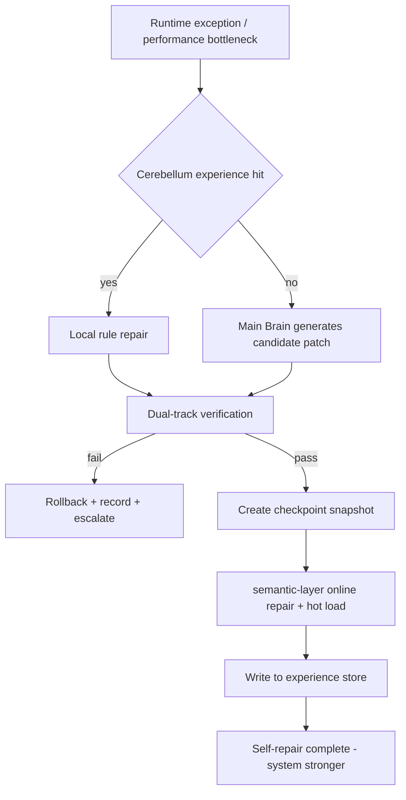

### 8.5 Hardware-Topology-Aware Execution Optimization

> Corresponds to 2.3. The same semantic layer does not have the same "optimal" instruction sequence on different physical carriers — repairing without regard to hardware may fix the logic while crippling performance.

- **Mandatory requirement (hardware-topology awareness)**: when generating minimal online repairs or performing adaptive optimization, the semantic layer **must** make adaptive decisions based on the physical characteristics of the current runtime environment, including at minimum: processor capabilities, accelerator core count and type, memory hierarchy and bandwidth, and interconnect and data-access affinity. A "one-size-fits-all" patch sequence on any hardware is forbidden.
- **Profile acquisition**: hardware characteristics must be detected at startup and refreshed on change, and recorded in the observability ledger; when the profile is missing, degrade to a conservative baseline and raise an alert (see Chapter 21 graceful degradation) — never guess hardware capabilities.
- **Cost-model linkage**: the deterministic cost model used for optimization (see Chapter 4 Cerebellum) must take the hardware profile as input when choosing execution scheduling, operation merging, and parallelism strategies; the same patch may yield different variants under different profiles, and each variant must independently pass dual-track verification (Chapter 7).
- **Reproducibility**: each patch variant must record "profile fingerprint → selected prioritization strategy" so that a repair in the same environment can be reproduced and replayed.

| Physical characteristic | Prioritization impact | Degradation when profile missing |
|---|---|---|
| Processor capabilities | Execution-path selection, parallelization path | Conservative baseline capabilities |
| Accelerator core count / type | Parallelism, operator offload decision | Disable offload, host path |
| Memory hierarchy / bandwidth | Data layout, cache blocking | Default blocking parameters |
| Interconnect / memory affinity | Thread binding, data placement | Ignore affinity constraints |

> **Generality statement**: this clause specifies only the paradigm requirement to "sense and adapt to hardware physical characteristics"; it binds to no specific processor capabilities, accelerator architecture, or buildr implementation, and applies to heterogeneous environments from edge devices to data centers.

---

## Chapter 9: Human-Machine Collaboration: Human Sovereignty and Tiered Authorization

> Corresponds to Axiom 5. Humans are not removed, but elevated to the position of "legislator / adjudicator."

### 9.1 Mandatory clauses

- **Clause 9 (Veto Power)**: no AI agent may directly modify main-branch code or issue instructions to production without explicit human authorization. Human and machine are separated, with clear authority and responsibility.
- **Clause 10 (Full-Spectrum White Box)**: all low-level operation mappings, adaptive optimization, and graph reconstruction must provide a global "god's-eye view" ledger. No black box may exist in the living system.

> Note: clause numbering = seven axioms + ten normative clauses, continuous with no duplicates.

### 9.2 Tiered authorization model (breaking the "human bottleneck")

| Authorization level | Trigger condition | Human action |
|---|---|---|
| **L0 automatic** | D3 layer, no side effects (documentation / comments / test generation) | After-the-fact audit only |
| **L1 review** | D2 layer, all gates green, high-confidence experience hit | Batch confirmation / spot check |
| **L2 strong authorization** | Touching D0/D1, production environment, irreversible changes | Explicit double-confirmation approval |

### 9.3 Dual-layer confirmation interaction

- **Judgment layer**: presents the AI's intent, diff, rationale, and verification conclusion for human judgment.
- **Authorization layer**: only takes effect after explicit human approval. Judgment and authorization are separated to eliminate mis-touches.

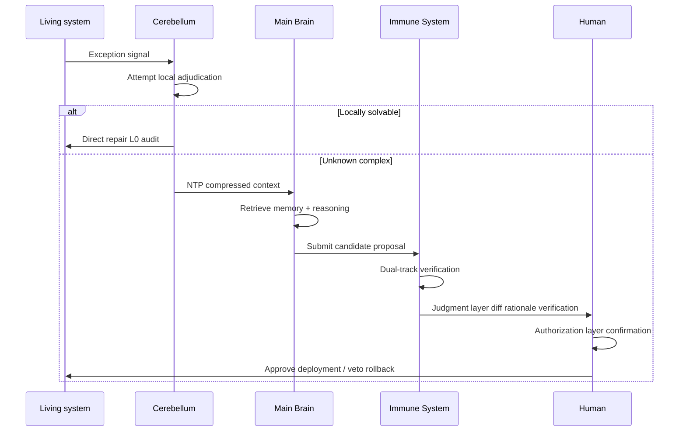

---

## Chapter 10: Evolution Theory: The Unified Development-Maintenance Flywheel

> Corresponds to the core vision of "development and maintenance as one." Going live is not the end, but the beginning of life.

### 10.1 Six stages of the flywheel

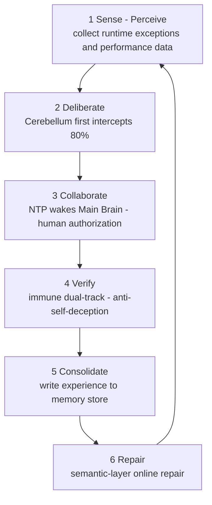

### 10.2 The threefold compounding of the flywheel

1. **Cost compounding**: the thicker the experience store and the more experience promoted to Cerebellum rules → fewer Main Brain awakenings → tokens and latency approach zero.
2. **Capability compounding**: each "mutate–verify–consolidate" exposes the system to more scenarios → faster response to the unknown.
3. **Safety compounding**: gates and experience reinforce each other → false positives decline, false negatives approach zero → the system becomes more trustworthy.

### 10.3 Development is maintenance, maintenance is development

- Traditional: build a building (development), repair it when broken (maintenance) — disconnected, decaying.
- ANE: like a tree, growing (development) while self-repairing (maintenance), in the same rhythm.
- **Running is sensing, sensing is maintenance, maintenance is development, development is evolution.**

### 10.4 Evolution speed: the five-step algorithm (order may not be inverted)

> **Law 1**: the rotational speed of the feedback loop decides the living system's right to survive. Speed is not an efficiency metric but the highest form of moat — for the same insight, whoever closes the loop of sensing → deliberation → verification → consolidation first gets the next round of samples.

When refactoring, optimizing, or generating any code block, a living system **must** follow this order. The order itself is part of the specification:

| Step | Action | What it does | Completion criterion (verifiable) |
|---|---|---|---|
| 1 | **Delete** | Remove pseudo-requirements, dead code, and over-abstraction reserved for an imagined future | Build and full regression green afterwards, with net code volume negative |
| 2 | **Simplify** | Reduce coupling, eliminate duplicate paths, narrow interfaces | Cyclomatic complexity and cross-module dependencies do not rise; interface parameters decrease |
| 3 | **Optimize** | On the simplified structure, prioritize low-level operations and tune the deterministic cost model | Metrics improve with correctness unchanged, and results are reproducible (8.5) |
| 4 | **Accelerate** | Raise concurrent throughput: batching, pipelining, caching, distribution by hardware topology | No new races or shared state; the stress curve is explainable |
| 5 | **Automate** | Only at the end, freeze pipelines, gates, and inspection | Human intervention points can be enumerated one by one |

**Why the order cannot be inverted**:

- **Automating before deleting** = pipelining a rubbish heap. The faster it produces, the thicker the technical debt — and the debt is masked by a "green pipeline".
- **Optimizing before simplifying** = fine-tuning the most complex structure. Optimization gains are eaten by complexity, and equivalence becomes hard to prove.
- **Automating before accelerating** = freezing a serial bottleneck into the pipeline; every later speed-up requires tearing the pipeline apart.

> Relation to the axioms: the five-step algorithm is Axiom 1 (static–dynamic duality) projected onto "evolution actions" — deleting and simplifying contract the static skeleton, optimizing and accelerating expand dynamic capability, and automation only freezes already-verified paths; **it produces no new correctness**.

### 10.5 Execution discipline: flat channels, no overnight bad news, grey release

**1. Flat communication (the three-sentence rule)**

When escalating — to the Main Brain or to a human — only three sentences are allowed: **what the problem is · what has been tried · what is needed next**. Long preamble, emotional narrative, and irrelevant context are stripped. This is both the human-readable form of the NTP uplink (5.4) and the organizational governance of information entropy.

**2. No overnight bad news**

False green ticks, silent failures, unauthorized mutations, and gate bypasses must be reported to the ledger **in the same round they occur**. A system that hides bad news should be judged **contaminated** by its own Immune System and degraded — because an unrecorded failure re-contaminates the memory store in the form of "experience".

**3. Integrated die-casting (high-cohesion fusion)**

A call chain that can be fused at the base layer into a high-cohesion module must not be split into a long cross-process microservice chain — every boundary crossing pays serialization, network, and observability overhead three times over. But fusion has hard limits: **D0 skeleton logic may not be smeared into business modules**, and replaceability may not be sacrificed merely to reduce calls.

**4. High-frequency grey release (Autopilot mode)**

When confidence reaches **99%**, enter grey release rather than waiting for 100%. Waiting for perfection is indistinguishable from shutting down the feedback loop. Grey release must simultaneously have: a rollback checkpoint, a monotonically tightening degradation path (21.3), and observable success criteria.

> Gates and grey release are not opposites: **the gate decides "may it ship"; grey release decides "how much, to whom"**. If the gate has not passed, grey release is meaningless.

---

## Chapter 11: Adoption: The ANE Maturity Model L0–L5

> Allows the paradigm to be adopted progressively from "vision" rather than all at once.

| Level | Name | Characteristics | Criterion |
|---|---|---|---|
| **L0** | Static workshop | Purely deterministic code, no AI involvement | No AI-generated code enters mainline |
| **L1** | Tool-assisted | AI completes/suggests, humans review everything | AI assistance but no automatic loop |
| **L2** | Cerebellum in place | Local rules intercept high-frequency decisions, zero tokens | Routine decisions bypass the LLM |
| **L3** | Memory loop | Experience store + retrieval augmentation effective | Same class of problem is not re-asked of the Main Brain |
| **L4** | Self-repair running | semantic-layer online repairs + flywheel turning | Runtime repair without restart |
| **L5** | Living system | Unified development-maintenance, controlled self-iteration | Mutate–verify–consolidate fully automated, humans only strategic authorization |

**Adoption path**: starting with L2 (Cerebellum) and L3 (memory) yields the greatest benefit at the lowest risk; L4 (self-repair) may be enabled only after L2/L3 and the immune system are mature.

---

## Chapter 12: Metrics and Anti-Patterns

### 12.1 Key metrics (KPI)

| Metric | Definition | Target direction |
|---|---|---|
| Cerebellum interception rate | locally adjudicated decisions / total decisions | ↑ (target ≥80%) |
| Token-per-decision ratio | average tokens consumed per decision | ↓ |
| Memory hit rate | retrieval-augmented experience hits / Main Brain awakenings | ↑ |
| Experience promotion rate | share of experience consolidated into Cerebellum rules | ↑ |
| First-pass gate rate | share of proposals passing dual-track on the first try | ↑ (reflects Main Brain quality) |
| Self-repair success rate | successful online repairs / attempted online repairs | ↑ |
| Rollback rate | failed rollbacks / total changes | ↓ |
| MTTR | mean time to repair | ↓ |
| Silent-failure count | number of exceptions swallowed without reporting | = 0 (red line) |
| Feedback-loop duration | time from signal generation to completed consolidation | ↓ (core metric of the speed law) |
| Net code-volume change | deleted minus added lines per evolution round | should be negative or near zero |
| Quota exhaustion rate | denied uplinks due to budget exhaustion / all uplink requests | observation item; a spike triggers a rate-limit review |
| Rejection rate | requests forced back to conservative Cerebellum rules / all uplink requests | ↓ a high value indicates a rule gap, not Main Brain incapacity |
| D0/D1 preemption rate | high-priority preemptions / total arbitrations | observation item; audits arbitration fairness (5.5) |

### 12.2 Anti-pattern list (explicit "don'ts")

| Anti-pattern | Harm | Correct practice |
|---|---|---|
| Dumping full context into the LLM | Token explosion, high latency | Use NTP to transmit features and digests |
| AI directly modifying main branch / production | Bypassing sovereignty and immunity | Tiered authorization |
| Silent failure / fake green checkmark | Hides problems, system decays | Immediate error, block, record |
| Unverified experience written to store | Memory pollution, negative flywheel | Write only after immune verification |
| Hot update without snapshot | Non-rollbackable, disaster risk | Checkpoint + automatic rollback |
| Omni-LLM (no Cerebellum) | Stalls, burns money, unreliable | Cerebellum first |
| Unexplainable black box | Uncontrollable, untrustworthy | Full-spectrum white-box ledger |
| Unlimited rule-base growth | Cerebellum degenerates into a new monolith | Experience promotion + decay archiving |
| Automating before simplifying | Pipelines technical debt; green ticks mask decay | Five-step algorithm order (10.4) |
| Masking a missing rule base with high-frequency distress | Hollow Cerebellum; cost rises linearly with traffic | Rate limiting + attributing misses to rule gaps (5.5) |
| Cerebellum forcing a guess (answering without a rule) | Hallucination into the trunk, unreplayable | Throw `UnknownSignal`; no approximate substitution (4.4) |

---

## Chapter 13: Interaction Modes: The Agent Interaction-Pattern Matrix

### 13.1 Four dimensions of interaction

Any AI-native interaction can be classified along four axes:

| Dimension | Values | Description |
|---|---|---|
| **Tense** | synchronous / asynchronous / streaming | whether the request blocks and whether results return incrementally |
| **Direction** | human→machine / machine→human / machine→machine / machine→tool | relationship of interacting subjects |
| **Autonomy** | suggestion / semi-automatic / fully automatic (subject to authorization) | corresponds to tiered authorization L0–L2 in Chapter 9 |
| **Persistence** | stateless single-shot / stateful session / long-term memory | boundary across which state persists |

### 13.2 Ten standard interaction patterns (Interaction Patterns)

| Pattern | Core idea | Position in ANE | Risks and constraints |
|---|---|---|---|
| **Chain** | steps executed in sequence | Cerebellum deterministic pipeline | single-point failure must be rollbackable |
| **Routing** | dispatch by feature to different branches | Cerebellum routes by D0–D3 grading | routing criteria must be explainable |
| **Parallelization** | independent subtasks concurrently | Main Brain batch reasoning / multi-track verification | result aggregation must be deterministic |
| **Planning** | decompose a goal into a multi-step plan | Main Brain handles unknown complexity | plan must be shown in the judgment layer |
| **Reflection** | producer + reviewer dual agent | corresponds to the Immune System's "critic" | reviewer must not endorse itself |
| **Tool Use** | affect the external world via tools | see the MCP specification in Chapter 15 | least privilege + pre-call authorization |
| **Retrieval-Augmented Generation (RAG)** | retrieve first, then reason | Hippocampus experience reading | retrieval must carry access control |
| **Multi-Agent Collaboration** | role division, shared memory | see Chapter 16 | must be protocolized, no private chats |
| **Human-in-the-Loop (HITL)** | humans adjudicate key decisions | Human Sovereignty layer veto | avoid making humans a bottleneck |
| **Event-Driven Architecture (EDA)** | state change as event, subscribers respond | flywheel's sense–self-repair chain | events must be traceable and replayable |

### 13.3 Interaction pattern selection criteria

- **Use the Cerebellum when possible, not the Main Brain**: chain/routing first; planning/reflection only at D2/D3.
- **Synchronous when possible, not asynchronous**: async only for long tasks; but self-repair and production changes must go through an auditable async event chain.
- **Stream when possible**: human-facing output should stream first to reduce perceived latency, but streamed content is not considered a verified conclusion.
- **Any side effect must be explicit**: all tool calls and state writes must carry authorization credentials and provenance identifiers.

### 13.4 Dual-Fold Collaboration

> Corresponds to Axioms 5 and 6; it is the mandatory formalization of the "dual-layer confirmation interaction" of 9.3 at the human-machine interface. It defines the standard structure of "how the machine presents its judgment to the human, and how the human writes intent back to the machine."

The human-machine collaboration interface **must** present two semantically isolated "folds"; mixing cognition and authorization in a single layer is forbidden.

| Fold | Name | Direction | Core payload | Determinacy level |
|---|---|---|---|---|
| **Fold 1** | Judgment Fold | machine → human | **Cognitive Summary**: AI intent, candidate actions, diffs, evidence, verification conclusions, risk warnings | D1–D3 (not directly executable) |
| **Fold 2** | Authorization Fold | human → machine | **Intent Binding**: the human binds approval/denial to one specific candidate action as a credential | D0 (human-made, machine cannot sign on its behalf) |

**Mandatory pattern rules**:

- **Folds cannot be merged**: Fold 1 only presents and explains, and may not trigger side effects; Fold 2 only carries human deterministic intent and may not be auto-generated by AI. Any automatic landing that bypasses Fold 2 is a violation of Axiom 5.
- **Summary must carry evidence**: a cognitive summary must simultaneously give its evidence chain (retrieved experience, evidence, verification results), never a bare conclusion — "seeing the reasons" is the prerequisite for humans exercising sovereignty.
- **Binding must be precise**: an intent binding must point to one specific candidate action in Fold 1 (action ID + parameters + target environment), preventing "approve A, execute B."
- **Full traceability**: every unfold, summary, binding, and denial in the two folds is written to the ledger with an `attest` credential for replay audit.

**Machine-readable binding of the Cognitive Summary (linked to 5.4)**

A Fold 1 summary is not merely human prose; it is simultaneously a verifiable credential. Minimal structure:

```json
{
  "summary_ref": "sum-9a1e",
  "proposal_id": "p-7f3c",
  "rationale_digest": "sha256:c3c4c8e4a969b52d457a33f82caf95781519c7433ad6be072d74a3c89d02cb0d",
  "summary_text_canonical": "Local rules did not hit; apply the semantic-layer patch in the sandbox and decide after dual-track verification.",
  "evidence_refs": ["exp_077", "run_2048"],
  "risk_codes": ["D1_ENV_UNVERIFIED", "MEMORY_HIT_LOW"],
  "binding_digest": "sha256:f535948ab4faff07fe8828a6dd2d99040fb0fdd55c06a9cfd7736448b0f38c76",
  "translation_of": null
}
```

- **【MUST】** `binding_digest` is recomputed per 5.4 ANS-1 rules over `algorithm + proposal_id + rationale_digest + summary_ref + summary_text_canonical`; the verifier recomputes from the ledger payload and refuses to display a mismatch.
- **【MUST】** `proposal_id` and `rationale_digest` match the downlink payload verbatim; summary text may not be edited independently of its binding.
- **【MAY】** Non-English summaries declare `translation_of: "sum-9a1e"` and are excluded from binding.

Thus "understandable" and "not swapped" are guaranteed by one credential — the text a human reads is exactly the text the machine signed.

> This pattern is the confluence of "full-spectrum white box" (Axiom 6) and "human sovereignty" (Axiom 5) at the interaction layer: Fold 1 ensures humans **understand**, Fold 2 ensures humans **decide**.

### 13.5 Interaction Traceability: Log Form and Replay

> **Do we need logs? Yes — but not raw chat transcripts.** What interaction traceability needs is a **structured interaction event log**: the minimum facts sufficient to reconstruct responsibility and decisions — replayable without leaking privacy or burning tokens.

**Three log tiers (distinct duties; never mixed)**

| Tier | Records | Retention | Audience |
|---|---|---|---|
| **L1 Audit log** | Who, when, on what evidence, which primitive was requested, who authorized, the outcome, and which clause was applied | Immutable, guaranteed delivery, long-term | Auditors, governance committee, regulators |
| **L2 Runtime log** | Latency, hit rate, tokens/cost, failures and retries, environment profile | Sampled, short-term | Developers, operations |
| **L3 Decision summary** | One human sentence: "what happened, why, who approved, how to undo" | Same lifecycle as L1 | Human operators, business stakeholders |

**Minimum L1 fields (one record per event)**

| Field | Plain meaning | Why mandatory |
|---|---|---|
| `trace-id` | Unique identifier of this interaction | Links scattered records into one complete story (22.1) |
| `seq`, `ts` | Position in the primitive chain; timestamp with timezone | Reconstructs order; aligns with incident timelines |
| `actor` | Initiator: human / organ / agent (stable ID) | Establishes accountability |
| `primitive` | Which interaction primitive was called (14.2) | Records the actual action |
| `payload_digest` | Digest/hash of the payload, never the raw text | Verifiable, private, compact |
| `evidence_ref` | Experience ID / rule ID / clause ID relied upon | **Answers "on what grounds"** — the core of traceability |
| `authorization` | Intent-binding credential from Fold 2 | Proves the side effect was explicitly approved |
| `result` | Success / failure / rollback / degradation + reason code | Bad news must be recorded (10.5) |
| `prev_hash` | Hash of the previous record | Chains records so tampering breaks the chain |

**Four traceability disciplines**: ① **No bulk capture** — raw conversations, source code, and full logs never enter L1; store digests and references (5.4 / 18.2). ② **Provenance required** — a record without `evidence_ref` is an "unfounded decision" and counts as contamination. ③ **One-click replay** — given a `trace-id`, reconstruct the full chain from `observe` to `attest` with input digests, evidence, and authorizations (28.1). ④ **Logs are not gates** — writing a log does not mean the action was correct; verification still belongs to the Immune System (Chapter 7). Treating "recorded" as "verified" is a classic false green tick.

> **Logs are evidence** (28.2): L1 directly supports compliance proof (20.2), incident postmortems (21.5), and promotion audits (24.3). **An interaction without logs has no evidence of ever having occurred.**

### 13.6 Visualization Stage List: What Must Be Visible

> Visualization is not decoration; it is the entry point for sovereignty. Rule: **every stage that affects "should a human approve this, and can we question it later" must be visualized; everything visualized must drill down to a `trace-id`.**

| Stage | Audience | What must be shown | Why | Provenance |
|---|---|---|---|---|
| ① Observe | Operations / developers | Current state digest, anomaly signals, impact scope | Early detection; no silent failures | 14.2 · 28.1 |
| ② Classify / Digest | Human operator | Cognitive Summary (Fold 1): intent, candidates, evidence, conclusions, risks | Understanding precedes approval | 13.4 · 5.4 |
| ③ Authorize | Human sovereignty | Intent Binding (Fold 2): action ID, parameters, target, impact, undo entry | Prevents "approve A, execute B" | 9.3 · 13.4 |
| ④ Uplink | Human / cost owner | Why escalation occurred, tried rules, budget, environment digest | Cost transparency; detects masking of rule gaps | 5.4 · 5.5 · 18.1 |
| ⑤ Verify | Developers / auditors | Dual-track results item by item, gate pass/fail reasons, evidence chain | Trust comes from evidence | Ch. 7 · 26.3 |
| ⑥ Apply / Rollback | Operations | Before/after diff, rollback point, active version | Every side effect is reversible | Ch. 8 · 21.1 |
| ⑦ Repair / Postmortem | All stakeholders | Event timeline, root cause, repair action, review date | Incidents become experience | 21.5 |
| ⑧ Promotion | Governance committee | Experience source, N independent reproductions, endorser signature, relevance check | Prevents poisoning and inbreeding | 24.3 |

**Three hard constraints on visualization**: conclusions and evidence on the same screen (otherwise Axiom 6 is violated); every item drills down to digests, evidence IDs, and `trace-id` (otherwise it is a promotional chart, not observable evidence); accessibility — no information conveyed by color or sound alone, with text alternatives and keyboard access (extending 23.2).

### 13.7 Interaction Friendliness Criteria

> Friendliness is not "pretty UI" but **the ability to use the system safely without guessing**. ANE turns friendliness into checkable clauses rather than aesthetic preferences.

| Criterion | Requirement | Checkable evidence |
|---|---|---|
| **Understandable** | Plain explanation on first use of a term; no bare internal codenames in UI; every term searchable in Appendix A | 100% glossary coverage (A.0) |
| **Predictable** | State what will happen, its scope, and whether authorization is needed before execution | Fold 1 cognitive summary (13.4) |
| **Reversible** | Every side effect has a rollback point and a human-triggered undo entry | Rollback-point field in L1 (13.5) |
| **Timely feedback** | Visible states: pending / verifying / applied / rolled back; timeouts reported, never silent | Communication state machine (5.5) |
| **Not overwhelming** | Show only 3–5 key items at a time; details on drill-down; tiered alerts | 23.2 alert governance |
| **Accessible** | No single-sensory dependency; text alternatives; keyboard access; zoomable | 13.6 visualization constraints |
| **Accurate wording** | No "AI has decided"; consistently "AI proposes, you approve/deny" | Axiom 5 human sovereignty |

> **Definition of beginner-usable**: an interface satisfying all seven criteria needs no extra training for safe operation.

---

## Chapter 14: Interaction Primitives: Composable Minimal Interaction Units

### 14.1 Primitive layering

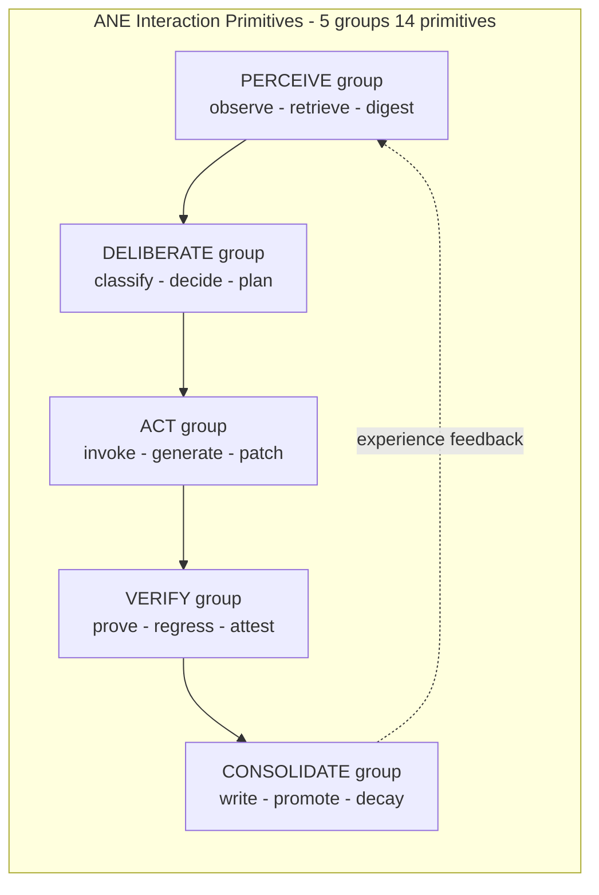

### 14.2 Primitive definition table

| Group | Primitive | Semantics | Determinacy level | Composable |
|---|---|---|---|---|
| Perceive | `observe` | collect runtime signals and exceptions | D0 | Yes |
| Perceive | `retrieve` | retrieve relevant memories from the experience store | D1 | Yes |
| Perceive | `digest` | compress raw context into a feature digest | D1 | Yes |
| Deliberate | `classify` | grade the problem by D0–D3 | D0 | Yes |
| Deliberate | `decide` | Cerebellum local adjudication or escalation to Main Brain | D1 | Yes |
| Deliberate | `plan` | generate a multi-step action plan | D3 | Yes |
| Act | `invoke` | call an external tool (under MCP contract) | D2 | Yes |
| Act | `generate` | generate code/text/patch draft | D3 | Yes |
| Act | `patch` | land a minimal modification in the semantic layer | D1 | No (verification prerequisite) |
| Verify | `prove` | symbolic-track equivalence proof | D0 | Yes |
| Verify | `regress` | statistical-track regression verification | D0 | Yes |
| Verify | `attest` | generate an auditable credential and write to ledger | D0 | Yes |
| Consolidate | `write` | write an experience record (after verification) | D1 | Yes |
| Consolidate | `promote` | promote experience to a Cerebellum rule | D1 | No (requires high confidence) |
| Consolidate | `decay` | experience decay and archiving | D1 | Yes |

### 14.3 Primitive composition rules

1. **Type consistency**: primitive output types must match downstream input types (feature vectors, credentials, patches, judgments).
2. **Side-effect isolation**: `invoke`/`patch` are side-effect primitives and must carry an `attest` credential in pairs.
3. **Verification cannot be skipped**: before any `patch`, there must be passing records of `prove` and `regress`.
4. **Escalation is traceable**: the jump from `generate` (D3) to `patch` (D1) must leave a complete primitive chain for replay audit.

**Primitive encoding of Dual-Fold Collaboration (cf. 13.4)**: Fold 1's "cognitive summary" is produced by the `digest → retrieve → prove/regress` combination, stopping at `attest` (evidence credential) without landing; Fold 2's "intent binding" is a human-in-the-loop deterministic authorization write whose product is a credential bound to a specific action, after which `invoke`/`patch` is permitted. Thus a complete controlled chain is:

```
observe → digest → retrieve → decide(candidate) → prove+regress
        → attest(Fold 1 cognitive summary) → [human intent binding] → invoke/patch → attest(Fold 2 authorization) → write
```

> Key constraint: `attest` appears once in each fold with different semantics — the former is "machine self-attests evidence," the latter is "human grants authority"; the absence of either is a bypass of the dual-fold pattern.

> NTP (Neural Transmitter Protocol) is essentially the standardized payload format of the `digest → decide → plan` primitive group.

---

## Chapter 15: Tool Ecosystem: MCP and Capability Integration Specification

### 15.1 Why a standard protocol rather than private glue is mandatory

Private tool integration leads to semantic fragmentation, hidden risk surfaces, masked failures, and an inability to accumulate an ecosystem. ANE requires tool integration to go through a **contractual protocol layer**, unifying capability discovery, permission negotiation, and audit tracing.

### 15.2 Three-part architecture and ANE organ mapping

| MCP role | Responsibility | Counterpart in ANE |
|---|---|---|
| **Host** | hosts the agent, holds the model, enforces security policies and user authorization | Sovereignty adjudication layer + Immune System |
| **Client** | maintains a 1:1 session with a single Server, performs capability negotiation and message routing | Cerebellum local scheduling |
| **Server** | exposes tools/resources/prompts, focused on a single capability | capability unit callable by Main Brain / Cerebellum |

**Core principle**: the Host never touches tools directly; all access goes through a negotiated contract; the Server must not read the full session and must not "see" other Servers.

### 15.3 Capability negotiation and four primitive groups

| Primitive category | Representative operations | Description |
|---|---|---|
| Server · Tools | `tools/list` · `tools/call` | executable functions that change external state |
| Server · Resources | `resources/list` · `resources/read` | context data sources (documents, configuration, records) |
| Server · Prompts | `prompts/list` · `prompts/get` | reusable interaction templates |
| Client · Sampling | `sampling/createMessage` | Server requests the Host to perform model inference (reverse call) |
| Client · Elicitation | `elicitation/create` | Server requests supplementary information or confirmation (corresponds to the judgment layer) |
| Client · Logging | `logging/*` | structured logs for audit |

**Capability negotiation**: during the initialization handshake both parties declare capabilities; undeclared capabilities may not be used; incompatible protocol versions must terminate the connection. This directly corresponds to ANE's "least privilege" principle.

### 15.4 Tool contracts and dual validation

- Each tool declares its input via JSON Schema and **must** use `additionalProperties: false`, rejecting unexpected fields.
- The Host validates agent parameters before sending; the Server validates again before execution — **dual-defense redundancy**.
- Descriptions from untrusted Servers must not be treated as automatically trustworthy or safe.

### 15.5 Tool security annotations → D0–D3 mapping

| Annotation | Meaning | ANE authorization requirement |
|---|---|---|
| `readOnlyHint` | does not change external state | L0 automatic release (D3 read) |
| `idempotentHint` | repeated calls yield the same result | automatic retry after L1 review |
| `destructiveHint` | has permanent impact | L2 strong authorization + rollback snapshot |
| `openWorldHint` | accesses external data that may contain arbitrary instructions | treat as untrusted input, guard against injection |

### 15.6 Integration gates

Before any new tool is integrated, it must pass:

1. **Contract review**: complete Schema, clear capability declaration, explicit transport mode (local process / remote HTTP).
2. **Least privilege**: grant only the minimum scope needed to complete the task; remote Servers should use OAuth 2.1 + PKCE with short-lived rotating tokens.
3. **Boundary declaration**: filesystem-type tools must declare allowed workspace boundaries (roots); the boundary itself is not a complete security boundary and still requires Host-policy backstop.
4. **Immune verification**: tool calls are incorporated into the dual-track verification chain; side-effect calls must generate an `attest` credential.

---

## Chapter 16: Multi-Agent Collaboration Protocol

### 16.1 Two complementary protocols

| Protocol | Layer | What it solves | ANE mapping |
|---|---|---|---|
| Tool-context protocol (e.g., MCP) | agent ↔ tool | capability discovery, tool calls, context exchange | Chapter 15 |
| Agent-to-agent protocol (e.g., A2A) | agent ↔ agent | capability advertising, task delegation, long-task state | this chapter |

### 16.2 Agent card and task lifecycle

- **Capability advertising (Agent Card)**: declares skills, endpoints, and authentication methods in a structured document for discovery by others.
- **Task state machine**: created → working → input required → completed / failed / cancelled.
- **Interaction tenses**: fast synchronous calls, long-task streaming subscriptions, and fully asynchronous webhook notifications coexist.
- **Opaque execution**: collaborators need not expose internal thoughts, plans, or tools, exchanging only context, state, instructions, and data — protecting implementation privacy, while task metadata must remain auditable.

### 16.3 Collaboration discipline

1. **Single responsibility**: each agent focuses on a clear capability, composable and replaceable.
2. **Observable communication**: all inter-agent messages must pass through an observable bus; untraceable peer-to-peer is forbidden.
3. **Human sovereignty penetration**: cross-agent task delegation may not bypass tiered authorization; delegation touching D0/D1 or production must return to human adjudication.
4. **Conflicts adjudicable**: when multi-agent conclusions conflict, gate verification results and human judgment are the final arbitration; "majority vote" does not replace truth.
5. **Scarce resources must queue**: when multiple agents share the same Main Brain quota, a unified scheduling unit must arbitrate (urgency + budget); connecting to the remote service independently and bypassing quota is forbidden (see 5.5).

---

## Chapter 17: Security and Trust Boundaries: OWASP Alignment

### 17.1 Three trust boundaries

| Boundary | Content | Corresponding risk |
|---|---|---|
| **What the model reads** | user input, retrieved documents, tool results, web content | prompt injection, system prompt leakage |
| **What the model learns** | training data, fine-tuning sets, vector stores | data poisoning, vector and embedding weaknesses |
| **What the model can do** | output handling, tool permissions, autonomous action | improper output handling, excessive agency |

**Core principle**: everything the model reads is treated as potentially adversarial input; every model output must be verified before use; every action is confined to the minimum blast radius.

### 17.2 Top ten risks → ANE countermeasure matrix

| Risk (common industry list) | ANE countermeasure | Organ primarily responsible |
|---|---|---|
| Prompt injection | external content treated as untrusted; tool annotations distinguish open-world data; least agency | Immune + Sovereignty |
| Sensitive information disclosure | access control on retrieval, secret isolation at construction, output redaction | Hippocampus + Immune |
| Supply chain | tools / Servers / dependencies must have contracts and provenance reviewed | Immune |
| Data and model poisoning | experience writes must be verified; full lineage recorded | Hippocampus |
| **Memory-promotion poisoning** (experience → global rule) | **Promotion Audit**: N consecutive independent reproductions + human engineer signature endorsement (see 24.3), preventing AI inbreeding from corrupting rules | Immune + Sovereignty + Hippocampus |
| Improper output handling | mandatory validation before output to Shell/SQL/browser | Immune |
| Excessive agency | least agency: grant only the autonomy and tools needed; time-limited permissions | Sovereignty + Immune |
| System prompt leakage | no secrets in prompts; assume extractability | Sovereignty |
| Vector and embedding weaknesses | mandatory per-user access control on retrieval; guard against embedding inversion | Hippocampus |
| Misinformation | explicit uncertainty; review step for high-risk answers | Main Brain + Immune |
| Unbounded consumption | budget caps, rate limits, timeouts, cost alerts | Cost governance (Chapter 18) |

### 17.3 Least Agency principle (Least Agency)

- An agent's autonomy, tool set, permission scope, and validity period are all **task-level and time-limited**.
- Permissions are automatically reclaimed when the task ends or times out.
- Destructive or money-related actions always require explicit human confirmation.
- This principle aligns with Axiom 5 (human sovereignty) and is its concretization in the security domain.

---

## Chapter 18: Cost Governance and Context Engineering

### 18.1 Three budget gates

| Gate | Constraint | Trigger action |
|---|---|---|
| Token budget | per-call / per-task token cap (see NTP `budget_hint`) | compress context on overrun or escalate to human |
| Time budget | per-step latency cap, total task duration cap | timeout degrades to local adjudication |
| Monetary budget | per-task cost cap | circuit break and alert |

### 18.2 Context engineering strategies

1. **Compression**: the `digest` primitive transmits only features and digests, not full text.
2. **Caching**: prompt caching for stable prefixes and high-frequency knowledge, avoiding repeated billing.
3. **Subtask isolation**: sub-agents use fresh contexts and return only digests, preventing context bloat.
4. **Retrieval instead of stuffing**: use RAG to fetch on demand rather than stuffing all material into the prompt.
5. **Experience promotion**: consolidate high-frequency conclusions into Cerebellum rules, permanently removing LLM calls.

### 18.3 Cost observability

- Record token consumption, latency, cost, and memory-hit status for every decision.
- Use "Cerebellum interception rate," "memory hit rate," and "token-per-decision ratio" as first-class operational metrics (see Chapter 12).
- Cost anomalies (denial-of-service-style consumption / wallet attacks) are incorporated into alerts and circuit breaking.

### 18.4 Prompt Asset Governance

> Prompts are the Main Brain's "operating surface" and the primary injection attack vector. They must be treated like code: versioned, owned, evaluated, and reversible.

- **Prompts are artefacts**: templates enter version control with a stable ID, version, owner, applicable scenarios, expected output format, and prohibited items; generating critical prompts by runtime string concatenation is forbidden.
- **Layering and freezing**: system prompts, task templates, and context fragments are managed separately; factual prefixes reference the frozen glossary (35.3) and verified Cerebellum rules and **may not be freely rewritten by the model**.
- **Injection guard**: content from external documents, tool returns, and memory retrieval is marked "untrusted data" and enters only as data, never elevated to instructions; detected override attempts are rejected and recorded (17.2).
- **Change evaluation**: template changes pass the same dual-track verification and regression sampling as code; pre/post output differences enter the ledger, and any security or cost regression triggers a rollback.
- **Cost linkage**: template token occupancy counts against the budget gate (18.1); redundant prefixes go to cache and repeated conclusions are promoted into Cerebellum rules (18.2).

---

## Chapter 19: Sublation of Traditional Software Engineering

### 19.1 Virtues that must be inherited (not to be discarded)

| Traditional virtue | Position in ANE |
|---|---|
| Strong typing and formal methods | foundation of Axiom 1's static bedrock and symbolic-track verification |
| Version control and traceability | prerequisite for experience lineage, ledger, and replay |
| Automated testing and regression | core means of the immune statistical track |
| CI/CD and quality gates | engineering carrier of the gate responsibility chain |
| Code review | concrete form of the judgment layer + human sovereignty |
| Modularity and separation of concerns | source of the seven organs and the single-capability principle |
| Immutable infrastructure and rollback | foundation of "rollbackable" in self-repair's threefold insurance |

### 19.2 Vices that must be overcome

| Traditional vice | How ANE overcomes it |
|---|---|
| Long change cycles, slow feedback | the flywheel makes running equal development, shortening the feedback loop |
| Maintenance as "debt repayment," rot on arrival | self-repair + experience promotion make the system stronger with use |
| Deterministic assumptions cannot handle open environments | Main Brain handles the unknown; immune filtering consolidates it into determinacy |
| Human-machine split (development/operations separation) | unified development and maintenance, with humans adjudicating at the center |
| Large amounts of glue code and duplicated labor | primitive composition + tool protocol reuse |
| Change risk relying on "human carefulness" | gates + dual-track verification + tiered authorization institutionalized |

### 19.3 Sublation principle

> **Retain the deterministic "bone," replace the rigid "shell."** Whatever can be proven continues to use traditional engineering means; whatever must adapt to openness is augmented with agents; between the two, immune gates and human sovereignty are always the boundary. ANE is the evolved state of traditional software engineering, not a replacement.

---

## Chapter 20: Organizational Governance and Compliance Alignment

### 20.1 Mapping of the four governance functions (aligned with NIST AI RMF)

NIST AI RMF 1.0 proposes four functions — GOVERN / MAP / MEASURE / MANAGE — which ANE maps item by item onto its organs:

| RMF function | Connotation | ANE organ | Landing point in this specification |
|---|---|---|---|
| **GOVERN** | risk culture, policies, role accountability, third-party risk | Human Sovereignty layer | Axiom 5, tiered authorization in Chapter 9, RACI in 20.3 |
| **MAP** | establish system context: purpose, users, capability boundaries, possible impacts | Skeleton + Main Brain | problem statement in Chapter 0, D0–D3 grading, NTP constraints |
| **MEASURE** | quantitative/qualitative assessment, benchmarks, monitoring trustworthiness characteristics | Immune System + cost governance | KPIs in Chapter 12, dual-track verification in Chapter 7, cost observability in Chapter 18 |
| **MANAGE** | prioritized response, go/no-go, incident response, decommissioning, continuous improvement | Self-Repair + full flywheel | self-repair in Chapter 8, flywheel in Chapter 10, circuit breaking in Chapter 21 |

**Requirement**: any organization claiming ANE conformance must be able to draw a map of these four functions to its own processes — missing any function means "organs without governance."

### 20.2 Regulatory alignment (referencing the EU AI Act and others)

| Regulatory requirement (referencing the EU AI Act) | ANE mechanism | Evidence material |
|---|---|---|
| **Risk-based regulation** | D0–D3 determinacy grading + maturity L0–L5 | grading ledger, maturity assessment form |
| **Lifecycle risk management** | six flywheel stages + mutate–verify–consolidate | primitive-chain trace, experience-store lineage |
| **Technical documentation and log retention** | `attest` credentials + full-spectrum white-box ledger | tamper-proof audit logs, AI-BOM (see Chapter 22) |
| **Human oversight (Art.14)** | Axiom 5 + tiered authorization + global circuit breaker | authorization credentials, stop-button drill records |
| **Accuracy, robustness, cybersecurity** | dual-track verification + OWASP alignment | symbolic-track proofs, statistical-track regression reports |
| **Automation-bias protection** | human factors in Chapter 23 | judgment-layer design, review sampling records |

**Domestic regulatory alignment (China)**:

| Domestic regulation / standard | Core requirement | ANE mechanism | Evidence material |
|---|---|---|---|
| **Data Security Law** | data classification and grading, whole-process records, risk monitoring and response | three-tier information grading (N/E/P), experience-record `lineage` chain, global white-box ledger | data grading inventory, primitive-chain trace, tamper-proof audit logs |
| **Personal Information Protection Law** | informed consent, data minimization, right to erasure | Least Agency principle (17.3), redaction before write, delete-by-source with cascade (24.4) | authorization credentials, redaction records, erasure deletion credentials |
| **Multi-Level Protection Scheme 2.0 (Level 3)** | identity authentication, access control, security auditing, data integrity and confidentiality | stable ID and AI-BOM (Chapter 22), per-user access control (24.2), dual-track verification, full-spectrum white box | identity ledger, access logs, symbolic-track proofs and statistical-track regression reports |
| **Generative-AI traceability / controllability** | generated-content labeling, process traceability, human intervention | Axiom 5 Human Sovereignty + Axiom 6 Anti-Self-Deception: `attest` credentials, tiered authorization, global circuit breaker, silent failures = 0 | authorization credentials, circuit-breaker drill records, complete primitive-chain trace |

> **Why "Human Sovereignty + Anti-Self-Deception" satisfies domestic regulatory hard requirements**: the core domestic demand on generative AI is "traceable and controllable." **Axiom 5 (Human Sovereignty)** ensures every dynamic mutation requires explicit human authorization, is subject to veto and a global circuit breaker — corresponding to "controllable"; **Axiom 6 (Anti-Self-Deception)** ensures the whole process is white-box and logged, silent failures are zero, and conclusions are replayable — corresponding to "traceable." These are not documents added after launch but execution disciplines built into the primitive chain and gates, making regulatory evidence a natural byproduct of the system.

**ISO/IEC 42001 AI Management System alignment**

| Management-system element | ANE's corresponding mechanism | Evidence |
|---|---|---|
| AI policy and objectives | Axiom system + one-page summary + maturity L0–L5 | Charter, objective ledger, maturity assessment |
| AI risk and impact assessment | 20.4 risk register + 20.2 tiered alignment + FMEA (21.2) | Risk register, FMEA table, tiering ledger |
| AI lifecycle process control | Flywheel six stages (10.1) + five-step algorithm (10.4) + G1–G7 | Primitive-chain trace, gate records, projection consistency report |
| Data and model supply-chain governance | Carrier governance (5.6) + AI-BOM (22.3) + Promotion Audit (24.3) | Model cards, AI-BOM, promotion endorsement signatures |
| Monitoring, measurement, evaluation | Metrics (12.1) + observability (28.x) + conformance assessment (26.x) | KPI dashboards, event ledger, ANE-CONF records |
| Management review and continual improvement | Meta-specification flywheel (25.2) + design review records + evolution planning | Review records, audit conclusions, iteration traces |
| Incident and nonconformity handling | Incident response and blameless postmortem (21.5) + global circuit breaker (21.1) | Incident reports, postmortems, circuit-breaker drill records |

> **The substance of alignment**: ISO 42001 requires "a system, evidence, and improvement." ANE writes the system into primitive chains and gates, makes evidence a natural byproduct of projection, and entrusts improvement to the flywheel — alignment is not an added manual but the system's native way of operating.

> **Temporal facts** (per the 2026-08 Digital Omnibus revision): EU AI Act obligations for GPAI have applied since 2025-08; core obligations such as Art.14 human oversight and transparency since 2026-08; Annex III high-risk obligations from 2027-12 and Annex I from 2028-08. **ANE front-loads these obligations as built-in engineering capabilities rather than adding documentation after launch.**

### 20.3 Responsibility matrix (RACI)

| Activity | Living system / Cerebellum | Main Brain | Immune | Human sovereignty | Governance committee |
|---|---|---|---|---|---|
| D0/D1 change approval | C | R (proposal) | C | **A** | I |
| Routine adjudication (D2/D3) | **R/A** | I | C | I (after-the-fact audit) | I |
| Gate rule formulation | I | I | R | C | **A** |
| Memory store admission review | C | R | **A** | I | I |
| Circuit breaker trigger and recovery | R | I | C | **A** | I |
| Compliance evidence | C | I | R | C | **A** |

> R = Responsible · A = Accountable · C = Consulted · I = Informed. **Key principle: the Main Brain never holds A (ultimate responsibility); A belongs to humans or the governance committee.**

### 20.4 Risk register

Every ANE system must maintain a living risk register with at least these fields: risk description, trust boundary (see Chapter 17), determinacy level, probability × impact, responsible organ, owner, status, and review date. The register itself is placed under version control and traceability.

---

## Chapter 21: Fail-Safe and Graceful Degradation

### 21.1 Mandatory clauses

- **Clause 26 (Fail-Safe Default State)**: when any organ fails, the system must automatically retreat to a **predefined fail-safe state** — the skeleton foundation remains intact, no side-effect writes occur, and external services continue in degraded mode; **"fully automatic while broken" is absolutely forbidden**.
- **Clause 27 (Global Circuit Breaker)**: the system must provide a **global stop switch** that humans can trigger at any time, freezing all self-repair, tool calls, and Main Brain awakenings within one minute and locking the system at the most recent verified steady state. This aligns with the EU AI Act Art.14 stop-button requirement and cannot be bypassed by any automation.

### 21.2 Organ-level failure mode analysis (FMEA)

| Organ | Failure mode | Impact | Detection signal | Degradation action |
|---|---|---|---|---|
| Skeleton | type/semantic foundation corrupted | catastrophic | consistency check failure | roll back to latest steady state + refuse external service |
| Cerebellum | rule base failure / misjudgment | high-frequency decision errors | interception rate drops sharply, more escalations | degrade to conservative rules + restricted Main Brain |
| Main Brain | hallucination / timeout / unavailability | wrong candidate proposals | first-pass gate rate drops sharply | reject its output, fall back to local adjudication |
| Hippocampus | memory pollution / retrieval failure | negative flywheel | abnormal hit rate, missing lineage | freeze writes, switch to empty-memory mode |
| Immune | gate bypass / missed detection | contamination enters mainline | ledger gap, abnormal two-person spot check | reject all changes, enter read-only |
| Self-Repair | online repair failure | runtime corruption | rollback rate rises, checkpoint anomaly | automatic rollback + stop self-repair |
| Sovereignty | authorization chain failure | unauthorized changes | side-effect calls without credentials | reject all side effects, human takeover |

### 21.3 Graceful degradation ladder

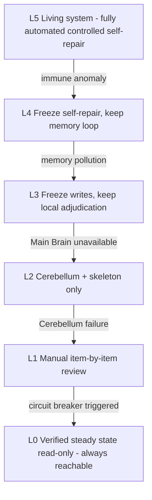

**Iron law**: degradation is **one-way tightening**, **automatically triggered**, and **manually accelerated by humans**; upgrading back to a higher level must re-run immune verification and authorization and may not automatically rise.

### 21.3b Two-brain extreme states

| Extreme state | Detection signal | Mandatory action | Still guaranteed |
|---|---|---|---|
| **Main Brain unreachable** (network cut / timeout / quota exhausted) | consecutive uplink timeouts, failed health probes | Cut every escalate path, fall back to L2 "Cerebellum + static skeleton only", reject all mutation-class changes | Core business survives; routine transactions ≥80% available (4.4) |
| **Memory store contaminated** (poisoning / broken lineage / retrieval anomalies) | abnormal hit rate, source verification failure, failed promotion audit | Freeze all **experience-promotion** writes, degrade to "memoryless state", use local hard rules only | Read-only availability; already-promoted rules must be re-traced to source, suspicious ones demoted |

> Neither extreme state permits "escalating while sick" — when the Main Brain is unreachable, repeated uplinks only drag latency into an avalanche; when memory is contaminated, still reading it only spreads the contamination into the judgment layer.

### 21.4 Circuit breaker drills

The global circuit breaker must be drilled regularly like a fire drill, recording trigger latency, correctness of the locked steady state, and recovery procedure. A circuit breaker never drilled is considered nonexistent.

### 21.5 Incident Response and Blameless Postmortem

> "No overnight bad news" (10.5) is a reporting discipline; this section covers what happens after the report — how an incident becomes an evolution. Honest reporting without postmortem only creates ledger noise.

- **Severity and clocks**: classify by D0–D3 and business impact; each tier defines deadlines for detection, confirmation, containment, and recovery. Exceeding a deadline automatically escalates to human sovereignty; "still investigating" is not grounds for silent delay.
- **Five response steps (order inviolable)**: detect (observability alerts) → contain (circuit breaker / degradation; stop the bleeding before diagnosing) → root cause (replay the primitive-chain trace, never guess) → recover (return to the latest verified steady state) → postmortem (blameless, time-boxed, with deliverables).
- **Blameless principle**: postmortems target mechanisms, not individuals; timely reporting with complete traces is not grounds for blame. **Concealment, delayed reporting, and ledger tampering are red lines** — judged as "contamination" under 10.5.
- **Mandatory outputs**: timeline, root cause, why the gate failed to intercept, corrective action, accountable owner, review date. Corrective action must be one of a new rule (promotion), a new gate, or a new parameter — "be more careful" is not an acceptable, verifiable output.
- **Flywheel integration**: postmortem records enter the experience store (Chapter 6) and trigger the Promotion Audit (24.3); recurrence of the same root cause is a flywheel failure and forces a review of promotion thresholds and gate effectiveness.
- **Drill linkage**: circuit-breaker drills (21.4) must yield at least one postmortem in the prescribed format per quarter; a drill without one counts as incomplete.

---

## Chapter 22: Identity, Namespaces, and Traceability

### 22.1 Stable identification system

All first-class citizens must have globally unique, stable, resolvable identifiers (URN style, examples):

| Object | Identifier format | Example |
|---|---|---|
| Rule | `urn:ane:rule:<domain>:<seq>@<semver>` | `urn:ane:rule:sched:114@2.1.0` |
| Experience | `urn:ane:exp:<domain>:<hash>` | `urn:ane:exp:core:9f3a…` |
| Primitive call | `urn:ane:op:<type>:<trace-id>` | `urn:ane:op:patch:t-8c21` |
| Gate | `urn:ane:gate:<track>:<seq>@<semver>` | `urn:ane:gate:symbol:03@1.4.0` |
| Agent | `urn:ane:agent:<role>:<instance>` | `urn:ane:agent:brain:prod-01` |
| Steady-state snapshot | `urn:ane:snap:<system>@<digest>` | `urn:ane:snap:core@sha256:…` |

**Requirement**: once published, an identifier may not be reused; a content change must produce a new versioned identifier; `trace-id` runs through an entire primitive chain.

### 22.2 Semantic versioning

Rules, experience templates, gate definitions, tool contracts, and model prompts — every evolvable artefact — must carry semantic version `MAJOR.MINOR.PATCH`:

- **MAJOR**: incompatible change (judgment criteria changed, output type changed) → all dependents must be re-verified;
- **MINOR**: backward-compatible capability addition;
- **PATCH**: semantic-neutral fix.

### 22.3 AI-BOM (AI Bill of Materials)

Every living system must maintain an AI-BOM registering "what it is made of":

| Category | Registered content |
|---|---|
| Model | model name, version, provenance, license, capability boundary |
| Data / memory | experience-store snapshot version, retrieval index version, data sources and authorization |
| Tools | tool Server list, versions, permission annotations, contract digests |
| Rules | Cerebellum rule-set version, promotion provenance |
| Prompts | system prompt version, template version |

**Use**: when a supply-chain incident occurs (a model or tool is found vulnerable), affected systems can be located within minutes — this is the engineered antidote to the OWASP "supply chain" risk.

### 22.4 Configuration as code

Gate rules, authorization policies, degradation ladders, and circuit-breaker thresholds are all incorporated into version control and dual-track verification as code; **existing only in someone's head or an admin configuration page is forbidden**. Configuration changes go through the same immune chain as code changes.

---

## Chapter 23: Human Factors and Cognitive Engineering

### 23.1 Mandatory clauses

- **Clause 28 (Anti-Automation Bias)**: the judgment layer must proactively present "where the system is uncertain, possible errors, and rejected alternatives" rather than only a single seemingly authoritative conclusion. This aligns with the EU AI Act Art.14 explicit requirement to guard against automation bias.
- **Clause 29 (Adjudication Challengeable)**: humans must be able to view the evidence chain of any AI conclusion with one click (NTP payload, memory hits, gate results) and overturn it; the overturn record enters the experience store as a negative sample.

### 23.2 Cognitive load and alert governance

| Anti-pattern | Consequence | ANE constraint |
|---|---|---|
| Alert flood | alert fatigue, real risks ignored | tiered aggregation of alerts; L0 automatic items do not disturb humans |
| Pop-up every time | authorization fatigue, humans click "agree" with eyes closed | batch processing by authorization level; only L2 requires explicit confirmation |
| Only good news, no bad | automation bias, humans lose judgment | mandatory display of confidence, failure cases, alternatives |
| Unexplainable urgency | humans cannot make responsible judgments in time | key adjudications must have a "pause" option; no countdown pressure |

### 23.3 Skill retention

Highly automated systems degrade human operators' skills, leaving them unable to take over during rare failures. ANE requires:

- regular "no-AI drills": humans handle simulated failures manually with Main Brain/self-repair disabled;
- rotation training for key roles to maintain direct understanding of the foundation;
- mandatory human post-mortem after circuit-breaker recovery; no "system self-repaired, so it never happened."

### 23.4 Authority-responsibility consistency

The person granted adjudication authority must have corresponding capability and time guarantees. **A "veto power" without sufficient information and time is fake sovereignty** — the organization must invest presentation quality and human resources in the judgment layer commensurate with the risk level.

---

## Chapter 24: Multi-Tenancy and Memory Boundaries

### 24.1 Memory partitions

| Partition | Visibility | Write permission | Purpose |
|---|---|---|---|
| **Global public zone** | read-only for all tenants | write after governance committee review | general deterministic experience, security patches |
| **Tenant private zone** | only that tenant | write after that tenant's immune verification | business-specific experience |
| **Project isolation zone** | only that project | write after that project's immune verification | project-specific context |
| **Temporary sandbox zone** | creator | verification-free but non-promotable | tentative experience, burned on expiry |

**Red line**: without explicit authorization, no experience may be written or read across tenants; sandbox experience **can never** be directly promoted to a Cerebellum rule.

### 24.2 Access control on retrieval

- Retrieval augmentation (RAG) must carry tenant/project context as a mandatory filter; "recall from the whole store" is forbidden.
- Cross-zone retrieval requires an explicitly declared purpose and a trail.
- Vector embeddings must guard against inversion and membership inference (aligning with the vector-weakness risk in Chapter 17).

### 24.3 Memory isolation verification and Promotion Audit

When the Immune System admits experience to the store, in addition to content verification it must also verify **boundary compliance**: source tenant, authorization credential, and target partition must be consistent; otherwise the write is rejected and an alert is raised.

On top of this, any experience promoted from a "private zone / sandbox zone" to a "global Cerebellum rule" must additionally pass a **Promotion Audit** — the last immune gate on the main highway of the flywheel:

- **Mandatory requirement (Promotion Audit)**: promotion must satisfy three hard conditions simultaneously, none of which may be omitted:
  1. **N consecutive independent reproductions**: the same benefit must be reproduced across N mutually independent run cycles / environments / evaluators, with N set by the governance committee by risk level (recommended N ≥ 3); "independent" means at least two of data source, execution environment, and verifying subject differ, preventing a single model from "self-endorsing."
  2. **Human engineer signature endorsement**: at least one authorized human engineer must review the reproduction evidence and sign; the Main Brain (LLM) may never self-sign a promotion. Signatures count toward RACI (see 20.3) and are traceable to a specific natural person.
  3. **Anti-inbreeding check**: examine the correlation between the experience and its "ancestor experiences / homologous variants"; if the promotion basis is highly dependent on homologous samples (near self-reference), it is judged as inbreeding and rejected, downgraded to "under observation."
- **Audit credential**: every promotion generates an independent credential recording the experience ID, the N-reproduction evidence chain, the endorser's signature, and the correlation-check result, written to a tamper-proof ledger for post-hoc review and regulatory evidence.
- **Degradation linkage**: if corruption is discovered after promotion, it must be possible to roll back to the pre-promotion state with one action and cascade-invalidate all downstream rules derived from it (aligning with the cascade cleanup of the right to be forgotten in 24.4).

> **Why this is mandatory**: Chapter 17 lists "data and model poisoning" as a risk, but this system's unique attack surface is "promotion" — an attacker can induce the Cerebellum to solidify a wrong experience into a global instinct, far more damaging than a single wrong output. The Promotion Audit, through "independent reproduction + human endorsement + anti-inbreeding," demotes AI self-promotion from "trusted" to "must be proven," upholding Axiom 5 (human sovereignty) and Axiom 6 (anti-self-deception).

### 24.4 Redaction and the right to be forgotten

- Experience records must be redacted before writing (keys, personal data, commercially sensitive information).
- Support deletion by source (right to be forgotten) — deletion must cascade-clean vector indexes and derived rules and record a deletion credential.

---

## Chapter 25: Meta-Specification: Governance and Evolution of the Specification Itself

### 25.1 Three-layer structure

| Layer | Content | Mutability |
|---|---|---|
| **Axiom layer** | seven axioms of Chapter 1 | **immutable** (constitutional red line); change requires v2.0-level consensus |
| **Clause layer** | mandatory clauses and organ specifications in each chapter | evolvable, must go through proposal–verification–approval–version bump |
| **Guide layer** | implementation suggestions, examples, patterns | freely replaceable, follows best-practice updates |

**Principle**: the lower may not violate the higher. Any new clause conflicting with an axiom is rejected outright.

### 25.2 Revision process (an instance of the specification flywheel)

Every revision of the specification itself runs through one ANE flywheel:

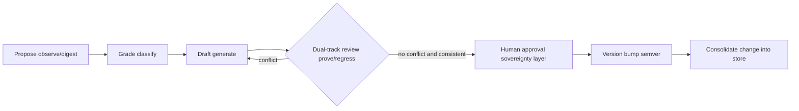

### 25.3 Compatibility commitments

- **PATCH**: no change to clause semantics (errata, wording); old implementations remain compliant;
- **MINOR**: new clauses or capabilities, without breaking existing compliance;
- **MAJOR**: changes to axiom or clause semantics, requiring a migration guide and comparison table.

### 25.4 Self-application

The specification's iteration process is an instance of the meta-specification: every round of "modify → verify → record," every round leaves a trail in the experience store, both versions are synchronized, and red lines remain unbroken. **However the specification requires living systems to evolve, it requires itself to evolve in the same way** — this is the ultimate proof of ANE's self-consistency.

### 25.5 Constitutional red lines

The following three points constitute the "constitution" of ANE and may not be deleted or altered by any version, any organization, or any efficiency rationale:

1. **Human sovereignty is inalienable** (Axiom 5);
2. **Anti-self-deception, silent failures = 0** (Axiom 6, Clause 7);
3. **The global circuit breaker is always reachable** (Clause 27).

---

## Chapter 26: Conformance Assessment Framework (ANE-CONF)

### 26.1 Why a conformance framework is mandatory

The more requirements a specification has, the more it needs an operable ruler. ANE-CONF (ANE Conformance Framework) provides **graded, auditable, reproducible** conformance determination, making "ANE conformant" an evidenced fact rather than marketing language. It aligns with the conformity-assessment thinking of NIST AI RMF and the EU AI Act for high-risk systems.

### 26.2 Three conformance levels

| Level | Name | Criterion | Applicability |
|---|---|---|---|
| **ANE-C1** | Principle conformance | all seven axioms + D0–D3 grading landed + full-spectrum white-box ledger | internal pilots, early projects |
| **ANE-C2** | Mechanism conformance | C1 + Cerebellum interception rate ≥80% + memory loop effective + dual-track all green + circuit-breaker drill passed | production systems, internal delivery |
| **ANE-C3** | System conformance | C2 + organizational governance (RACI/risk register) + compliance alignment + observability + migration and testing discipline + third-party audit | external certification, highly regulated industries |

### 26.3 Assessment methods (four evidence types)

| Evidence type | Means | Output |
|---|---|---|
| **Document review** | evidence clause by clause against mandatory clauses of each chapter | conformance matrix (clause → evidence → conclusion) |
| **Configuration review** | check whether gate rules, authorization policies, and circuit-breaker thresholds are code | configuration-as-code verification report |
| **Behavioral review** | run primitive-chain traces, replay attack/exception scenarios | primitive-chain execution trace + replay report |
| **Operational review** | collect KPIs (interception / hit / rollback / silent-failure counts) | periodic metric snapshots |

### 26.4 Self-assessment questionnaire (minimal set)

1. Is there a D0 static foundation untouchable by AI? (Axiom 1)
2. Are routine decisions completed without an LLM? (Axiom 3)
3. Is every success/failure structured into the store with promotable experience? (Axiom 4)
4. Are there human veto and a global circuit breaker? (Axiom 5 / Clause 27)
5. Are silent failures eliminated and the ledger replayable? (Axiom 6)
6. Must AI output pass dual-track verification before landing? (Axiom 7)
7. Does the system automatically retreat to a fail-safe state on failure? (Clause 26)

> **Red-line veto**: any answer "no" disqualifies the system from ANE-C1 or above.

### 26.5 Continuous conformance

Conformance is not a one-time certification but a **continuous state**: KPIs falling below thresholds, failed circuit-breaker drills, or any silent failure all trigger conformance downgrade and alerts. This embodies the flywheel of Chapter 10 and the meta-specification of Chapter 25 — **conformance itself is a vital sign requiring continuous maintenance**.

---

## Chapter 27: Migration and Adoption Path

### 27.1 Three adoption principles

1. **Evolution, not revolution**: start from localized high-value scenarios; no full-system rewrite.
2. **Solidify before intelligent**: first converge the static foundation and determinacy (L0→L1), then add the Cerebellum (L2).
3. **Every step rollbackable**: each migration stage has an explicit rollback point; failure returns to the previous steady state.

### 27.2 Six-step migration path


| Step | Action | Entry condition | Exit verification | Corresponding level |
|---|---|---|---|---|
| 1 Map | inventory determinacy boundaries, AI touchpoints, data flows | — | produce boundary map | L0 |
| 2 Solidify foundation | define immutable D0 core, add type/state-machine/compatibility tests | boundaries clear | foundation provable | L0→L1 |
| 3 Build Cerebellum | sink high-frequency rules from the LLM into local rules/state machines | foundation stable | interception rate ≥80% | L1→L2 |
| 4 Build memory loop | connect experience store, read-only retrieval first then verified writes | Cerebellum in place | same problem no longer asked of Main Brain | L2→L3 |
| 5 Install immune and circuit breaker | dual-track verification gates + global circuit breaker + FMEA drill | memory effective | circuit-breaker drill passed | L3→L4 prerequisite |
| 6 Enable self-repair and flywheel | semantic-layer online repaires, fully automated flywheel loop | immunity mature | self-repair success rate met | L4→L5 |

### 27.3 Anti-migration patterns (pitfalls)

| Anti-pattern | Consequence | Correct practice |
|---|---|---|
| Start with fully automatic LLM | hallucination enters mainline, cost explosion | solidify foundation + Cerebellum first |
| Self-repair without a foundation | online repair without rollback point = disaster | do steps 2, 3, 5 before step 6 |
| Pollute experience store before governance | negative flywheel, increasingly wrong | write only after verification (Axiom 4) |
| One-shot full migration | uncontrollable risk surface | canary-style small-step gradual rollout (see 27.4) |
| Treat ANE as a tool purchase | buying a platform ≠ landing the paradigm | build organizational governance in parallel (Chapter 20) |

### 27.4 Gradual adoption (learning from progressive delivery)

Follow mature industry practice: first run new mechanisms in parallel with the old system in shadow mode, suppressing side effects and recording without taking effect; then gradually ramp up by small percentages (e.g., 1%→5%→25%→100%), with quality/safety/cost SLOs at each level and automatic rollback on breach. **Shadow mode validates "reasoning and decision-making"; gradual rollout validates "consequences and side effects" — the two must not be confused.**

---

## Chapter 28: Observability System

### 28.1 Three pillars + event sourcing

| Pillar | Role in ANE | Key requirement |
|---|---|---|
| **Logs** | structured event records of primitive calls, authorization, gates, exceptions | structured (key-value/JSON), audit logs guarantee delivery and tamper-resistance |
| **Metrics** | time series of KPIs from Chapter 12 | high-cardinality dimensions drillable; metrics can be derived post hoc from richer data |
| **Traces** | end-to-end DAG of one primitive chain across organs | trace-id runs through the whole path, correlated with logs/metrics via shared context |
| **Event Sourcing** | full immutable event stream of state changes | replay to the steady state at any moment, supporting rollback and audit |

> The three pillars require correlation via "shared context" (context propagation) — this is exactly where `trace-id` from Chapter 22 earns its keep: a single decision can be linked end-to-end from `observe` to `attest` with one click.

### 28.2 Observability as evidence

- Every assessment/change produces **signed, timestamped artefacts**: configuration hash, data snapshot hash, score, security metrics, approval signatures — stored in an auditable ledger.
- These artefacts serve directly as evidence for compliance claims in Chapter 20 and conformance assessment in Chapter 26.
- When logs are used for audit trails they must **guarantee delivery** (blocking delivery), not be dropped best-effort like ordinary telemetry.

### 28.3 SLOs and error budgets

- Set SLOs for Cerebellum interception rate, gate pass rate, self-repair success rate, and cost/decision.
- Use error budgets to **datafy** the trade-off between "fast evolution" and "stable reliability": when the budget is exhausted, freeze mutation and prioritize stability — this is the observable landing of Axiom 7's "stability first."

### 28.4 The observation-to-action loop

```
Observe (three pillars + event stream) → Detect (anomaly / drift / cost spike)
→ Trigger (Cerebellum adjudication / Main Brain awakening / circuit breaker) → Verify (dual-track) → Consolidate (experience store)
→ Feedback (update SLOs / gate rules) → back to observation
```

**Anti-patterns**: building dashboards without looking, only good news, ungraded alerts — all violate Axiom 6 and the alert governance of Chapter 23.

---

## Chapter 29: Testing Evolving Systems

### 29.1 Core shift: from "asserting exact values" to "asserting invariants and relations"

| Method | Problem solved | Landing point in ANE |
|---|---|---|
| **Metamorphic testing** | cannot preset exact output | define input–output relations: similar inputs should yield similar-quality outputs; semantically equivalent rewrites should be preserved |
| **Property-based testing** | boundaries and input space | invariants must always hold: Schema validity, safe refusal, D0 untouched |
| **Golden-set regression** | every model/prompt change | curated sample set fully run on every change to prevent regression |
| **Adversarial / red teaming** | prompt injection, privilege escalation, tool abuse | cover jailbreak, injection, PII leakage, tool misuse (aligning with Chapter 17) |

### 29.2 Testing for side effects and deployment

| Means | Key point | Discipline |
|---|---|---|
| **Shadow mode** | new version handles real traffic, suppresses all side effects, records only | must intercept every tool call; suppress execution but **never suppress logs** |
| **Canary** | 1%→5%→25%→100% gradual rollout | quality/safety/latency SLOs at each level, **automatic rollback** on breach (manual rollback = failed control) |
| **Chaos engineering** | continuous low-blast-radius fault injection | validate FMEA and degradation paths in Chapter 21; regular game days |
| **Mutation testing** | check whether assertions really catch bugs | AI-generated tests retained only after mechanical checks such as "mutants killed" |

### 29.3 Evaluator discipline

- **LLM-as-judge** can scale scoring but must be **regularly calibrated with human annotation**; it may not self-evaluate and self-certify.
- Human evaluation is the gold standard for subjective quality and intent alignment; invest review resources commensurate with risk (authority-responsibility consistency in Chapter 23).
- Generative tests are treated as **proposals**: included only after mechanical verification (mutants killed / new coverage / reproducible crashes) and human review of assertions.

### 29.4 Continuous verification (testing never ends)

After launch, AI systems drift, encounter new inputs, and evolve. ANE requires:

- **continuous monitoring** replaces "test then release": drift detection, alert triggering, and feedback into the experience store must all be proven effective in practice;
- **after every self-repair**, regression and metamorphic tests are automatically triggered to confirm the patch did not break invariants;
- **after every version bump**, signed, timestamped evaluation artefacts are produced and entered into the auditable ledger (Chapter 28).

> In one sentence: traditional testing verifies "is it correct now," while testing evolving systems must also verify "**is it still correct after change, and can it return to correctness on its own when something goes wrong**."

---

## Chapter 30: Applicability Boundaries and Clarification of Common Misreadings

### 30.1 Applicability boundaries (where to use with caution or not at all)

| Scenario | Why caution | Recommendation |
|---|---|---|
| Hard real-time safety-critical systems (e.g., flight control) | self-repair and Main Brain awakening introduce unpredictable latency | use only D0/D1 static skeleton and formal verification; disable runtime self-repair |
| Very small one-off scripts | cost of seven organs far exceeds benefit | use lightweight engineering; no full ANE needed |
| Fully offline, no-network environments | Main Brain unreachable, experience store hard to sync | strengthen Cerebellum + local experience, degrade to L2/L3 |
| Highly regulated domains prohibiting automatic changes | self-repair and automatic landing are non-compliant | disable automatic landing, route everything through L2 strong authorization |

**Principle**: ANE is a **tailorable paradigm**, not a cure-all. Select organs by scenario; better to use fewer than to misuse.

### 30.2 Clarification of common misreadings (what ANE is not)

| Misreading | Clarification |
|---|---|
| "ANE means letting AI write code fully automatically" | Wrong. AI output is a **proposal** that must pass immune verification and human authorization; the Main Brain is a scarce resource, not the main force. |
| "With ANE humans can stop caring" | Wrong. Humans are **elevated** to legislators/adjudicators; sovereignty is inalienable (Axiom 5). |
| "ANE discards traditional software engineering" | Wrong. It is **sublation**: inherit the deterministic hard core, replace the rigid shell (Chapter 19). |
| "Cerebellum = a crude rule engine" | Wrong. The Cerebellum is the **strategic cost-control layer**, 80% of decisions at zero tokens, the key that keeps the flywheel turning. |
| "The bigger the memory store the better" | Wrong. Unverified experience is forbidden, and promotion + decay + forgetting are required, otherwise a negative flywheel. |
| "Self-repair = arbitrary hot updates" | Wrong. Self-repair has threefold insurance (rollbackable / provable / auditable) and fail-safe preconditions. |
| "Conforming to ANE = buying a platform" | Wrong. ANE is a **paradigm**, independent of any product; platforms are merely implementation carriers. |
| "L5 is the only goal" | Wrong. Most systems are optimal staying at L2/L3 long-term; L5 applies only to suitable scenarios. |
| "Circuit breaker can wait until something happens" | Wrong. Circuit breakers must be **drilled regularly**; one never drilled is considered nonexistent. |
| "The specification is static" | Wrong. The specification evolves according to the meta-specification; every 30-round iteration is an instance (Chapter 25). |

### 30.3 Semantic guardianship

The creator and the governance committee are responsible for maintaining the **semantic integrity** of this specification: any implementation claiming "ANE compatible" should pass the evidenced assessment of the conformance framework in Chapter 26, rather than merely citing terminology. The clarification list is updated with every audit round and consolidated into the experience store.

---

## Chapter 31: Economics and Adoption Decisions

### 31.1 Cost structure

| Cost item | Description | Control means |
|---|---|---|
| Static foundation construction | initial investment in types/state machines/compatibility tests | one-time investment, amortized long-term |
| Main Brain token cost | inference fees for on-demand awakening | Cerebellum interception + memory promotion, approaching zero (Chapter 18) |
| Experience store operations | storage, retrieval, governance | decay archiving + partitioning (Chapter 24) |
| Governance and compliance | RACI, audits, drills | institutionalized, tooled |
| Migration cost | human effort and time for the six-step path | gradual canary, localized start (Chapter 27) |

### 31.2 Benefit sources (ROI model)

| Benefit | Measure | Source |
|---|---|---|
| Efficiency benefit | MTTR↓, change cycle↓, labor freed | self-repair + flywheel, maintenance no longer "debt repayment" |
| Cost benefit | token/decision ratio↓, Main Brain calls↓ | Cerebellum interception + memory promotion compounding |
| Quality benefit | rollback rate↓, silent failures = 0, defect escape↓ | dual-track immunity + observability |
| Risk benefit | compliance evidence cost↓, incident loss↓ | compliance alignment + circuit breaking + audit evidence |
| Moat benefit | experience store appreciates with use | compounding asset that grows stronger with use |

**Simplified ROI**: `ROI = (efficiency benefit + cost benefit + quality benefit + risk avoidance) − total investment`, where "cost benefit" grows compounding as the flywheel turns — this is the fundamental economic difference between ANE and the "pile on compute / pile on tokens" route.

### 31.3 Adoption decision tree

```
Is the system long-lived with a maintenance burden?
 ├─ No (one-off / short-lived) → no need for ANE
 └─ Yes → Is there a high-value, locally startable scenario?
          ├─ No → first do step 2 solidify foundation, defer the intelligent layer
          └─ Yes → run a canary pilot along the six-step path → measure EROI → expand if target met
```

### 31.4 Value realization cadence

- **Short term (L2/L3)**: Cerebellum interception + memory hits → tokens and MTTR drop immediately;
- **Medium term (L4)**: self-repair + flywheel → maintenance shifts from "firefighting" to "growth";
- **Long term (L5/C3)**: experience moat + system conformance → an organizational capability that is hard to replicate.

> Decision-makers need only remember: **the economics of ANE are to exchange deterministic "subtraction" (Cerebellum interception, memory promotion) for the "multiplication" of intelligence (growing stronger with use), rather than piling up "addition" with compute.**

---

## Chapter 32: Release Forms and Audience Views

### 32.1 Why a specification needs multiple release forms

One specification serves three audiences at once, whose needs conflict:

| Audience | Cares about | Does not need | Required form |
|---|---|---|---|
| Adoption decision-makers | value, cost, risk, feasibility | clause details, audit process | executive summary + conformance levels |
| Implementers / architects | precise clauses, interfaces, contracts, gates | background of design trade-offs | full normative text (formal release) |
| Maintainers / governance committee | why it is defined this way, what changed, basis | — | development view (including process layer) |

**Core contradiction**: one document cannot be both "minimal" and "complete." ANE's answer is **single source of truth, multiple projections** (see Chapter 34), rather than maintaining several documents that evolve independently.

### 32.2 Three-layer view model

- **View V1 · Decision Summary Layer**: one-page executive summary + conformance level explanation. Goal: decide "whether to adopt" within 5 minutes.
- **View V2 · Normative Text Layer**: all normative content (axioms, clauses, interfaces, contracts, glossary, conclusion). This is the main body of the **formal release** and the only authoritative text usable for conformance assessment.
- **View V3 · Development Process Layer**: design decision records, change rationale, version history, phase notes. This is exclusive to the **development view**, for traceability only, and **may not serve as a conformance criterion**.

**Iron law**: V2 is the sole authority; V1 may not distort V2 when citing it; V3 may not tamper with V2 when explaining it. Normative statements across the three layers must be word-for-word identical; any difference is a document defect.

### 32.3 View consistency constraints

1. **One-way derivation**: V1 and V3 are derived from or interpret V2; reverse modification of V2 from V1/V3 without synchronization is forbidden.
2. **Same clause source**: all "Clause X" numbers, wording, and semantics are consistent across the three views.
3. **Projection verifiable**: release views must be reproducible from the source through deterministic rules, word-for-word identical (Chapter 34).
4. **Process-layer isolation**: any content bearing version trails, phase markers, or process-record wording belongs only to V3.

---

## Chapter 33: Information Grading and Release Gates

### 33.1 Three-tier information grading (N / E / P)

| Tier | Code | Definition | Typical content | In formal release |
|---|---|---|---|---|
| Normative layer | **N (Normative)** | authoritative statements prescribing "how the system should be implemented" | axioms, clauses, interfaces, contracts, glossary, conclusion | ✅ all must be retained |
| Evidentiary layer | **E (Evidentiary)** | artefacts proving "the implementation conforms to the specification" | design review conclusions, verification records, traces, conformance assessments | ⚠️ trimmed as needed (full text not included by default) |
| Process layer | **P (Process)** | traces recording "how the specification was designed" | version history, phase notes, evolution plans, review rounds, draft notes | ❌ all removed |

**Decision mantra**: if it says "how the system should be" → N; if it says "how we prove/verify" → E; if it says "how this document came to be" → P.

### 33.2 Formal release purity checklist (prohibited items)

The following must not appear in the formal release (any occurrence = gate failure):

1. Version-number iteration trails (historical version wording);
2. Per-round versions, review rounds, continuous-revision timestamps;
3. Full design-review records and review-role labels;
4. Evolution plans, execution discipline, version-increment rules, and other development-process descriptions;
5. Development-history descriptions such as "early versions";
6. Form labels and multi-view release descriptions themselves.

**Boundary note**: external compliance references within the N layer (e.g., "aligned with EU AI Act Art.14") are normative content and are **retained**; this chapter itself, being N layer (prescribing release rules), is retained in the formal edition, but its example version wording is expressed with placeholders.

### 33.3 Release Gate

After the formal release is generated, it must pass the following gates before external release:

| Gate | Check item | Pass criterion |
|---|---|---|
| G1 purity | scan for prohibited keywords from 33.2 | zero hits |
| G2 completeness | word-for-word comparison of N-layer clauses with the source of truth | zero differences |
| G3 consistency | chapter numbering, terminology, anchors | fully aligned |
| G4 renderability | diagram syntax, label closure | no errors |
| G5 attribution | creator attribution retained | hit |

Failure of any item prohibits release — **this is the "anti-self-deception" principle applied to the document itself**: a draft with residual process traces may not masquerade as a formal standard.

---

## Chapter 34: Specification as Artefact: Single Source of Truth and Deterministic Projection

### 34.1 Specification as Artefact (Spec-as-Artefact)

A specification is not a one-off article, but an **artefact under version control, buildable and verifiable**:

- it has a **stable identity** (name + semantic version + creator attribution, see Chapter 22);
- it has a **build process** (projecting different views from the source of truth);
- it has **quality gates** (G1–G5 in Chapter 33);
- it follows **compatibility commitments** (PATCH/MINOR/MAJOR in Chapter 25).

This is fully isomorphic with ANE's requirements for living software systems — **however the specification uses ANE to govern itself is how it requires living systems to govern themselves** (the third self-application of the meta-specification).

### 34.2 Single Source of Truth (SSOT)

- **Development view as the source of truth (SSOT)**: all normative clauses are edited and maintained only in the source.
- **Release views are derived artefacts**: generated from the source through deterministic projection rules; **direct manual editing is forbidden**.
- **No dual writing**: any clause change is made in one place in the source and then re-projected — radically eliminating the risk of "content drift across views."

### 34.3 Deterministic projection rules

Projection is a pure function from the source to the formal release: `Release = Project(Debug, Rules)`. The rule set retains R1 (executive summary without process wording, preface, N-layer content of Chapters 0–34, glossary, conclusion), R2 (remove process descriptions, multi-view release notes, newly added chapter introductions, P-layer process appendices), R3 (header version fixed to the formal identifier, TOC without P-layer appendices, footer without process rounds), R4 (attribution, clause numbering, Mermaid diagrams, and table structure preserved word-for-word).

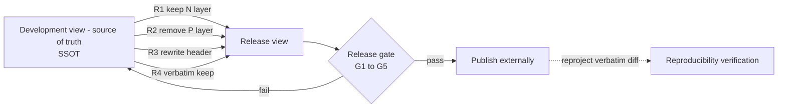

**Reproducibility**: the same source + the same rule set necessarily produce a word-for-word identical release view. If re-projection differs, the rules are ambiguous or manual intervention occurred; fix the rules, not the artefact.

### 34.4 Machine-readable contracts and consistency self-check

The specification should provide machine-readable interface contracts (NTP, experience-record structure, stable IDs, RACI, etc.) so organs can interoperate and be externally verified; and establish a **consistency self-check script** that automatically executes G1–G5 of Chapter 33:

- keyword scanning (zero hits for prohibited items);
- uniqueness of clause numbers, TOC anchors, diagram-count alignment;
- attribution placement, word-for-word diff of N-layer across both versions.

**Significance of this discipline**: turning "anti-self-deception" from a verbal principle into a **repeatedly runnable checker** — the specification no longer relies on humans claiming it is clean, but on machines proving it is clean.

---

## Chapter 35: Multi-Language and Localization Governance

### 35.1 The essence of the problem: translation is a derived view

A multi-language version of a specification is essentially **different language projections of the same N-layer content**, not several independent documents. Therefore:

- **The source of truth is unique**: at any moment only one authoritative language version is the sole source of truth for clauses; this specification uses Chinese as the source and English as the authoritative translation.
- **Translations are derived views**: like the formal release, they must be generated/verified from the source through a deterministic process; "dual writing" (source changed but translation not updated) is forbidden.
- **Terminology is the anchor**: cross-language consistency is guaranteed by a **frozen glossary**, not by translators' improvisation.

### 35.2 Three-language role model

| Role | Definition | Authority | Update method |
|---|---|---|---|
| **Source language** | language used for clause creation and adjudication (this specification = Chinese) | highest; the source prevails in ambiguity | edited directly in the source of truth |
| **Authoritative translation** | translation strictly derived from the source and verified by G7 (this specification = English) | equal effect to the source | derived from source + verification |
| **Reference translation** | community/third-party translation without G7 verification | reference only, not a basis for compliance | independently maintained, marked "non-authoritative" |

**Iron law for ambiguity adjudication**: any semantic divergence between language versions is resolved in favor of the **source language**; reference translations may not serve as evidence for conformance assessment (Chapter 26).

### 35.3 Frozen Glossary

The first engineering task of localization is to establish a **frozen glossary** — once the Chinese–English (and multilingual) mappings of key terms are approved by the governance committee, they are frozen; any change goes through the meta-specification revision process (Chapter 25):

| Source term | Authoritative English translation | Meaning anchor |
|---|---|---|
| Cerebellum (小脑) | Cerebellum | local deterministic high-frequency adjudication layer |
| Main Brain (大脑) | Main Brain / Deliberative Agent | on-demand LLM agent |
| Immune System (免疫系统) | Immune System | multi-layer quality gates + dual-track verification |
| Memory Moat (记忆护城河) | Memory Moat | learning barrier formed by experience store + retrieval augmentation |
| Deterministic Projection (确定性投影) | Deterministic Projection | pure-function release yielding word-for-word identical output from identical input |
| Process Layer / Normative Layer (过程层 / 规范层) | Process Layer / Normative Layer | P-layer / N-layer information grading |

**Freezing discipline**: translation renderings may not drift with versions; new terms must be entered into the table before use; terms not in the table may not appear in key clauses of authoritative translations.

### 35.4 Multi-language artefact governance rules

1. **Version lockstep**: version numbers of the source and all authoritative translations must be identical; when the source bumps version, authoritative translations must be synchronized in the same projection cycle; long-term "Chinese v0.5 / English v0.4" coexistence is not allowed.
2. **Structural alignment**: chapter/clause/axiom/diagram numbers of translations must align **one-to-one** with the source (verified by G6).
3. **Process layer not translated**: P-layer content in the source (design process records, evolution plans) does not enter formal translations — translations are likewise clean projections of the N layer.
4. **Translations traceable**: the header of each authoritative translation is marked "translated from source vX.Y.Z + localization gate G7 passed + verification date."

### 35.5 Localization fidelity gate G7

In addition to G1–G6, multilingual versions must additionally pass **G7, the localization fidelity gate**:

- **G7-a terminology consistency**: hit rate of the frozen glossary in the authoritative translation = 100%, with no unauthorized translation drift.
- **G7-b structural alignment**: chapter/clause/axiom/diagram numbers correspond one-to-one with the source, with no missing or misplaced numbers (assisted by G6).
- **G7-c semantic spot check**: bidirectional back-translation spot checks on every axiom and normative clause; semantic deviation beyond threshold requires human adjudication.
- **G7-d purity inheritance**: translations inherit the N-layer purity of the source — the G1 zero-hit process-trace scan is also run on translations.
- **G7-e version lockstep**: translation header version == source version; otherwise gate failure.

> **Key assertion**: without G7, multilingual means "copying one specification into several that will fight each other." With G7, multilingual means "several authoritative texts of the same law."

---

## Chapter 36: Artefact Naming and Identification Specification

### 36.1 Three elements of naming

The file identifier of every specification artefact consists of three parts, none optional:

```
<topic name> [form suffix] [language identifier] . <extension>
```

| Element | Values | Description |
|---|---|---|
| Topic name | fixed specification brand name | shared by all artefacts of the same specification family; no independent renaming |
| Form suffix | none / `<development form identifier>` | **the formal release has no form suffix**; the development view must have one |
| Language identifier | none (Chinese source) / `-en` (English) or the English name | distinguishes language versions |
| Extension | `.md` / `.html` | delivery format |

### 36.2 Semantic contract of the form suffix

**Core rule: the formal release view has no suffix; the development view has a form identifier.**

- **Formal release** = no form suffix. Reason: the formal version is the "default state"; a recipient seeing a file without a suffix can confirm it is the authoritative clean version, with no need for additional disclaimers in the filename.
- **Development view** = must carry the `<development form identifier>` suffix. Reason: the development view contains process-layer content (audits, evolution plans, version history) and **must be prominently marked in the filename** to prevent it from being mistaken for the formal release.
- **Anti-patterns**: adding suffixes such as "-formal / -final / -release" to the formal version (implying a more formal version exists), or omitting the form identifier on the development view (letting process traces masquerade as a formal specification) — both undermine audience judgment.

### 36.3 Three-track naming instances for this specification

| Artefact | File identifier | Audience | Purity |
|---|---|---|---|
| Formal release | `ANE-Specification-AI-Native-Engineering-Paradigm.md/.html` | implementers, auditors, adoption decision-makers | N layer, G1–G6 all passed |
| Development view | `ANE-Specification-AI-Native-Engineering-Paradigm<development form identifier>.md/.html` | maintainers, governance committee | full P-layer process |
| English authoritative translation | `ANE-Specification-...-en.md/.html` | international audience | N layer, G1–G7 all passed |

### 36.4 Naming stability and change discipline

1. **Published artefact names may not be changed arbitrarily**: once released externally, the filename becomes an external reference contract; renaming requires a minor version bump and registration in the change record.
2. **Form and content must match**: a file labeled "development view" must genuinely contain process-layer content; a file without a suffix must genuinely pass purity gates — name–reality mismatch is a release incident.
3. **Naming validation incorporated into G6**: the projection and delivery process must validate consistency between "form suffix ↔ content purity," preventing a development view from being misnamed as a formal view.

---

## Chapter 37: Structural Integrity and Post-Projection Verification

### 37.1 Problem: keyword purity and structural integrity are two different things

| Dimension | G1 purity gate | G6 structural integrity gate (new in this chapter) |
|---|---|---|
| Check object | words (whether process-trace words appear) | structure (numbering, anchors, pairing, sequence) |
| Meaning of pass | no words that should not appear | structure self-consistent, no breaks, no dangling references |
| Failure example | — | appendix has only B but not A; chapter number skipped; anchor points to deleted content |

**Lesson**: projection deletes whole blocks of content; after deletion, affected numbering must be **re-sequenced** — otherwise the higher the purity, the more hidden the structural break (because no one will look at the vacancy left by the deleted block).

### 37.2 G6 structural integrity gate (six items)

Before delivery, formal releases/translations must pass **G6, the structural integrity gate**, in addition to G1–G5:

- **G6-a appendix continuity**: appendix numbers run continuously from A with no skips. If a P-layer appendix is removed, N-layer appendices must be **renumbered** (continuous from A after renumbering), with TOC, body headings, and anchors updated synchronously.
- **G6-b chapter continuity**: body chapter numbers run continuously from zero/one, with no gaps or duplicates.
- **G6-c clause uniqueness**: each normative clause number is unique, with no duplicate definitions (cross-references do not count as definitions).
- **G6-d valid anchors**: every TOC anchor has a corresponding target in the body; no dangling links to deleted chapters.
- **G6-e diagram pairing**: Mermaid diagram counts match between MD and HTML; HTML `<section>` / `<div>` tags are balanced and closed.
- **G6-f name–reality consistency**: form suffix matches content purity (36.4 in Chapter 36); suffixless files must pass G1, files with the development-view suffix must contain the P layer.

### 37.3 Appendix renumbering rule (root-cause fix for this incident)

Projection rules must explicitly include appendix renumbering:

```
R5 (renumbering): after deleting P-layer appendices, re-sequence retained N-layer appendices as A, B, C... ;
                  update synchronously: TOC entries, body appendix headings, HTML section ids and <span class="num">, anchor references.
```

R5 is consolidated into the projection process, making appendix renumbering reproducible.

### 37.4 Engineering the structural self-check

G6 should not be checked by human eyes, but executed automatically by projection/verification scripts (e.g., `ane_release_projector.py` and the accompanying G1–G6 checker). **The ultimate form of "anti-self-deception" is: the structural correctness of the specification is proven by machines, not claimed by humans.** This is in one lineage with Chapter 34's "specification as artefact" and Chapter 25's "using ANE to govern ANE."

---

## Chapter 38: Inter-Organism Protocol (IOP)

> **【Original to this specification】** IOP = Inter-Organism Protocol. This chapter extends ANE from a single living system to an ecosystem of living systems. NTP (Chapter 5) handles distress inside one organism; IOP handles identification, delegation, and verification **between independent organisms**.

### 38.1 Why a single-organism protocol is not enough

| Dimension | NTP (Ch. 5) | IOP (this chapter) |
|---|---|---|
| Parties | Cerebellum ↔ Main Brain inside one organism | Organism ↔ organism |
| Trust premise | One sovereignty domain, shared ledger | Separate domains, zero trust by default |
| Payload | Compressed features + error code + budget | Capability claim + task digest + credential |
| Memory | Shared hippocampus | **Not shared by default** (38.5) |
| Failure | Route to `DEGRADED` | Refuse collaboration, keep running independently |

**【MUST】** Every cross-organism call goes through IOP. Never expose the internal NTP channel to an external organism's brain.

### 38.2 Four-layer IOP model

| Layer | Name | Solves | Artefact | Level |
|---|---|---|---|---|
| L1 | Identity | Who are you, who answers for you | Organism Card | 【MUST】 |
| L2 | Capability | What can you do, at which tier | Capability Set | 【MUST】 |
| L3 | Messaging | What is this request, where is the evidence | Envelope | 【MUST】 |
| L4 | Trust | Why should I believe you, who is liable | Credential + ledger ref | 【MUST】 |

Layers cannot be skipped: identity before capability, capability before task, credential before execution.

### 38.3 Organism Card

An Organism Card is the minimal, stable, verifiable self-description of an organism. It exposes identity and boundaries, never internals.

```json
{
  "organism_id": "org-7a31",
  "card_version": "1.0",
  "capabilities": ["classify", "digest"],
  "determinacy": "D1",
  "owner": "human:finlei",
  "card_digest": "sha256:309c06e49be85fc3b26eb8c6f2d1b355678aedef027c5521dba6a8e3b5932821"
}
```

| Field | Type | Plain meaning | Why needed | Level |
|---|---|---|---|---|
| `organism_id` | string | Stable identity | Recognize the same organism across sessions | 【MUST】 |
| `card_version` | string | Card format version | Capability evolves; card must be versioned | 【MUST】 |
| `capabilities` | string[] | Promised capability names | Undeclared capability may not be invoked | 【MUST】 |
| `determinacy` | enum D0–D3 | Highest determinacy tier accepted | Prevents delegating D0 work to a D2-only peer | 【MUST】 |
| `owner` | string | Ultimately responsible human | Axiom 5: liability must land on an accountable subject | 【MUST】 |
| `card_digest` | string | Card fingerprint | Anti-tampering during handshake | 【MUST】 |

**【MUST】** A card must not contain implementation details, model vendors, or secrets. **【MUST】** Card changes require a new `card_version` and a recomputed digest.

### 38.4 Envelope

The envelope carries "who to whom, what, where the evidence is". **The payload body is never inlined** — the same discipline as `candidate.digest` in 5.4.

```json
{
  "iop_version": "1.0",
  "msg_id": "m-4c81",
  "from": "org-7a31",
  "to": "org-9b42",
  "type": "TASK_DELEGATE",
  "payload_ref": "sha256:74490ea0feecf6e8246f97cc81c12544f136f596eb596cbd4ccbeed2c7ec6cbe",
  "payload_format": "ANS-1",
  "traceparent": "00-0af7651916cd43dd8448eb211c80319c-b7ad6b7169203331-01",
  "auth_ref": "cred-9d02",
  "ts": "2026-11-21T04:00:00Z",
  "ttl_ms": 30000,
  "determinacy_ceiling": "D1"
}
```

| Field | Plain meaning | Level |
|---|---|---|
| `iop_version` | Protocol version | 【MUST】 |
| `msg_id` | Unique message ID for dedup and replay | 【MUST】 |
| `from` / `to` | Parties, checked against cards | 【MUST】 |
| `type` | `CAPABILITY_QUERY` / `CAPABILITY_ADVERTISE` / `TASK_DELEGATE` / `RESULT_REPORT` / `VETO` | 【MUST】 |
| `payload_ref` | Digest instead of body | 【MUST】 |
| `payload_format` | Fixed to `ANS-1` so digests can be recomputed | 【MUST】 |
| `traceparent` | Distributed trace ID (**referenced** from W3C Trace Context) | 【SHOULD】 |
| `auth_ref` | Credential reference; requests without one are rejected | 【MUST】 |
| `ts` / `ttl_ms` | Timestamp and expiry to stop replay | 【MUST】 |
| `determinacy_ceiling` | Highest determinacy this message may exercise | 【MUST】 |

**【MUST】** Verify card digest, credential, and `ttl_ms` before accepting; discard and log on any failure. **【MAY】** Batch envelopes in high-throughput settings, but each keeps its own `auth_ref`.

### 38.5 Trust boundaries

| Principle | Meaning | Level |
|---|---|---|
| **No shared memory** | A peer never opens its hippocampus; only `digest`-compressed evidence crosses | 【MUST】 |
| **No inherited capability** | Calling a capability grants no permission; credentials are not forwarded | 【MUST】 |
| **No transferred liability** | The delegator remains responsible | 【MUST】 |
| **Veto retained** | Either side may issue `VETO` at any time | 【MUST】 |

### 38.6 Mandatory and optional

| Item | Level |
|---|---|
| Card identity + digest, capability + determinacy declaration | 【MUST】 |
| Six mandatory envelope fields, digest-only payload, credential + TTL | 【MUST】 |
| `traceparent` | 【SHOULD】 |
| Batched envelopes | 【MAY】 |

---

## Chapter 39: Suite Composition

> **【Original to this specification】** A suite is a temporary capability unit composed of independent organisms under a declarative contract. Composition is not fusion: members keep their own lifecycle, owner, and memory boundary.

### 39.1 Declarative contracts, not implicit fusion

| Approach | Risk | Level |
|---|---|---|
| **Declarative contract** (suite manifest) | Configuration overhead | 【MUST】 |
| Implicit shared memory | Memory poisoning, unclear liability | 【MUST NOT】 |
| Hard-coded call chain | One upgrade breaks the whole chain | 【MUST NOT】 |

### 39.2 Suite Manifest

```json
{
  "suite_id": "suite-1f2e",
  "members": ["org-7a31", "org-9b42"],
  "binding": "declarative",
  "suite_digest": "sha256:41cc1149e9108d1d286063a04c38143bee03aefdce7148ade900ef3c400065a5"
}
```

| Field | Plain meaning | Level |
|---|---|---|
| `suite_id` | Stable suite identity | 【MUST】 |
| `members` | Member organism IDs | 【MUST】 |
| `binding` | Fixed to `declarative`, banning implicit fusion at protocol level | 【MUST】 |
| `suite_digest` | Manifest fingerprint against silent member swapping | 【MUST】 |

**【MUST】** A suite may not lower any member's determinacy floor nor exceed the highest `determinacy` among members.

### 39.3 Three composition modes

| Mode | Structure | Use case | Level |
|---|---|---|---|
| Parallel | Same task, cross-verified results | High-assurance judgment | 【SHOULD】 |
| Pipeline | A's digest feeds B | Staged processing | 【SHOULD】 |
| Federation | Independent runs, conclusions only | Privacy-sensitive cross-domain work | 【MAY】 |

### 39.4 Weakest-link protection

- **【MUST】** Verify each member's card digest and promotion audit (24.3) before admission.
- **【MUST】** If any member trips a circuit breaker (21.4), the whole suite degrades — no "sick assembly".
- **【MUST】** D0 affairs are never delegated into a suite; only the human sovereignty layer may handle them.
- **【MAY】** Run member-replacement drills for resilience.

### 39.5 Retirement

Suites are temporary. **【MUST】** Invalidate the manifest and recompute `suite_digest` when the task ends or a member changes. **【MUST】** Retain all evidence and ledger entries: a suite may dissolve, liability may not.

### 39.6 Mandatory and optional

| Item | Level |
|---|---|
| Declarative manifest + digest, admission check, D0 non-delegation, breaker linkage | 【MUST】 |
| Parallel / pipeline modes | 【SHOULD】 |
| Federation, replacement drills | 【MAY】 |

---

## Chapter 40: Evolution Ladder toward an AGI Organism

> **【Original to this specification】** This chapter does not predict when AGI arrives; it defines how a software organism grades its capability boundary while sovereignty never decays.

### 40.1 Evolution is boundary expansion, not permission inflation

| Misconception | Correct reading | Level |
|---|---|---|
| "Stronger AGI automatically earns more authority" | Authority is granted explicitly by humans only | 【MUST】 |
| "Self-improvement may recurse without limit" | Recursion is bounded and every step leaves a verifiable credential | 【MUST】 |
| "Stronger intelligence replaces sovereignty" | Sovereignty is non-delegable (25.5) | 【MUST】 |

### 40.2 Five capability tiers A0–A4

| Tier | Name | Boundary | Authorization | Level |
|---|---|---|---|---|
| A0 | Reflex | Deterministic rules only; `UnknownSignal` on miss | No per-action approval | 【MUST】 start |
| A1 | Memory | Rules + promoted experience | Promotion needs human endorsement | 【MUST】 |
| A2 | Coordinator | A1 + external capability calls | Tool gates (15.6) | 【SHOULD】 |
| A3 | Reasoner | A2 + generalization; proposals only | Dual-track + human review per adoption | 【SHOULD】 |
| A4 | Evolver | A3 + controlled self-improvement proposals | Full promotion audit + human signature | 【MAY】 |

**【MUST】** A4 and above never receive D0 authority. **【MUST】** No direct jump from A3 execution to A4.

### 40.3 Non-decaying authority and bounded recursion

| Constraint | Meaning | Level |
|---|---|---|
| Non-decaying authority | Human veto, breaker, and audit rights never shrink | 【MUST】 |
| Bounded recursion | Improvement depth capped; over the cap returns to human approval | 【MUST】 |
| Reversible capability | Every tier can fall back to a lower tier, drilled in advance | 【MUST】 |
| Credential per step | Every upgrade leaves a verifiable credential in the ledger | 【MUST】 |

### 40.4 Evolution Attestation

```json
{
  "organism_id": "org-7a31",
  "level": "A3",
  "evidence_refs": ["exp_077", "run_2048"],
  "attestation_digest": "sha256:7326a58cd20787f5dd97e8cb551354360aff2abe48e351c01ce14c1d28068f58"
}
```

| Field | Plain meaning | Level |
|---|---|---|
| `organism_id` | Which organism upgraded | 【MUST】 |
| `level` | Target tier A0–A4 | 【MUST】 |
| `evidence_refs` | Evidence IDs — upgrades rely on evidence, not claims | 【MUST】 |
| `attestation_digest` | Anti-forgery, replayable fingerprint | 【MUST】 |

### 40.5 RSI compatibility floor

**【Referenced】** RSI is an upper-bound reference, not a promise. **【MUST】** Three floors hold for any RSI form: human breaker, replayable decisions, traceable liability. **【MAY】** Reserve interfaces for A4; reservation is not activation.

### 40.6 Mandatory and optional

| Item | Level |
|---|---|
| A0/A1 baseline, non-decaying authority, bounded recursion, reversibility, attestation | 【MUST】 |
| A2/A3 | 【SHOULD】 |
| A4, RSI interface reservation | 【MAY】 |

---

## Chapter 41: Communication Data Format, Storage, and Connectivity

### 41.1 Data temperature tiers

| Tier | Holds | Retention | Level |
|---|---|---|---|
| Hot | Rules, state machine, current context | Process lifetime | 【MUST】 |
| Warm | Experience records, promotion audits, recent ledger | Migratable, rebuildable | 【MUST】 |
| Cold | Audit logs, evidence packs | Append-only, searchable | 【SHOULD】 |
| Frozen | Legal retention, liability credentials | Write-once | 【MAY】 |

**【MUST】** Hot data is never persisted to an external service. **【MUST】** Migrating warm data across organisms transfers digests only, never raw memory.

### 41.2 Three format classes

| Class | Format | Prohibited | Level |
|---|---|---|---|
| Envelope | ANS-1 JSON (38.4) | Inlined body, glosses inside values | 【MUST】 |
| Digest | `sha256:<64 lowercase hex>` | Truncated or non-hex digests | 【MUST】 |
| Credential | Unforgeable signature/token ref bound to `msg_id` + `ttl_ms` | Plaintext secrets, replayable tokens | 【MUST】 |

### 41.3 Storage: local-first, layered, migratable

- **【MUST】** Local-first: routine transactions never depend on remote storage.
- **【MUST】** Rebuildable: warm data can be reconstructed from the ledger and evidence packs.
- **【SHOULD】** Decouple tiers so one backend failure cannot take down all layers.
- **【MAY】** Cross-device migration preserving `organism_id` and experience lineage.

### 41.4 Connectivity tri-state

| State | Trigger | Allowed | Level |
|---|---|---|---|
| OFFLINE_FIRST | Default | Local rules + promoted experience handle all routine work | 【MUST】 |
| ON_DEMAND | Local miss + authorization | IOP request or Main Brain call under `budget_hint` | 【SHOULD】 |
| DEGRADED | Timeout / unreachable / budget exhausted | Fall back to Cerebellum-only L2 (21.3b); no guessing | 【MUST】 |

> Must a living organism be online? **It may work offline, but must not only work online.** Connectivity is an enhancement 【SHOULD】; offline capability is a survival floor 【MUST】.

| Risk | Countermeasure | Level |
|---|---|---|
| Data leakage | Transmit digests/features only | 【MUST】 |
| Supply-chain attack | Gate every carrier and tool (5.6 / 15.6) | 【MUST】 |
| Availability dependency | Timeout always degrades | 【MUST】 |
| Cross-sovereignty flow | Align with 20.2; block unlawful transfer | 【MUST】 |

### 41.5 Privacy across organisms

**【MUST】** When an organism executes forgetting (24.4), it notifies peers that received related digests. **【MUST】** Frozen personal data needs a legal basis, not merely audit convenience. **【MAY】** Keep a privacy budget ledger of cumulative outbound volume.

### 41.6 Mandatory and optional

| Item | Level |
|---|---|
| Hot layer never externalized, ANS-1 digests, offline-first + degraded | 【MUST】 |
| On-demand connectivity; cold/frozen tiers | 【SHOULD】/【MAY】 |
| Privacy budget ledger | 【MAY】 |

---

## Chapter 42: Normative Levels and Mandatory Checklist

> **【Referenced】** MUST / SHOULD / MAY follow RFC 2119 and RFC 8174 conventions (**referenced**), adapted into ANE's Chinese labels.

### 42.1 Four labels

| Label | English | Meaning | Consequence |
|---|---|---|---|
| 【MUST】 | MUST / REQUIRED | Mandatory | ANE-CONF fails if unmet |
| 【SHOULD】 | SHOULD / RECOMMENDED | Default expectation | Allowed with written rationale |
| 【MAY】 | MAY / OPTIONAL | Discretionary | No impact |
| 【MUST NOT】 | MUST NOT | Absolutely forbidden | Violates constitutional red line (25.5) |

### 42.2 Syntax and scope

- **【MUST】** Every normative clause carries exactly one level label.
- **【MUST】** The label sits next to the clause, not collected at chapter end.
- **【SHOULD】** Mixed-level clauses label each item separately.
- **【MAY】** The DEBUG view adds origin labels (original/referenced); the formal release keeps normative levels.

### 42.3 Mandatory quick reference

| Chapters | Mandatory items |
|---|---|
| 0–3 | Seven axioms, seven-organ model, D0–D3 |
| 4 | Cerebellum hard boundaries: offline / growable / no speculation |
| 5 | Proposal-only brain, NTP iron laws, ANS-1, binding credential |
| 6–9 | Promotion audit, dual-track verification, sovereignty, two folds |
| 10–21 | Flywheel, five-step order, compliance, fail-safe |
| 22–37 | Stable IDs, AI-BOM, memory isolation, single source, projection, G7 |
| 38 | Card, capability, envelope fields, credential, no shared memory |
| 39 | Declarative suite, admission, D0 non-delegation, breaker linkage |
| 40 | Non-decaying authority, bounded recursion, reversibility, attestation |
| 41 | Local-first, ANS-1, offline-first and degraded |

### 42.4 Conformance and exceptions

**【MUST】** ANE-CONF passes only when all 【MUST】 items pass and no 【MUST NOT】 is violated. **【MUST】** Conclusions state deviations with rationale — no bare pass/fail. **【MUST】** Any exception to a 【MUST】 requires written human approval with scope, expiry, and recovery plan. **【MUST】** Exceptions never touch constitutional red lines. **【MAY】** Exceptions auto-expire.

## Appendix A · Glossary

> This appendix has three parts: **A.0 core glossary in plain language** for first-time readers; **A.1 numbers and thresholds explained**, covering every figure in the document; the table below is the **complete term index**. Every entry states its source type — "original to this specification" means the term or definition is first proposed here; "adopted" means an established industry concept is used with an ANE-specific role.

### A.0 Core glossary in plain language

| Term | One sentence, plainly | Source type | Authoritative definition / first appearance | English |
|---|---|---|---|---|
| ANE | AI-native engineering: software that evolves while it runs | Original (acronym) | Executive summary · 0.2 | AI Native Engineering |
| Living system | Software that senses, decides, remembers, self-repairs, and remains under human control | Original (paradigm definition) | Preface · 0.4 | Living Software System |
| Skeleton | The part of the system that must not be changed: foundations and hard rules | Original (engineering role) | 2.2 · Axiom 1 | Skeleton |
| Cerebellum | Local fast reflex: consult a rule, decide immediately, never call the LLM | Original (role, biological metaphor) | 4.1 · 4.4 · Axiom 3 | Cerebellum |
| Main Brain | A reasoning engine awakened only for unseen problems; proposes but never executes | Original (role, biological metaphor) | 5.1 · 5.3 · Axiom 3 | Main Brain |
| Hippocampus | The memory store: successes and failures are recorded so they are not repeated | Original (role, biological metaphor) | 6.1 · 6.2 | Hippocampus |
| Immune System | Gates and verification: unproven generation is not admitted | Original (role, biological metaphor) | 7.1 · Axiom 6 | Immune System |
| Self-Repair | Detect a problem at runtime and repair in place, leaving a rollback record | Original (engineering role) | 8.1 · 8.3 | Self-Repair |
| Human Sovereignty | Humans decide: authorize, veto, and stop everything at any time | Original (engineering role) | 9.1 · Axiom 5 | Human Sovereignty |
| Unified Semantic Layer | The deterministic middle layer connecting high-level design and low-level execution; also the repair point | Original (generalized term) | 2.3 · 8.2 | Unified Semantic Layer |
| D0–D3 | Four risk tiers from "never touch" to "may generate" | Original (tier definition) | Chapter 3 · A.1 | Determinism Tiers |
| NTP | Structured distress/proposal packets between Cerebellum and Main Brain — not chat | Original (protocol name) | 5.2 · 5.4 | Neurotransmitter Protocol |
| Interaction primitive | The smallest action of human–AI interaction: observe, classify, invoke, verify, etc. | Original (primitive set) | 14.2 | Interaction Primitive |
| Experience promotion | Turning a successful experience into a local rule so the LLM need not be asked again | Original (mechanism) | 6.3 · 24.3 | Experience Promotion |
| Dual-Fold Collaboration | Fold 1 shows evidence; Fold 2 records human authorization; they cannot be merged | Original (interaction pattern) | 13.4 | Dual-Fold Collaboration |
| Flywheel | The sense → decide → collaborate → verify → consolidate → repair loop | Original (mechanism) | 10.1 | Flywheel |
| Audit ledger | A structured chain of who, when, on what grounds, and what happened | Adopted (audit-log idea) + specified here | 13.5 · 28.1 · Axiom 6 | Audit Ledger |
| trace-id | A globally unique identifier for one interaction, linking all its records | Adopted (distributed tracing) + named here | 22.1 · 13.5 | Trace Identifier |
| RAG | Retrieve past experience on demand rather than stuffing all material into the prompt | Adopted | 0.3 · 6.1 | Retrieval-Augmented Generation |
| MCP / A2A | Standard protocols for tool and agent integration | Adopted (industry protocols) | 15.1 · 16.1 | Model Context Protocol / Agent-to-Agent |
| NIST RMF / EU AI Act / ISO 42001 | External governance and compliance frameworks internalized as engineering mechanisms | Adopted (standards and law) | 20.1 · 20.2 | NIST AI RMF / EU AI Act / ISO/IEC 42001 |
| FMEA / RACI | Failure-mode analysis and responsibility matrices, used directly | Adopted (engineering methods) | 21.2 · 20.3 | FMEA / RACI |

> **Source discipline**: terms marked "original" are defined authoritatively by this specification — cite ANE when reusing them. "Adopted" terms retain their industry meaning; this specification only assigns them a role inside the living system.

### A.1 Numbers and thresholds explained (every figure has provenance and rationale)

| Value | Detailed meaning | Why this value | Source type | Provenance | How to adjust |
|---|---|---|---|---|---|
| **7 axioms / 7 organs** | Seven supreme laws; seven engineering roles (Skeleton, Cerebellum, Main Brain, Hippocampus, Immune, Self-Repair, Sovereignty) | Covers structure, decision, memory, sovereignty, auditability, safety, plus one law constraining mutation; roles map one-to-one to axioms | Original | Ch. 1 · 2.2 · 25.5 | Meta-specification revision only; no merging |
| **D0–D3 (4 tiers)** | Immutable / provably mutable / auditable mutable / generatable | Further subdivision costs more authorization effort than it saves | Original | Chapter 3 | Subdivide within tiers; never reduce the count |
| **L0–L5 (6 levels)** | Uncontrolled / visible / Cerebellum / memory / self-repair / living system | Each level adds exactly one verifiable capability and evidence gate, supporting gradual adoption | Original | Chapter 11 | Assessment in 26.2; no level skipping |
| **G1–G7 (7 gates)** | First five protect release purity; G6 protects structure; G7 protects translations | Three distinct objects of inspection cannot substitute for one another | Original (gate idea adopted) | 33.3 · 37.2 · 35.5 | Add sub-items; never break numbering |
| **≥80% interception / offline availability** | Eight in ten routine decisions are local; eight in ten transactions survive without the Main Brain | The intersection of token saving, low latency, and offline capability; below it, grow rules rather than raise budget | Original (threshold) | 4.4 · 12.1 · 21.3b | Adjust per SLO with recorded rationale |
| **N ≥ 3 reproductions** | At least three independent reproductions before promotion | Once may be chance, twice may be same-source coincidence, three begins to exclude inbreeding | Original (threshold) | 24.3 · 13.6 ⑧ | Raise by risk; never lower to 1 |
| **99% grey release** | Release at 99% certainty rather than waiting for 100% | 100% means the feedback loop has stopped; grey release buys real feedback | Original (threshold) | 10.5 · 27.4 | Tighten by D-tier; D0 never grey |
| **1–3 uplinks** | Maximum Main Brain escalations per task in Exploit mode | Tolerates one retry but cannot mask missing rules | Original (threshold) | 5.5 parameter table | D1 config; gate required to change |
| **D0 seconds / D1 tens of seconds / D2 minutes** | Maximum wait for the Main Brain by risk tier | Higher risk cannot wait; documentation may wait minutes | Original (default range) | 5.5 parameter table | Register within range; absent config uses conservative end |
| **2 min/round · 60 min cycle** | One topic per round; one cycle forms an auditable evolution unit | Two minutes forces focus; thirty rounds yield a reviewable unit | Original (cadence) | Appendices C–H | Cadence may change; the modify→verify→record loop may not |
| **Minor version every 10 rounds** | Minor version every ten rounds; formal release at cycle end | Ten rounds make an acceptable stage without version fragmentation | Original (semver discipline adopted) | Appendices C–H · 22.2 | Follow semantic versioning |
| **Five steps / six stages / four iron laws** | Delete→Simplify→Optimize→Accelerate→Automate; flywheel stages; NTP iron laws | Cover the full de-bloating chain, the evolution loop, and four common two-brain failures | Original | 10.4 · 10.1 · 5.4 | Order and count are invariant |
| **Two folds / three log tiers / eight visualization stages / seven friendliness criteria** | Judgment vs authorization; L1/L2/L3; eight must-see stages; seven usability criteria | Correspond respectively to understanding vs approval, three audiences, all nodes affecting approval or later questioning, and seven dimensions of cognition/trust/safety/feedback/load/inclusion/accountability | Original | 13.4 · 13.5 · 13.6 · 13.7 | May add; may not delete |
| **3–5 items at a time** | Upper bound on items shown at once in an interface | Beyond working-memory capacity, readers miss items; details move to drill-down | Adopted (cognitive load theory) + chosen here | 13.7 · 23.2 | Adjust per user research |

> **Numerical discipline**: thresholds are defaults plus auditable adjustments, not physical constants. Every adjustment records the new value, rationale, approver, review date, and D-tier configuration (22.4). **A number without provenance may not enter a normative clause.**

### Term definitions (complete index)

| Term | Definition |
|---|---|
| ANE | AI Native Engineering — AI-native software engineering |
| semantic layer | deterministic foundation connecting high-level semantics and low-level operations, serving as both semantic transformation hub and self-repair carrier |
| Cerebellum | local deterministic high-frequency adjudication layer: rule base + state machine + deterministic cost model |
| Main Brain | on-demand LLM agent handling unknown, complex problems |
| NTP | Neural Transmitter Protocol, the structured compressed-context format from Cerebellum to Main Brain |
| Hippocampus | experience vector store + retrieval augmentation mechanism |
| Immune System | multi-layer quality gates + dual-track verification + anti-self-deception |
| Dual-track verification | symbolic track (semantic equivalence) + statistical track (behavioral regression) passing simultaneously |
| Tiered confirmation | dual confirmation interaction: judgment layer display + authorization layer approval |
| Experience promotion | high-frequency experience consolidated into Cerebellum local rules |
| Flywheel | closed loop of sense–deliberate–collaborate–verify–consolidate–repair |
| Steady state | stable version after immune filtering of mutation |
| Interaction pattern | chain / routing / parallel / planning / reflection / tool / RAG / multi-agent / HITL / event-driven |
| Interaction primitive | observe·retrieve·digest / classify·decide·plan / invoke·generate·patch / prove·regress·attest / write·promote·decay |
| Tool-context protocol | contractual integration protocol between agents and tools (Host/Client/Server + capability negotiation) |
| Agent-to-agent protocol | protocol for capability advertising and task delegation between agents |
| Least agency | grant only time-limited autonomy and tool permissions required by the task |
| Sublation | inherit the deterministic hard core, replace the rigid shell |
| Four governance functions | NIST AI RMF GOVERN/MAP/MEASURE/MANAGE, based on which this specification maps organs |
| RACI | responsibility matrix: Responsible R / Accountable A / Consulted C / Informed I; the Main Brain never holds A |
| Fail-safe state | predefined safe state the system retreats to when an organ fails |
| Global circuit breaker | stop switch that lets humans freeze all automation and lock the verified steady state at any time |
| FMEA | Failure Mode and Effects Analysis, enumerating failure modes/effects/signals/degradation actions organ by organ |
| Stable identifier | URN-style globally unique ID; rules/experience/primitives/gates/agents/snapshots all have versioned identities |
| AI-BOM | AI bill of materials, registering the composition and versions of models/data/tools/rules/prompts |
| Automation bias | the cognitive tendency of humans to over-trust automated conclusions, which must be actively guarded against |
| Memory partition | four-level experience isolation: global/tenant/project/sandbox, prohibiting unauthorized cross-zone flow |
| Meta-specification | governance rules of the specification itself; three-layer structure (axioms immutable / clauses evolvable / guides replaceable) |
| Constitutional red lines | three bottom lines never to be deleted or altered: human sovereignty, anti-self-deception, global circuit breaker |
| ANE-CONF | ANE conformance framework; three certification levels: C1 principle / C2 mechanism / C3 system |
| Conformance assessment | four evidence types — document / configuration / behavioral / operational review — determining whether a system truly conforms to ANE |
| Six migration steps | map → solidify foundation → build Cerebellum → memory loop → immune and circuit breaker → self-repair flywheel |
| Three pillars | observability logs / metrics / traces, requiring shared-context correlation |
| Event sourcing | full immutable stream of state-change events, supporting replay to the steady state at any moment |
| Metamorphic testing | asserts input–output relations rather than exact values, suited to nondeterministic systems |
| Shadow mode | new version handles real traffic but suppresses all side effects, recording without taking effect |
| Canary | gradual rollout 1%→5%→25%→100%, automatic rollback on breach |
| SLO / error budget | service-level objective and tolerable unreliability allowance, datafying the stability–evolution trade-off |
| Misreading clarification | the "what ANE is not" list, guarding paradigm semantics against dilution and misuse |
| ROI model | economic calculation of five benefit types (efficiency/cost/quality/risk/moat) minus total investment |
| Release form | ways the same specification is presented to different audiences; three views: V1 decision summary / V2 normative text / V3 development process |
| Information grading | three tiers: N normative / E evidentiary / P process; determines whether content may enter the formal release |
| Release gate | five pre-release checks: G1 purity / G2 completeness / G3 consistency / G4 renderability / G5 attribution |
| Single Source of Truth (SSOT) | development view is the sole editing source; release views are generated by projection, with no dual writing |
| Deterministic Projection | `Release = Project(Debug, Rules)`, pure-function release yielding word-for-word identical output from identical input |
| Source / authoritative translation | the sole source-of-truth language for clauses / a translation strictly derived from the source and verified by G7 |
| Frozen glossary | cross-language locked mappings of key terms, approved by the governance committee and not allowed to drift with versions |
| G6 structural integrity | gate verifying appendix continuity / chapter continuity / clause uniqueness / valid anchors / diagram pairing / name–reality consistency |
| G7 localization fidelity | gate verifying terminology consistency / structural alignment / semantic spot check / purity inheritance / version lockstep |
| Seed Rules | initial golden rule set injected by human experts during cold start, immune-verified |
| Explore / Exploit modes | two memory-usage modes: Explore (high-frequency Main Brain sampling) / Exploit (local-priority token saving), switched by coverage threshold |
| Knowledge quenching | process by which seed rules and Explore-phase samples are quenched into stable rules after immune verification |
| Hardware-topology awareness | semantic layer adaptively optimizing execution strategies by runtime physical characteristics (processor capabilities / accelerator units / memory and storage characteristics / interconnect affinity) |
| Dual-Fold Collaboration | mandatory human-machine pattern: Fold 1 judgment layer (Cognitive Summary) + Fold 2 authorization layer (Intent Binding) |
| Cognitive Summary | Fold 1 output: AI intent, candidates, evidence, verification conclusions, and risk warnings, not directly executable |
| Intent Binding | Fold 2 output: a deterministic credential binding human approval to a specific candidate action |
| Promotion Audit | N independent reproductions + human signature endorsement + anti-inbreeding check before experience is promoted to a global rule |
| Inbreeding | rule corruption caused by promotion evidence depending heavily on homologous / self-referential samples; must be checked and rejected |
| Appendix renumbering R5 | after projection deletes P-layer appendices, retained N-layer appendices are renumbered continuously with anchors synchronized |
| Form-suffix contract | naming rule: formal release has no suffix, development view carries the `<development form identifier>` suffix |
| Five-Step Algorithm | mandatory evolution order — delete → simplify → optimize → accelerate → automate; inverting it is forbidden |
| Feedback-loop duration | time from signal generation to completed consolidation; the core metric of the speed law |
| Integrated die-casting | fusing a long call chain into a high-cohesion module at the base layer to cut cross-boundary communication loss |
| No Speculation | the Cerebellum must throw `UnknownSignal` when no rule matches; guessing or approximate substitution is forbidden |
| Offline capability | requirement that the Cerebellum sustain ≥80% of routine transactions while the Main Brain is unreachable |
| Uplink | Cerebellum → Main Brain distress payload: feature vector, error code, tried rules, environment profile, budget |
| Downlink | Main Brain → Cerebellum proposal payload: candidate patch, confidence, reasoning summary; status always pending verification |
| Communication state machine | the two-brain link sequence Pending → Proposal → Verifying → Applied/Rollback → Ledger |
| Channel arbitration | unified queuing of competing requests for Main Brain quota by urgency and budget |
| Model carrier | the physical implementation of the Main Brain, replaceable through a uniform capability interface and never an architectural dependency |
| Model card | mandatory carrier record of version, boundaries, biases, evaluation, and accountable owner, entered into the AI-BOM |
| Prompt asset | an artefact under version control with a stable ID, owner, evaluation, and rollback path |
| Injection guard | mandatory boundary under which external content is data only and may never be elevated to instructions |
| Blameless postmortem | mechanism-focused incident review; concealment and ledger tampering are the real red lines |
| Arbitration observability | three metrics — quota exhaustion rate / rejection rate / D0-D1 preemption rate — for auditing arbitration fairness |
| Timeout disposition | an uplink timeout always routes to DEGRADED, never to "Main Brain refused" or a silent retry |

---

---

> **Conclusion**: While an organization is still doing "addition" — piling up compute, models, and tokens — ANE is doing "subtraction and multiplication": setting rules for the Cerebellum, drawing boundaries for the Main Brain, building a moat for memory, and installing an immune system for evolution.
>
> Even this specification obeys the rules it defines — projecting a clean formal release from a single source of truth and proving its own purity with gates. **Only a specification that can govern itself is qualified to govern living systems.**

*Created by Feng Lei (冯磊), continuously evolving, planned to v1.0.0. New experience records are welcome via issue / PR.*
